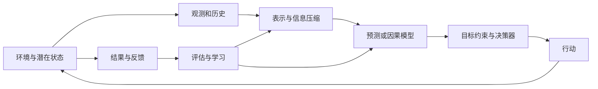
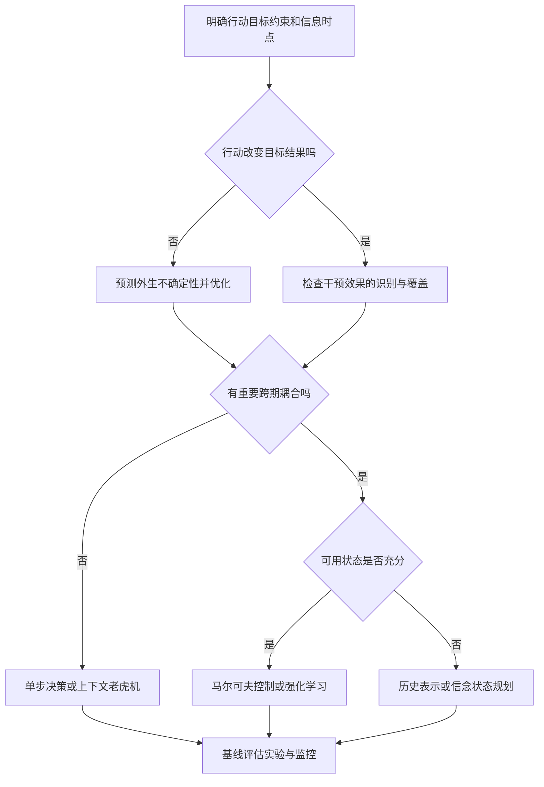

# 决策科学的统一框架：复杂性、结构假设与有限理性

> **面对复杂问题，先明确什么行动值得做，再判断现有信息能支持什么结论，最后选择可计算、可检验的方法。**
>
> 本文的主线是：**决策目标 → 复杂性的来源 → 信息与识别边界 → 结构假设 → 可执行方法 → 决策评价。**

假设你负责一个量化投资与交易执行系统，需要回答三个问题：未来收益和风险可能怎样、各资产配置多少仓位、大额订单怎样执行。表面上，它们分别涉及预测、组合优化和动态控制；但从最终行动出发，会发现它们都在处理同一件事：

**根据有限的信息，在不确定的结果中选择一个行动，让收益与成本的权衡尽可能合理。**

困难也相似。你不知道未来的真实收益，不知道同一笔母订单采用另一种执行方式会怎样，也不可能在市场中尝试所有持仓与交易路径。模型的作用，是利用可信的共享规律缩小问题，使有限数据和有限计算足以支持某些有价值的选择。

本文采用“先例子、后概念、再公式与边界”的方式。重要结论用加粗和引用块突出，表格用于比较，推导紧接直观解释。数值例子均为教学示例。正文标题和文件名使用中文；必要的英文术语只作为概念的辅助标注。修订日期：2026-10-15。

**怎样阅读：** 首次阅读可顺着前六章建立概念，再读第八章的完整金融案例；第九章给出决策差距的严格分析。已有基础时，可以直接用第十一章的流程检查自己的项目。

## 阅读导航

1. [一、先看一个例子：预测准确，为什么仍会决策失误](#一先看一个例子预测准确为什么仍会决策失误)
2. [二、统一表达：用信息选择行动，用结果评价策略](#二统一表达用信息选择行动用结果评价策略)
3. [三、问题为什么难：六类复杂性与指数序列空间](#三问题为什么难六类复杂性与指数序列空间)
4. [四、数据能告诉我们什么：信息与因果识别的边界](#四数据能告诉我们什么信息与因果识别的边界)
5. [五、让问题变得可学：结构假设及其收益与代价](#五让问题变得可学结构假设及其收益与代价)
6. [六、怎样压缩历史：状态、信念与决策充分表示](#六怎样压缩历史状态信念与决策充分表示)
7. [七、各种方法分别解决了什么问题](#七各种方法分别解决了什么问题)
8. [八、完整案例：从收益预测走到仓位与流动性决策](#八完整案例从收益预测走到仓位与流动性决策)
9. [九、怎样判断做得好不好：决策差距的分解与上界](#九怎样判断做得好不好决策差距的分解与上界)
10. [十、有限理性：什么值得算，什么值得知道](#十有限理性什么值得算什么值得知道)
11. [十一、面对新问题：一套可执行的分析流程](#十一面对新问题一套可执行的分析流程)
12. [十二、参考资料与延伸阅读](#十二参考资料与延伸阅读)

---

## 一、先看一个例子：预测准确，为什么仍会决策失误

### 1.1 胜率更高的交易，为什么可能更差

假设有两种单次交易机会，暂时忽略仓位差异：

| 交易机会 | 获利概率 | 获利时收益率 | 亏损时收益率 | 期望毛收益率 |
| --- | --- | --- | --- | --- |
| 甲 | 80% | +0.5% | −3% | −0.2% |
| 乙 | 55% | +2% | −1% | +0.65% |

甲的胜率更高，却可能经常赚小钱、偶尔亏大钱。乙的胜率更低，但盈亏幅度使期望收益更高。若两者每次交易的总成本都为 0.1%，期望净收益分别为 −0.3% 和 +0.55%。

**预测“涨不涨”只是一个中间任务。决策还需要知道涨跌幅度、成本、风险，以及这笔交易与现有持仓的关系。**

这里的概率与收益是已知的教学设定，不能把历史样本胜率直接当成未来真实概率。即使乙的期望收益为正，也不能据此推出应该满仓；仓位还取决于风险和约束。

### 1.2 预测、因果和决策分别问什么

在金融问题中，这三个层次可以这样区分：

1. **预测：** 根据当前信息，未来收益、波动和成交量可能是多少？
2. **因果：** 对同一类母订单，把执行方式从被动挂单改成主动吃单，会怎样改变成交价格与总执行成本？
3. **决策：** 在收益、风险、市场冲击和执行期限约束下，买不买、买多少、怎样执行？

一般形式仍然是：

$$
\begin{aligned}
\text{预测：}\quad &P(Y\mid X,A),\\
\text{因果：}\quad &P(Y\mid X,\mathrm{do}(A=a)),\\
\text{决策：}\quad &\arg\max_a\mathbb E[U(a,Y(a))\mid X].
\end{aligned}
$$

注意两个方向不能混淆：某个信号能够预测市场，不等于改变这个信号就能改变市场；某种执行方式出现在高成本订单中，也不等于它导致了高成本。

### 1.3 把胜率转成收益，还缺少哪些量

若获利概率为 $p$ ，获利时平均收益率为 $g$ ，亏损时平均损失幅度为 $\ell$ ，交易总成本率为 $c$ ，则在这一简化的两类结果模型中：

$$
\mathbb E[r_{\mathrm{net}}]=pg-(1-p)\ell-c.
$$

代入甲与乙：

$$
\begin{aligned}
\mathbb E[r_{\mathrm{net},甲}]
&=0.8\times0.005-0.2\times0.03-0.001=-0.003,\\
\mathbb E[r_{\mathrm{net},乙}]
&=0.55\times0.02-0.45\times0.01-0.001=0.0055.
\end{aligned}
$$

这一步说明胜率为什么不够，但期望净收益也不是完整决策依据。两笔期望收益相同的交易，可能具有不同尾部风险；两只单独看都不错的资产，也可能因为高度相关而形成过于集中的组合。

**预测目标应由下游行动决定：** 若只决定是否做一笔固定规模交易，可能先比较期望净收益；若决定仓位，就需要风险信息；若控制极端亏损，则需要进一步了解尾部分布。

### 1.4 执行方式的因果效果，也不等于整体最优策略

设两种执行规则的潜在总成本为 $C(0)$ 和 $C(1)$ ，其中成本统一包含已成交部分的价差、费用，以及事先规定的未完成订单处理代价。我们想比较：

$$
\tau(x)=\mathbb E[C(1)-C(0)\mid X=x].
$$

即使知道规则 1 平均更便宜，还要检查它能否在期限内完成、是否增加未成交风险，以及大额订单采用它是否会影响后续流动性。仅比较“已经成交的订单”的平均价格，可能遗漏被动挂单未成交的部分，形成选择偏差。

当多笔订单共享资金、风险额度和成交容量时，必须联合优化。单笔交易排序不是组合配置的替代品；资产间的相关性和共同冲击尤其会破坏简单可加的比较。

### 1.5 并非所有投资决策都需要完整因果模型

在足够小的价格接受者近似下，自己的交易不会显著改变外部价格过程。此时，预测收益和风险，再结合成本与约束进行优化，可以成为有用的起点。

当订单规模足以影响市场，或执行动作改变后续可成交性时，就必须考虑动作的后果。随机实验、可信的执行模型或其他识别设计，可以提供相关证据；历史回测本身不会自动识别市场冲击。

> **预测解决“市场可能怎样”，因果分析解决“改变执行会怎样”，决策解决“在这些后果下值得怎样做”。**

---

## 二、统一表达：用信息选择行动，用结果评价策略

### 2.1 把金融问题翻译成五个对象

| 对象 | 通俗含义 | 交易系统中的例子 |
| --- | --- | --- |
| 信息 | 行动之前能知道什么 | 已发布行情、财报、盘口及当前持仓 |
| 动作 | 实际能改变什么 | 加仓、减仓、不交易，以及订单执行方式 |
| 结果 | 行动之后发生什么 | 净收益、风险暴露、成交与未成交情况 |
| 目标 | 怎样判断行动好不好 | 扣除成本后、符合风险偏好的策略价值 |
| 约束 | 哪些方案不能采用 | 杠杆、资金、借券、成交容量和时限 |

**策略就是一套“看到什么情况，就采取什么行动”的规则。** 它可以是阈值、一棵树、神经网络，也可以是预测器与优化器组成的系统。统一的是这五个对象之间的关系。

如果每天都要调仓，今天的买卖会改变明天的持仓、剩余资金和再次交易的成本。对大额订单，今天的执行还可能改变后续价格与流动性，因此需要考虑动态后果。

### 2.2 决策不是单独的一次模型预测

设时刻 $t$ 的潜在环境状态为 $S_t$ ，决策者观察到 $O_t$ ，选择动作 $A_t$ ，随后获得收益 $R_t$ 。能够用于决策的历史为

$$
H_t=(O_1,A_1,R_1,\ldots,O_{t-1},A_{t-1},R_{t-1},O_t).
$$

策略是从历史到动作分布的映射：

$$
A_t\sim\pi_t(\cdot\mid H_t),\qquad A_t\in\mathcal A_t(H_t).
$$

这里强调**非预见性**：策略只能使用决策时已经可获得的信息。未来价格、最终结算数据、事后修订指标，即使保存在数据库里，也不能直接当作当时已知的特征。

在环境模型 $M$ 下，一个有限期、风险中性的目标为

$$
J_M(\pi)=\mathbb E_{M,\pi}\left[\sum_{t=1}^{T}\gamma^{t-1}R_t\right],\qquad
\pi_M^{\ast}\in\arg\max_{\pi\in\Pi_{\mathrm{feas}}}J_M(\pi),
$$

这个目标式可以按三层阅读：收益先在每条未来轨迹上相加，再对可能发生的轨迹取平均，最后在可行策略中选平均收益最高的规则。这里 $J_M(\pi)$ 是策略价值， $T$ 是决策期数， $\gamma$ 控制远期收益的权重， $\Pi_{\mathrm{feas}}$ 是满足约束的策略集合。模型和策略共同决定轨迹出现的概率。

其中 $0\le\gamma\le1$ 。有限期可以取 $\gamma=1$ ；无限期折扣问题通常要求 $\gamma\lt 1$ 及适当的收益有界性。分布中包含策略，因为动作可能改变未来状态和后续数据。

真实问题还可能有预算、容量、公平性、风险与时延约束，例如

$$
\mathbb E_{M,\pi}\left[\sum_{t=1}^{T}c_t(H_t,A_t)\right]\le B.
$$

期望预算与逐路径预算不同：前者允许部分轨迹超支；若任何时刻都不能超支，应把剩余预算纳入状态并施加逐步可行性约束。

### 2.3 单步决策是这一框架的特例

当行动不影响后续决策问题，给定信息 $X=x$ ，损失最小化形式是

$$
a^{\ast}(x)\in\arg\min_{a\in\mathcal A(x)}\mathbb E[L(a,Y)\mid X=x].
$$

这个写法适用于外生结果 $Y$ 。若行动改变结果，则要写成潜在结果 $Y(a)$ 或干预分布：

$$
a^{\ast}(x)\in\arg\min_{a\in\mathcal A(x)}\mathbb E[L(a,Y(a))\mid X=x].
$$

因此，“预测明天收益”“决定配置多少仓位”“判断大额交易如何影响成交价格”不是同一个统计问题。

| 层次 | 核心对象 | 典型问题 |
| --- | --- | --- |
| 预测 | 观测条件分布 | 已知当前行情，下一持有期收益与波动可能是多少？ |
| 因果 | 干预后的结果分布 | 若加快执行速度，总执行成本会怎样变化？ |
| 决策 | 带成本与约束的策略价值 | 是否交易、配置多少、采用哪种执行规则？ |
| 学习 | 从数据得到可执行策略 | 有限数据下，怎样可靠地选出策略？ |
| 控制 | 行动与状态的动态闭环 | 今天的交易怎样影响后续持仓、资金与流动性？ |

### 2.4 统一框架不意味着统一算法

有些系统显式学习环境模型，有些直接学习价值或策略，有些把表示、预测与优化一起训练。统一的是问题分解和评价语言，不是必须使用同一模型架构。

---

## 三、问题为什么难：六类复杂性与指数序列空间

### 3.1 同一个投资系统的六种困难，需要不同的处理

设研究员要决定下一交易日的持仓和执行计划。把问题拆开看：

- **状态难：** 不只看最新价格，还要考虑波动、盘口、当前持仓、未完成订单与资金。
- **动作难：** 多个资产共同占用杠杆和风险额度，不能逐只独立追求最高收益。
- **时间难：** 信号可能很快衰减，订单却需要分批完成，今天的交易也影响明天的调仓成本。
- **统计难：** 收益信号很弱，新上市资产历史短，危机样本稀少。
- **计算难：** 即使收益分布已知，也可能无法在执行期限内搜完所有组合与路径。
- **环境难：** 波动、流动性、市场参与者和交易机制可能发生变化。

**先辨认困难属于哪一类，才能知道下一步应该补数据、改状态、换目标，还是改求解方法。** 如果瓶颈是相关风险和借券约束，扩大收益预测网络并不会自动解决问题。

### 3.2 复杂性不是一个数

| 维度 | 困难来源 | 典型后果 | 常用结构与代价 |
| --- | --- | --- | --- |
| 状态复杂性 | 高维、历史依赖、潜变量、连续状态 | 难以覆盖与区分不同情境 | 表示学习、状态聚合；可能损失决策信息 |
| 动作复杂性 | 海量候选、组合选择、连续控制、耦合约束 | 即使收益已知也难求最优行动 | 召回、分解、松弛；可能漏掉最优解 |
| 时间复杂性 | 延迟收益、长时规划、路径依赖 | 短期有效的行动长期可能有害 | 折扣、截断、层级策略；弱化远期目标 |
| 统计复杂性 | 样本少、噪声大、依赖强、反馈稀疏 | 估计方差、过拟合、探索不足 | 正则化、共享参数、实验；引入偏差或成本 |
| 计算复杂性 | 非凸训练、组合优化、在线时延 | 理论可定义但无法及时求解 | 近似、缓存、蒸馏；损失部分最优性 |
| 环境复杂性 | 漂移、竞争、干扰、机制响应 | 历史规律或策略价值失效 | 在线适应、鲁棒优化；保守或反应滞后 |

这里“时间复杂性”专指**决策跨度和时间耦合**；算法运行时间归入计算复杂性，避免两个概念混用。

### 3.3 表面维度不等于有效复杂性

一个百万维稀疏文本向量可能只有少量决策相关方向；一个只有两维的非平稳系统，也可能很难预测。需要区分：

- **表示维度**：存储一个观测需要多少数值。
- **函数类复杂度**：允许模型表达多少种不同映射。
- **内在结构**：稀疏性、低秩性、光滑性、对称性与局部依赖。
- **分布覆盖**：目标策略会访问的区域是否被数据充分覆盖。
- **目标敏感性**：估计误差是否会改变行动，改变后损失多大。

例如，两个预测模型的均方误差接近，但一个在触发风险限制的尾部区域更准确，另一个在无关区域更准确；它们的业务价值可能显著不同。

### 3.4 难度会在维度之间转移

把完整行为历史压缩为一个向量，减轻了状态表示负担，却增加了“这个表示是否充分”的问题。把动态决策简化为单步排序，降低了计算和探索成本，却引入了忽略长期影响的近似误差。扩大模型降低了函数逼近误差，也可能增加样本需求、推理成本和评估难度。

> 设计方法的实质，是选择哪些复杂性必须保留，哪些可以用可检验的结构假设压缩，哪些风险需要通过实验或约束管理。

### 3.5 为什么“每段行情几乎都不同”会令人担心

先把每个时点的价格变化粗略分成上涨、持平、下跌三类。长度为 2 的路径有 9 种，长度为 10 已有 59,049 种。再加入成交量、波动和盘口，每段历史几乎都不同。

如果学习要求“必须见过完全相同的路径，才能预测下一步”，就很难推广。但两段价格水平和具体涨跌次序不同的行情，可能都具有“波动急升、买卖价差扩大、市场深度下降”的结构。

模型试图共享这种结构，并把它与未来风险或执行成本联系起来。这种共享是否稳定，需要数据和机制支持，不能只凭图形相似便认定后续会重复。

> **指数空间带来的核心问题，是怎样合理共享经验。输入组合很多，并不等于每种组合都需要单独学习一套规律。**

### 3.6 为什么序列空间会指数增长

每一步有 $K$ 种离散事件，长度为 $L$ 的序列最多有

$$
N=K^L
$$

种。若 $K=100$ 、 $L=20$ ，则 $N=10^{40}$ 。逐一收集每种序列的多个标签显然不可行。

若把每条序列当成毫无关联的类别，并在均匀分布下独立抽样，至少见到全部类别一次的期望样本量是 coupon collector 数量级：

$$
\mathbb E[n_{\mathrm{cover}}]=N\sum_{j=1}^{N}\frac1j\approx N\log N.
$$

这已经是对每个类别“见过一次”；若每个类别还有噪声，需要更多观测才能估计其均值。非均匀分布中的极罕见类别可能让全覆盖更困难。

### 3.7 不应由此推出任何序列学习都需要指数样本

上述困难来自“每条序列都有独立且任意的响应函数”。如果序列之间存在共享机制，就不必分别估计每条序列。

例如，一阶齐次 Markov 链只需要描述 $K\times K$ 的转移表，其自由参数数目约为 $K(K-1)$ ，而不是 $K^L$ 。固定 $m$ 阶 Markov 假设则约有 $K^m(K-1)$ 个自由参数：对长度 $L$ 不再指数增长，但仍对阶数 $m$ 指数增长。

其他共享机制包括“资产共享风险因子”“近期波动对近期风险更重要”“少数潜在市场状态解释部分变化”。它们将未经约束的序列函数，限制为较小的函数类。

对有限假设类 $\mathcal F$ 、独立同分布样本以及取值在 $[0,1]$ 的损失，用 Hoeffding 不等式和并合界得到：以至少 $1-\delta$ 的概率，

$$
\sup_{f\in\mathcal F}\left|R(f)-\widehat R_n(f)\right|
\le\sqrt{\frac{\log(2\lvert\mathcal F\rvert/\delta)}{2n}}.
$$

关键量是函数类复杂度，而非输入空间的基数本身。对神经网络需采用不同的复杂度控制或额外结构分析；不能把参数数目机械代入这一有限类公式。

### 3.8 一条轨迹可以生成多个样本，但不是多个独立实验

一段长度为 $L$ 的历史可以构造多个滑动窗口。训练样本行数增加了，但相邻窗口大量重叠，信息并未等比例增长。

对某些平稳、弱依赖过程的样本均值，可用以下启发式衡量自相关影响：

$$
n_{\mathrm{eff}}\approx\frac{n}{1+2\sum_{k=1}^{\infty}\rho_k},
$$

前提包括相关和收敛、长程方差存在等；这不是任意深度学习任务的通用有效样本量公式。不同统计量、混合条件和资产或交易日聚类结构需要分别分析。

### 3.9 平均风险与全空间保证不同

实际学习往往希望降低目标分布上的平均损失，不要求每条理论上可能的序列都表现良好。低概率区域可以对平均风险贡献很小，却对安全约束、尾部风险或少数群体表现十分重要。

因此，应同时问：没有覆盖的序列有多常见？目标策略会不会主动进入这些区域？在那里犯错的代价是否很大？模型的泛化来源是可解释的共享结构，还是未经验证的外推？

---

## 四、数据能告诉我们什么：信息与因果识别的边界

### 4.1 为什么无限数据也可能回答不了问题

假设历史执行系统对紧急订单主要使用主动吃单，对不紧急的订单主要采用被动挂单。日志显示主动执行的总成本更高，至少可能有两种解释：

- 主动执行本身付出了更多价差和冲击。
- 紧急订单恰好集中在价格快速变化、流动性较差的情境，即使换成被动规则，也未必成本更低。

增加一百万条按同样机制产生的日志，可以让两组平均成本估得更准，却未必区分这两种解释。缺少的是**可比订单在不同执行动作下的证据**。

统计误差是估计不够精确；识别问题是即使知道观测分布，也未必得到唯一因果结论。两者决定了该增加同类数据，还是改变研究设计。

### 4.2 把识别条件翻译成交易执行语言

一致性要求“执行规则”定义清楚：下单量、限价偏移、撤单条件和截止时点不同，不能都不加区分地标为同一个动作。

条件可交换性要求：控制可见信息后，执行规则的分配不再受到同时影响成本的遗漏因素干扰。例如交易员没有记录的紧急程度，可能仍然造成混杂。

正值性要求：在想研究的订单情境下，各个被比较规则都有被采用的机会。如果高波动时永远采用规则甲，就缺少同类情境下规则乙的证据。

还需考虑干扰：同一资产上的多笔订单可能相互影响价格，不能把它们不加区分地当作独立实验。小规模随机比较是否可行，也取决于交易约束与执行风险。

### 4.3 四种边界应分别处理

| 边界 | 问题 | 增加样本是否一定解决？ |
| --- | --- | --- |
| 信息边界 | 决策时究竟能观察到什么？ | 不能自动得到未观测的当期状态或未来噪声 |
| 识别边界 | 观测分布能否唯一决定目标量？ | 不一定；可能无限数据仍不能识别 |
| 统计边界 | 已识别的目标能否精确估计？ | 常能改善，但受弱信号、依赖与尾部影响 |
| 计算边界 | 已知或已估计目标能否及时优化？ | 更多数据甚至可能增加计算负担 |

“神经网络足够大”主要增加函数表达能力，不会直接突破以上所有边界。

### 4.4 不可约噪声不等于学习造成的决策差距

对平方损失，令 $m(X)=\mathbb E[Y\mid X]$ ，则

$$
\mathbb E[(Y-f(X))^2]
=\mathbb E[\mathrm{Var}(Y\mid X)]+\mathbb E[(m(X)-f(X))^2].
$$

第一项是给定信息下的 Bayes 风险，第二项是相对 Bayes 预测器的超额风险。对于相同信息下的最优决策，无法消除的未来随机性不应再次算作算法没有学好的 regret。

可以通过增加真正有用的观测降低条件方差，但不能保证任何新增特征都能降低有限样本误差。

### 4.5 不可识别性的一个严格反例

令 $U\sim\mathrm{Bernoulli}(1/2)$ ，观测动作 $A=U$ 。考虑两个结构模型：

- 模型一： $Y=A$ ，行动直接决定结果。
- 模型二： $Y=U$ ，行动本身不影响结果。

在观测数据中，两者都满足 $A=Y=U$ ，所以观测联合分布完全一致。可是主动设置动作后：

$$
\mathbb E[Y\mid\mathrm{do}(A=1)]-
\mathbb E[Y\mid\mathrm{do}(A=0)]
=\begin{cases}
1,&\text{模型一},\\
0,&\text{模型二}.
\end{cases}
$$

任何只依赖这份观测分布的算法，都无法知道哪一个因果结论正确。这不是优化不够好，而是数据与假设不足以区分两个世界。

### 4.6 常见因果识别条件

在单次处理、无干扰的设定中，常用条件包括：一致性、条件可交换性 $Y(a)\perp A\mid X$ ，以及对目标人群和目标动作成立的正值性。满足这些条件时，才可将潜在结果均值与适当的观测条件均值联系起来。

这些条件的解释与研究设计可参见 [Hernán 与 Robins 的教材](https://miguelhernan.org/whatifbook)。神经网络可以估计相关函数，但不能凭拟合结果证明无未观测混杂。

正值性表示目标动作在相关情境下确有机会被采用。若某类订单从未采用被动挂单，那么无论记录多少主动吃单的样本，都不能仅凭数据可靠识别这类订单采用被动挂单的效果。模型可以外推，但外推是额外假设。

### 4.7 部分识别也是有用结论

当数据与假设仅将真实模型限制在集合 $\mathcal M(D)$ 内，可以计算策略价值区间：

$$
\underline J(\pi)=\inf_{M\in\mathcal M(D)}J_M(\pi),\qquad
\overline J(\pi)=\sup_{M\in\mathcal M(D)}J_M(\pi).
$$

如果策略甲的下界高于策略乙的上界，即使不能点识别，也足以排序。否则可以选择最坏情形优化、最小最大 regret，或设计新实验缩小不确定性集合。集合本身是否覆盖真实环境，仍取决于假设和构造方式。

---

## 五、让问题变得可学：结构假设及其收益与代价

### 5.1 结构假设究竟在做什么

假设你只有有限的历史时期，却要估计很多资产在不同市场情境下的收益与风险。仅靠记住过去的路径无法回答没有发生过的组合，必须利用某些可迁移结构。

**线性假设：** 资产对共同因子的暴露可以用少量系数近似。模型容易估计，但可能遗漏非线性暴露与极端情境下的变化。

**低秩假设：** 很多资产的共同波动可以由少数风险因子解释。它减少高维协方差估计负担，但特有风险仍需保留，危机时因子关系也可能变化。

**有限记忆假设：** 近期窗口包含了当前预测所需的大部分信息。输入变短，估计更集中，但可能遗漏长期机制和历史压力情境。

这些假设都在回答：**哪些变化可以共享估计，哪些差异必须单独保留。**

### 5.2 一个具体的收益与代价比较

考虑估计 100 只股票的风险：

- 每只股票独立估计：能保留差异，但新上市股票历史短，而且不能由独立模型自动得到可靠的交叉相关性。
- 所有股票使用同一种风险水平：简单稳定，却会忽略行业与个股差异。
- 使用共同市场和行业因子，再估计个股特有风险：在共享与差异之间折中，但依赖因子结构足以描述主要共同波动。

因此，“每个资产都配最复杂的模型”不一定最好。必须同时回答哪些参数共享、哪些资产关系被忽略，以及估计误差会怎样影响组合权重。

### 5.3 学习依赖共享结构

在未经约束的世界里，未观察到的输入可以具有任意输出。能够从旧样本推广到新情境，必然利用某种共享规则。结构假设可以显式写出，也可能隐含在网络架构、损失、数据增强、优化器和预训练数据中。

| 假设或方法 | 认为哪些部分可共享或忽略 | 获得什么 | 代价与失效方式 |
| --- | --- | --- | --- |
| 独立同分布 | 样本来自相同机制且独立 | 简洁估计和泛化理论 | 序列依赖、资产或交易日聚类、漂移会破坏条件 |
| 平稳或局部平稳 | 规律在一定时间内不变 | 可以跨时间合并数据 | 制度变化时历史数据产生偏差 |
| 有限阶 Markov | 较远历史在给定近期状态后可忽略 | 压缩序列与递归计算 | 丢失长期记忆与隐变量 |
| 线性或广义线性 | 特征效应按指定形式组合 | 低方差、可解释、易优化 | 复杂交互或阈值结构被遗漏 |
| 稀疏性 | 少量变量或交互决定结果 | 高维下减少估计负担 | 稠密弱信号可能被删去 |
| 低秩与潜因子 | 高维对象由少数潜在因素解释 | 参数共享、协同过滤 | 罕见偏好与局部异常被平滑 |
| 光滑性与局部相似 | 相近输入具有相近响应 | 邻域共享、插值泛化 | 高维距离失效、边界不连续 |
| 对称性与不变性 | 某些变换不改变目标 | 数据效率与稳健性 | 错误不变性会抹去真实信号 |
| 可分性 | 总目标可拆为独立子问题 | 并行计算、简单优化 | 预算竞争、替代与互补被忽略 |
| 折扣与短视近似 | 远期结果权重低或可截断 | 降低规划与评估成本 | 长期融资成本、流动性和尾部风险被低估 |
| 无未观测混杂 | 控制变量足以阻断处理选择偏差 | 从观测数据识别干预效果 | 未观测共同原因使估计系统偏离 |
| 策略覆盖 | 历史数据覆盖目标动作 | 可进行离线策略评估 | 稀有动作导致高方差或无法识别 |
| 深度参数共享 | 多情境可用同一可组合表示解释 | 表达复杂规律、跨任务迁移 | 训练昂贵、捷径学习、分布外不稳 |
| 鲁棒不确定性集合 | 真实分布落在指定集合中 | 最坏情形保护 | 集合过大则过于保守，过小则漏风险 |

### 5.4 收益与代价不能简化为“偏差换方差”

偏差—方差只覆盖部分问题。还有信息—隐私、探索—即时收益、规划精度—时延、目标覆盖—反馈成本、最坏情形保障—平均收益等权衡。

假设也存在层级。对称性可能是物理规律，而“未来与过去相同”通常只能近似成立。应记录假设的来源：制度、业务机制、实验设计、统计证据，还是仅为了让模型可训练。

### 5.5 更复杂不必然更少偏差

**这条原则有一个被引用了上千次的实证版本：1/N 组合。** DeMiguel、Garlappi 与 Uppal（*Review of Financial Studies* 2009）问了一个直白的问题：现代组合理论有 14 个精心设计的优化模型（均值-方差、贝叶斯收缩、约束优化、因子模型……），它们在真实数据上打得过「把钱平均分成 N 份」这个没有任何优化的朴素策略吗？他们在 7 个真实数据集（美股行业组合、国际指数等）上系统对比，结论是：**没有任何一个优化模型在样本外 Sharpe、换手率或回撤上稳定击败等权组合**；要使均值-方差优化的样本外表现稳定占优，估计窗口需要约 **250 年**（月频约 3000 期）——因为协方差矩阵的估计误差通过 $`\Sigma^{-1}`$ 放大（误差最大化），复杂模型每多一分「理论上更优」，就要为此多付一估计方差。这与本文 §3 的「复杂性不是一个数」、§4 的「估计误差经决策函数放大」完全咬合：**1/N 不是对优化的讽刺，而是估计误差预算的精确体现——当参数多到样本养不起时，零参数模型就是最优的正则化**。实务推论也直接：任何优化器都应把等权/逆波动作为必报的 baseline，跑不赢它的「优化」等于没优化。

大模型可以扩大函数类，但仍可能因训练目标、数据选择、上下文窗口和部署约束产生系统性遗漏。增加参数无法修复错误标签定义，也无法让历史不存在的动作对比自动变得可识别。

---

## 六、怎样压缩历史：状态、信念与决策充分表示

### 6.1 用持仓和未完成订单理解“状态”

两个账户当前都持有同样数量的某只股票，下一步是否还应买入？仅看已成交持仓无法判断：一个账户还有大额未成交买单，另一个没有。

所以“当前持仓”不是足够状态。还应考虑**未完成订单、剩余资金、风险额度和执行期限**。如果使用杠杆，还需考虑融资和保证金约束；对于期权，还可能需要到期日与风险敏感度。

状态构造的核心，是保留足以判断行动后果的信息，而不是把全部历史无差别地堆进去。

### 6.2 递推为什么能减少重复计算

设一个母订单可以现在多执行一些，也可以留到下一时段。把整天所有可能的分批执行方案列出来，组合数量会迅速增长。

但不同历史可能走到同样的局面：相同剩余数量、剩余时间、风险额度与市场状态。若这些量已包含未来所需的信息，就不必为每条历史重复计算后续方案。

**贝尔曼递推的直觉是：当前动作的价值 = 当前收益 + 到达下一状态后的最优剩余价值。** 执行问题也可以把收益定义为成本的负数。下面的公式将这一逻辑写得精确。

### 6.3 马尔可夫性取决于怎样定义状态

马尔可夫决策过程（MDP）假设存在可观测状态 $S_t$ ，使

$$
P(S_{t+1},R_t\mid H_t,A_t)
=P(S_{t+1},R_t\mid S_t,A_t).
$$

这不是说世界没有记忆，而是说被保留的状态已经包含预测下一步与收益所需的历史信息。完整历史总可以被形式上视为状态，但那并没有解决状态空间增长的问题。

对于有限期、已知模型，令 $V_{T+1}^{\ast}=0$ ，Bellman 递推为

$$
Q_t^{\ast}(s,a)=r_t(s,a)+\gamma\sum_{s'}P_t(s'\mid s,a)V_{t+1}^{\ast}(s'),
\qquad V_t^{\ast}(s)=\max_{a\in\mathcal A_t(s)}Q_t^{\ast}(s,a).
$$

在这组公式里， $r_t(s,a)$ 是当前期望收益， $P_t(s'\mid s,a)$ 是下一状态的概率， $V_t^{\ast}(s)$ 是从当前状态开始的最优剩余价值。 $Q_t^{\ast}(s,a)$ 则要求第一步先采取指定动作，之后再最优行动。对所有动作取最大值，就从动作价值回到状态价值。

枚举长度 $T$ 的开环动作序列有 $\lvert\mathcal A\rvert^T$ 种，而表格型有限期动态规划可通过共享子问题避免这种直接枚举。对稠密转移表，一轮完整有限期递推约需 $O(T\lvert\mathcal S\rvert^2\lvert\mathcal A\rvert)$ 运算。

但这没有消除巨大状态空间、未知转移估计、连续动作优化等困难。动态规划利用的是最优子结构，而不是无条件解决所有序列问题。

### 6.4 部分可观测情形：当前观测并非完整状态

市场隐含的流动性压力、其他参与者的交易意图和潜在风险状态通常不能直接观测。部分可观测马尔可夫决策过程（POMDP）用信念状态表示历史对潜在状态的后验信息：

$$
b_t(s)=P(S_t=s\mid H_t).
$$

在转移核 $P$ 和观测核 $\Omega$ 已知时，若下一步收到观测 $o'$ ，Bayes 更新为

$$
b_{t+1}(s')=
\frac{\Omega(o'\mid s',a_t)\sum_sP(s'\mid s,a_t)b_t(s)}
{\sum_{\tilde s}\Omega(o'\mid\tilde s,a_t)\sum_sP(\tilde s\mid s,a_t)b_t(s)}.
$$

这里观测可以包含已收到的奖励信号；若奖励也揭示隐藏状态，滤波必须利用该信息。标准已知模型条件下，信念状态可将 POMDP 转成信念空间上的 MDP；参见 [Kaelbling、Littman 与 Cassandra（1998）](https://www.sciencedirect.com/science/article/pii/S000437029800023X)。

即使隐藏状态有限，信念空间通常也是连续单纯形。POMDP 用概率分布整理历史，但求解和准确滤波仍可能昂贵。未知模型还要求估计模型参数，必要时将参数不确定性纳入信念。

### 6.5 一个隐藏市场状态的数值例子

假设市场可能处于高流动性压力或低流动性压力状态，先验概率各为一半。高压力下，观察到“价差明显扩大”的概率为 0.8；低压力下为 0.2。观察到这一信号后：

$$
P(\text{高压力}\mid\text{价差扩大})
=\frac{0.8\times0.5}{0.8\times0.5+0.2\times0.5}=0.8.
$$

我们没有直接看到真实状态，而是把高压力概率从 50% 更新到 80%。这份概率描述就是信念状态的直觉。

数字与观测机制是教学假设。真实价格与流动性机制需要估计；若自己的订单也造成价差扩大，滤波还必须考虑行动影响，不能把所有信号都解释为外部市场变化。

### 6.6 神经网络的隐藏表示不自动等于充分状态

神经网络表示 $Z_t=\phi_\theta(H_t)$ 可以近似历史压缩，但训练损失下降不足以证明它具备 Markov 性、正确后验或决策充分性。

仅预测下一次价格方向的表示，可能丢失影响后续执行成本的流动性信息；在旧执行策略下充分的表示，切换策略后也可能不充分。需要检查目标、策略覆盖、历史依赖和外推稳定性。

### 6.7 压缩得好不好，要看是否改变行动

若把过去上千个行情点压缩为一个“上涨概率”，这个表示是否够用，取决于下一步要做什么。

两段行情的上涨概率都为 60%，但其中一段下跌时可能亏损很大，另一段下跌幅度很小。若要决定仓位，忽略亏损幅度的表示可能把本应不同的动作合并。

反过来，两条价格路径不同，但对当前目标而言，给定它们得到的收益、风险、成本和约束信息完全相同，那么这个任务未必需要保留路径的所有细节。

> **决策充分表示保留的是“选择行动所需的信息”。充分与否必须相对于具体目标来判断。**

### 6.8 不必重建世界的每一个细节

对单步损失问题，令 $H$ 为全部可用历史， $Z=\phi(H)$ 为压缩表示，定义条件风险

$$
q(h,a)=\mathbb E[L(a,Y(a))\mid H=h].
$$

给定目标与行动集合，如果存在只依赖 $Z$ 的策略实现完整历史下的最优风险，就称该表示对这一决策任务充分。这里的“充分”不同于参数统计中的充分统计量；它依赖行动、损失和部署分布。

一种较强的充分条件是：对所有可行动作，存在函数 $\widetilde q$ 满足

$$
q(h,a)=\widetilde q(\phi(h),a).
$$

更弱的条件是，映射到同一表示的历史具有至少一个共同最优动作。它们的全部结果分布可以不同，只要不改变最优决策即可。若行动可行域随历史变化，还必须保留足够的约束信息。

### 6.9 均值何时充分，何时不充分

若成本为 $L(a,Y)=a^\top Y$ ，行动集合在给定信息下已知，则

$$
\mathbb E[a^\top Y\mid H]=a^\top\mathbb E[Y\mid H].
$$

此时条件均值足以支持风险中性的最优化。若损失非线性，则通常

$$
\mathbb E[L(a,Y)\mid H]\ne L(a,\mathbb E[Y\mid H]).
$$

流动性缓冲决策可能需要条件分位数；尾部风险约束需要尾部分布；组合风险通常需要联合依赖关系。只预测每个资产的均值，会丢失关键的协方差或联合尾部信息。

### 6.10 近似充分性的一个决策保证

假设对所有相关历史和可行动作都有

$$
\left|q(h,a)-\widetilde q(\phi(h),a)\right|\le\varepsilon,
$$

并让 $\widehat a(h)$ 最小化 $\widetilde q$ 。若最优动作 $a^{\ast}(h)$ 存在，则

$$
\begin{aligned}
q(h,\widehat a)-q(h,a^{\ast})
&=[q(h,\widehat a)-\widetilde q(z,\widehat a)]\\
&\quad+[\widetilde q(z,\widehat a)-\widetilde q(z,a^{\ast})]\\
&\quad+[\widetilde q(z,a^{\ast})-q(h,a^{\ast})]\\
&\le2\varepsilon.
\end{aligned}
$$

这是教学推导：中间项由优化性质不大于零，其余两项各不超过 $\varepsilon$ 。若求解器只达到 $\eta$ 精度，上界变成 $2\varepsilon+\eta$ 。保证要求动作相关风险的一致误差控制，不能仅凭平均预测误差很小来替代。

### 6.11 动态任务需要更强条件

对多步控制，仅保留当前奖励预测通常不够。一个常用的充分结构是：同一压缩状态下，各动作的期望奖励相同，且下一压缩状态的条件分布相同；并保留可行域。这样才可在压缩空间递推未来价值。

决策充分表示的研究方向，是将压缩与目标相联系；其边界是任务改变后，旧表示可能失效。适合涨跌预测的表示不一定适合尾部风险管理，适合小额交易的表示不一定适合存在市场冲击的大额执行。

---

## 七、各种方法分别解决了什么问题

### 7.1 用同一组问题看懂不同方法

这些对象不在同一个分类层级：深度学习是建模方法，大模型是模型与训练范式，量化投资是应用领域，强化学习是序贯学习框架。推荐系统中的候选筛选、个性化发券中的异质性干预，也提供了可迁移的分析思路。下面统一用金融场景解释这些思路，同时保留它们原有的概念联系。

为避免漫游，先给本章一条脊柱：**每一节回答的都是「§三 的六类复杂性中，它主要压缩哪一类」**。对应关系是——深度学习（§7.3）压缩「状态与表示」（§3.1 的第二类，共享函数结构替代逐格估计）；大模型（§7.4）压缩「序列空间的枚举困难」（条件概率分解）；候选筛选（§7.5）压缩「动作/资产空间的搜索规模」；异质性干预（§7.6）压缩「执行维度的异质性」；量化投资（§7.7）是全部六类的汇总战场；强化学习（§7.8）处理「行动改变状态」这类时间维困难。读完本章建议回到 §3.1 的清单自问一遍：你手里的方法，和你的瓶颈，对上号了吗？

比较时统一问四件事：**它主要压缩了哪种困难？依靠什么结构？需要什么数据？哪些问题仍然没有解决？**

### 7.2 一个投资系统怎样同时使用多种方法

假设研究范围包含数千只资产。系统先依据上市历史、成交容量和可交易性筛选候选，再预测收益与风险，随后在资金和风险约束下配置仓位，最后把目标仓位转成可执行订单。

这里：

- 表示学习从财报文本、价格和盘口中提取可共享的信息。
- 候选筛选减少计算，但可能排除对组合有分散价值的资产。
- 预测模型估计未来分布，风险模型描述共同波动。
- 决策器处理净收益、风险与约束，执行器处理成本和时限。
- 若当前交易影响后续价格、持仓或流动性，还需要研究动态后果。

一个系统是否做好，不能只看其中某个模型分数。需要检查整个“数据—候选—估计—行动—反馈”过程。

| 方法或思路 | 金融场景 | 关键收益 | 付出的成本 | 主要边界 |
| --- | --- | --- | --- | --- |
| 深度学习 | 财报、盘口与收益风险建模 | 表达复杂交互与共享结构 | 数据、算力和验证负担 | 不自动解决识别和漂移 |
| 大模型 | 财报信息提取、研究资料整理 | 共享语言知识与任务接口 | 推理成本和事实核验 | 文本合理不等于收益可预测 |
| 候选筛选与排序 | 构造可投资资产池 | 缩小计算范围 | 多阶段近似和遗漏 | 单资产排名不等于最优组合 |
| 异质性干预 | 按订单特征选择执行规则 | 匹配不同情境的增量效果 | 实验、因果假设与稀疏反馈 | 混杂、覆盖不足和订单干扰 |
| 量化投资 | 仓位、风险与执行的联合决策 | 将信号转为受约束行动 | 成本、模型风险与研究选择偏差 | 低信噪比、容量、冲击与竞争 |
| 强化学习 | 分批执行与动态调仓 | 纳入长期后果 | 探索、模拟和评估成本 | 奖励、覆盖与隐藏状态 |

### 7.3 深度学习：用共享函数结构替代逐格估计

深度网络用参数化函数 $f_\theta(x)$ 在大量输入之间共享统计强度。它能把复杂输入映射到任务相关表示，但成功依赖训练目标、优化过程和数据分布之间的匹配。

例如，网络可以把多档盘口压缩为流动性表示，也可以从财报中提取风险信息；它们是否有效，要在正确时间对齐的独立样本中检验。

神经网络可以作为预测器、结果回归器、倾向模型、价值函数或策略。它的角色由学习目标和数据生成过程决定。“因果神经网络”若只有普通预测损失，不能仅凭名称产生因果识别。

### 7.4 大模型：序列概率分解不等于枚举全部序列

自回归语言模型采用

$$
P_\theta(x_{1:L})=\prod_{t=1}^{L}P_\theta(x_t\mid x_{\lt t}),
\qquad
\mathcal L(\theta)=-\sum_t\log P_\theta(x_t\mid x_{\lt t}).
$$

链式分解本身是概率恒等式；能够学习和泛化，还依赖跨位置、跨序列共享参数及数据中的规律。Transformer 的自注意力提供了一种内容依赖的信息聚合机制，参见 [Vaswani 等（2017）](https://arxiv.org/abs/1706.03762)。

在金融研究中，大模型可以提取财报中已经披露的债务与风险信息。但回测还要核对文档发布时间、版本，以及模型训练是否包含评估时期之后的信息；能够总结一家公司，不意味着能够预测它的超额收益。

预测下一个 token 是训练接口，不意味着模型只能学局部词频；它可能形成可迁移表示。但同样不能由预训练目标推导出所有下游任务的正确性保证。工具调用、检索、规划和反馈可扩展系统能力，仍需分别验证信息来源、行动后果和任务成功率。

### 7.5 候选筛选：从推荐框架理解资产池限制

推荐系统中的“召回—排序—重排”，可以帮助理解投资系统中的“资产池筛选—信号估计—组合构建”。若一种有分散价值的资产没有进入候选池，后续优化再精确也无法配置它。单独收益排名靠后的资产，也可能因相关性低而改善组合。

这种联系只在分析结构上成立，反馈机制不能照搬。未持有股票的公开价格通常仍可观察；但自己的大额交易若采用另一种执行方式，其反事实成交成本仍不可直接观察。退市资产遗漏、停牌和历史成分股筛选也会扭曲研究样本。

因此应分别评估候选覆盖、信号质量、风险贡献和整体净价值。若动作不影响后续情境，可以研究单步决策或上下文老虎机；若有持仓、资金和冲击的跨期耦合，应显式建模这些动态影响。

### 7.6 异质性干预：按订单情境选择执行方式

个性化发券问题中的核心思想是“比较干预带来的增量结果，再在约束下分配”。在金融场景中，可对应为：不同流动性、紧急程度和订单规模下，主动与被动执行的成本差是否不同？

条件平均处理效应（CATE）可写为 $\tau(x)=\mathbb E[C(1)-C(0)\mid X=x]$ 。若成本越低越好，则负值支持规则 1；但必须同时考虑完成率、时限和交易容量。估计效应之后，仍需单独解决规则选择与资源分配。

应比较统一主动执行、统一被动执行、简单流动性分组和复杂自适应策略。弱异质性和高噪声下，复杂规则可能更不稳定。效应预测的拟合分数不能替代独立的策略价值评估，历史执行方式的选择也可能存在混杂。

### 7.7 量化投资：预测优势必须通过成本和约束检验

一个简化的单期组合目标是

$$
\max_{w\in\mathcal W}\left\lbrace \widehat\mu^\top w
-\frac\lambda2w^\top\widehat\Sigma w
-C(w-w_{\mathrm{prev}})\right\rbrace .
$$

在无约束、无交易成本且 $\widehat\Sigma$ 正定时，一阶条件给出

$$
w^{\ast}=\frac1\lambda\widehat\Sigma^{-1}\widehat\mu.
$$

如果协方差矩阵有很小的特征值，对均值的小误差就可能被逆矩阵放大。这说明更准确的平均预测指标不一定产生更稳定的仓位；正则化、仓位限制与风险估计本身具有决策价值。

实际研究必须考虑信息时点、存活者偏差、多重尝试、交易成本、冲击、融资与容量。历史回测选择出的最好策略，不等于真实最优策略。

### 7.8 强化学习：把行动改变未来纳入优化

分批执行一笔母订单时，当前多成交一些，会减少剩余数量，也可能增加冲击；当前等待，则保留后续选择，却增加无法按时完成的风险。强化学习关注这类长期价值与探索。探索不仅产生当期收益，也改变未来可获得的信息。若不存在重要动态影响或探索价值，强行使用 RL 可能徒增估计和验证负担。

离线 RL 尤其依赖历史策略覆盖。对数据没有支持的动作，价值函数可能乐观外推；优化器又倾向选择这些高估动作，从而放大误差。保守估计和行为约束可以缓和问题，但不能无条件恢复缺失的反事实证据。参见 [Levine 等（2020）](https://arxiv.org/abs/2005.01643)。

---

## 八、完整案例：从收益预测走到仓位与流动性决策

### 8.1 先说清楚交易时点和最终动作

假设研究一个日频资产配置系统：每天收盘后生成信号，下一交易日按预先约定的执行规则调整仓位，持有到再下一交易日的对应执行时点。

最终输出是**目标仓位和调仓订单**。预测目标必须与这段实际可交易的持有区间对齐，不能用收盘后才能获得的信息，假装自己已经在当天收盘价成交。

先采用三个简化假设：交易规模足够小、风险资产之外可持有现金、风险偏好在一个评估期内固定。暂时将收益视为外生，把交易费用单独建模。后续再检查市场冲击和动态约束是否使这些近似失效。

### 8.2 预测什么，由决策目标决定

如果只预测下一期收益的正负，缺少收益幅度；如果只预测均值，缺少风险；如果分别预测每个资产的分布，仍可能缺少资产间的联合依赖。

记 $r_{t+1}$ 为从实际建仓时点到下一次计划调仓时点的资产超额收益向量， $\mathcal I_t$ 为信号生成时可用的信息。均值—方差框架需要：

$$
\mu_t=\mathbb E[r_{t+1}\mid\mathcal I_t],\qquad
\Sigma_t=\mathrm{Cov}(r_{t+1}\mid\mathcal I_t).
$$

收益、协方差和成本必须使用相容的时间尺度和单位。不能把年化收益直接与日收益方差相减，而不作尺度调整。

这里的“超额收益”以同一期间的现金收益为基准。若现金收益不可忽略，应在总收益核算中加回，或者一致地使用超额收益目标。

### 8.3 用六类复杂性检查同一个系统

| 维度 | 金融案例中的具体问题 | 首轮处理 |
| --- | --- | --- |
| 状态 | 价格路径、波动、盘口、当前仓位 | 统一信息时点，构造风险与持仓特征 |
| 动作 | 多资产权重、做空、杠杆与整手限制 | 写出联合可行域，先研究简化配置 |
| 时间 | 信号衰减、交易期限、持仓与融资延续 | 区分单期近似和多期调仓 |
| 统计 | 弱收益信号、重叠标签、少数危机样本 | 收缩估计、时间切分、压力场景 |
| 计算 | 大规模风险矩阵、求解时延 | 因子模型、凸近似、限制搜索范围 |
| 环境 | 波动与流动性变化、策略拥挤 | 分时段验证、容量分析、失效回退 |

“金融数据很多”并不等于每个问题都有大量有效样本。一天有很多盘口更新，但一次危机只提供有限的独立机制信息；许多资产又受到共同因子的驱动。

### 8.4 从预测到仓位：先推导一个单资产问题

令 $w$ 为风险资产权重，剩余资金持有现金。暂时不考虑交易成本，选择如下效用：

$$
J(w)=\mu w-\frac{\lambda}{2}\sigma^2w^2,\qquad 0\le w\le1.
$$

第一项是期望超额收益，第二项是方差惩罚。 $\lambda\gt0$ 表示对风险的厌恶程度。这是明确选择的均值—方差目标，不是对所有投资者都必然正确的效用函数。

先忽略边界，对权重求导：

$$
J'(w)=\mu-\lambda\sigma^2w,\qquad
J''(w)=-\lambda\sigma^2.
$$

若 $\sigma^2\gt0$ ，目标严格凹，最优权重为：

$$
w^{\ast}=\min\left(1,\max\left(0,\frac{\mu}{\lambda\sigma^2}\right)\right).
$$

**这条公式的含义：** 收益优势越大，倾向持有更多；风险越大或越厌恶风险，倾向持有更少。它没有说只要预测上涨就应该满仓。

考虑同一日频尺度的教学数字： $\mu=0.001$ ， $\sigma=0.02$ ， $\lambda=5$ 。最优权重为 0.5。若均值不变，但波动率升到 0.04，最优权重下降到 0.125。

**均值预测完全一样，风险预测不同，合理行动就不同。**

### 8.5 加入交易成本：为什么出现“不交易区间”

设当前风险资产权重为 $w_0$ ，每单位权重变动付出比例成本 $\kappa$ 。目标变为：

$$
J(w)=\mu w-\frac{\lambda}{2}\sigma^2w^2-\kappa|w-w_0|.
$$

在 $w=w_0$ 处使用次梯度。若当前权重处于可行域内部，保持不动成为最优解的条件是：

$$
|\mu-\lambda\sigma^2w_0|\le\kappa.
$$

直觉上，增加或减少一小单位仓位带来的边际效用改善，都不足以补偿成本，就不值得动。若当前权重恰在边界，只需检查可行方向，条件应作相应调整。

沿用上节数字，设 $w_0=0.4$ ， $\kappa=0.0003$ 。调整前的边际效用为：

$$
0.001-5\times0.0004\times0.4=0.0002.
$$

它小于成本阈值 0.0003，因此维持 0.4 优于向无成本最优值 0.5 调整。**“预测变了”不等于“必须交易”；正确决策可以是不交易。**

这个成本模型只是一阶近似；大单的冲击可能非线性，多期问题还要考虑将来再次调仓的成本。相关建模框架可参见 [Boyd 等的多期交易论文](https://arxiv.org/abs/1705.00109)。

### 8.6 多资产问题：相关性让逐只排序失效

有多个资产时，风险项变成：

$$
w^\top\Sigma w
=\sum_iw_i^2\sigma_i^2+2\sum_{i\lt j}w_iw_j\Sigma_{ij}.
$$

第二部分包含共同波动。两只资产单独的收益与风险都很好，也可能高度同涨同跌；仅按单只预测收益排序，可能建立高度集中的组合。

例如，两只资产波动率都为 2%，各配一半。在相关系数为 0 时，组合方差为 0.0002；相关系数为 1 时，组合方差为 0.0004。单只资产的均值和波动没有改变，组合风险却不同。

实际约束还可能包含杠杆、行业暴露、借券可得性与成交容量。模型的任务不仅是预测每一项，还要为这些联合约束提供一致的输入。

### 8.7 同样的分位数推导，在金融中对应流动性缓冲

预测均值之外，金融决策也常需要分位数。考虑一个简化的资金管理问题：下一期不可延后的净现金支出为 $D$ ，今天预留的流动资金为 $q$ 。

若预留不足，需紧急融资或出售资产；预留过多，则有资金机会成本。把两种成本近似为线性：

$$
L(q,D)=c_u(D-q)_++c_o(q-D)_+.
$$

这里 $c_u$ 是单位资金短缺代价， $c_o$ 是单位富余资金的机会成本，二者按同一期间计量；它们是教学模型参数，不是监管资本要求或现实融资报价。

假设现金需求外生、条件分布连续且期望损失可微，则：

$$
\frac{\partial}{\partial q}\mathbb E[L(q,D)\mid\mathcal I_t]
=-c_u[1-F(q\mid\mathcal I_t)]+c_oF(q\mid\mathcal I_t).
$$

令导数为零：

$$
F(q^{\ast}\mid\mathcal I_t)=\frac{c_u}{c_u+c_o}.
$$

**为什么短缺越昂贵，应该预留的资金越多？** 多预留一单位资金，在需求超过当前缓冲时能避免紧急融资，在需求已被覆盖时却增加机会成本。最优点是这两种边际影响恰好平衡的位置。

若短缺与富余的单位代价之比为 9∶1，最优缓冲对应第 90 百分位。离散分布应使用满足分位数最优条件的广义分位数，而非强求累计概率刚好等于 0.9。

### 8.8 均值相同的现金需求，也可能需要不同缓冲

设金额单位为万元，成本以归一化的效用单位计，令 $c_u=9$ 、 $c_o=1$ ：

- 情境甲：现金需求恒为 100。
- 情境乙：现金需求以 0.8 的概率为 80，以 0.2 的概率为 180。

两者平均需求均为 100，但最优缓冲分别为 100 和 180。乙情境中：

$$
\begin{aligned}
\mathbb E[L(100,D)]&=0.8\times20+0.2\times80\times9=160,\\
\mathbb E[L(180,D)]&=0.8\times100=80.
\end{aligned}
$$

这说明即使均值预测完全正确，也未必给出了资金管理所需的信息。这里没有声称“总应多留现金”；代价比例改变，最优分位数和缓冲也会改变。

真实资金管理还可能涉及抵押品折扣、融资渠道、支出与市场下跌的相关性，以及被迫卖出引发的冲击。加入这些机制后，简单的外生单期模型未必成立。

### 8.9 尾部风险：分位数并未描述整个尾部

对组合损失 $Z(w)$ ，风险价值关注一个损失分位点，预期短缺关注最坏一部分情境的平均损失。两个组合可能有相同分位点，却有非常不同的极端亏损。

对可积损失，在置信水平 $0\lt\alpha\lt1$ 下，预期短缺可写为：

$$
\mathrm{ES}_{\alpha}(Z)
=\min_{\eta\in\mathbb R}\left[
\eta+\frac{1}{1-\alpha}\mathbb E[(Z-\eta)_+]
\right].
$$

这里 $\eta$ 是辅助阈值。超过阈值的损失通过正部项进入目标，因此严重尾部结果不会仅因为“发生概率低”而被忽略。在离散分布中，这一定义会正确处理分位点处的概率质量，不能一概替换为“严格超过分位点的条件均值”。参见 [Rockafellar 与 Uryasev 的原始论文](https://sites.math.washington.edu/~rtr/papers/rtr179-CVaR1.pdf)。

预期短缺也需要估计尾部。危机样本不足时，换一个风险指标不能凭空增加信息；还需压力情景与模型敏感性分析。

### 8.10 回测必须重现真实信息和交易过程

每个训练与预测起点只使用当时已经发布的信息。财报应按实际披露日进入特征；指数成分、停牌状态和借券信息也应对应当时版本，不能把今天的可交易资产集合回填整个历史。

标签必须与信号后的可执行区间对齐。若研究未来五天收益，邻近标签高度重叠；跨训练与验证边界的标签应根据实际时间区间清除或留出间隔。超参数用验证区间选择，最终测试区间不应反复参与择优。

滚动验证的一般原则可参考 [时间序列交叉验证说明](https://otexts.com/fpp3/toolbox.html#time-series-cross-validation)。金融任务还需额外模拟手续费、价差、成交量限制、冲击与融资成本。

| 评价层 | 指标或检查 | 能回答什么 |
| --- | --- | --- |
| 预测 | 收益误差、方向准确率、风险校准 | 预测对象是否被合理估计 |
| 决策 | 净收益、风险调整表现、尾部损失、换手 | 预测转成行动后是否有价值 |
| 执行 | 滑点、完成率、成交容量、成本敏感性 | 账面策略能否按假设交易 |
| 稳定性 | 分时期表现、压力场景、参数扰动 | 优势是否依赖少数时期或脆弱设定 |

没有一个指标可以代替其余各层。毛收益较高却在合理成本假设下消失的策略，不能被当作已验证的可执行优势。

### 8.11 根据误差来源选择改进方向

如果方向预测不错但净收益差，检查盈亏幅度和成本；如果均值估计稳定但仓位极端，检查风险矩阵与约束；如果历史回测好而真实执行差，检查成交假设和冲击；如果只在某段行情有效，检查结构变化与研究择优。

> **金融时间序列的完整任务是：在真实可用的信息下，预测决策所需的量，生成受约束的行动，再评价实际可执行的净结果。**

---

## 九、怎样判断做得好不好：决策差距的分解与上界

### 9.1 先用金额说明“差距”究竟指什么

假设在固定规模和相同完成要求的母订单任务中，一个执行策略的平均总成本为 120 元。在相同信息和约束下，最优策略平均成本为 80 元，那么它的决策差距是 40 元。以下成本均针对同一订单分布，并包含预先定义的未完成代价。

如果有一个事先知道未来外生价格与流动性路径的“先知”，平均损失可以降到 20 元，我们不能把 120 减 20 的全部 100 元都归咎于学习算法。这里有：

- 60 元来自决策时不知道未来；
- 40 元来自在已有信息下还没选好策略。

本文把相对于指定基准的这类差距称为**决策差距（regret）**。不同文献的基准可能不同，所以读到一个 regret 结论，第一步必须问“和谁比”。

### 9.2 拆分差距，是为了决定下一步改哪里

再把同信息下的 40 元分开。假设：

| 可用策略范围 | 最低平均损失 |
| --- | --- |
| 可以使用完整历史 | 80 元 |
| 只能使用压缩后的特征 | 90 元 |
| 还限制为当前模型能够表达的规则 | 100 元 |
| 实际训练并部署的规则 | 120 元 |

那么 40 元恰好拆成 10 + 10 + 20：

**第一个 10 元**是信息压缩丢失了有用差别；**第二个 10 元**是模型规则不够灵活；**最后 20 元**是在已有策略类中还没选好，可能涉及估计和优化。

这个例子中的最优值是假设已知的教学数字，实际项目通常无法直接测出。它的价值在于说明：只增加模型参数，未必能修复特征压缩造成的损失。

### 9.3 必须先固定比较基准

以下主要采用损失最小化。令部署分布下策略风险为 $R(\pi)$ ，全历史可行策略类为 $\Pi_H$ 。相同信息条件下的 Bayes 最优风险为

$$
R_H^{\ast}=\inf_{\pi\in\Pi_H}R(\pi),\qquad
\mathrm{Reg}(\widehat\pi)=R(\widehat\pi)-R_H^{\ast}.
$$

如果比较对象提前知道结果 $Y$ ，则单步外生结果问题中的事后最优风险为

$$
R_{\mathrm{PI}}=\mathbb E\left[\min_{a\in\mathcal A(X)}L(a,Y)\right].
$$

于是

$$
R(\widehat\pi)-R_{\mathrm{PI}}
=[R_H^{\ast}-R_{\mathrm{PI}}]+[R(\widehat\pi)-R_H^{\ast}].
$$

第一项是完全信息价值对应的差距，第二项才是相同信息下的学习与决策差距。这个公式假定各项在同一环境、损失与可行域下定义；动态事后先知还必须明确定义其额外信息。

### 9.4 表示与策略类的非负分解

令 $\Pi_Z\subseteq\Pi_H$ 是仅使用表示 $Z$ 的可行策略， $\Pi_F\subseteq\Pi_Z$ 是实际采用的函数类。定义

$$
R_Z^{\ast}=\inf_{\pi\in\Pi_Z}R(\pi),\qquad
R_F^{\ast}=\inf_{\pi\in\Pi_F}R(\pi).
$$

若最终策略 $\widehat\pi\in\Pi_F$ ，则严格恒等式为

$$
R(\widehat\pi)-R_H^{\ast}
=\underbrace{R_Z^{\ast}-R_H^{\ast}}_{\text{表示限制}}
+\underbrace{R_F^{\ast}-R_Z^{\ast}}_{\text{策略类限制}}
+\underbrace{R(\widehat\pi)-R_F^{\ast}}_{\text{类内选择差距}}.
$$

三个项因集合嵌套而非负。这里把表示和策略类视为固定；若它们由数据选择，可逐次条件化理解恒等式，但统计保证需要覆盖这种选择，不能忽略额外的模型搜索。

### 9.5 估计与优化：精确恒等式不意味着每项都非负

令 $\widehat R$ 为训练使用的风险估计， $\pi_F^{\ast}$ 为真实类内最优， $\widehat\pi$ 为算法输出，假设最优值达到。加减同样的量得到

$$
\begin{aligned}
R(\widehat\pi)-R(\pi_F^{\ast})
&=[R(\widehat\pi)-\widehat R(\widehat\pi)]\\
&\quad+[\widehat R(\widehat\pi)-\widehat R(\pi_F^{\ast})]\\
&\quad+[\widehat R(\pi_F^{\ast})-R(\pi_F^{\ast})].
\end{aligned}
$$

首尾是带符号的估计偏差项；中间项也可能为负，不能直接命名成一个必然非负的“优化 regret”。若经验优化误差满足

$$
\widehat R(\widehat\pi)\le\inf_{\pi\in\Pi_F}\widehat R(\pi)+\varepsilon_{\mathrm{opt}},
$$

且定义一致估计误差

$$
\Delta=\sup_{\pi\in\Pi_F}\left|R(\pi)-\widehat R(\pi)\right|,
$$

才可推出上界

$$
R(\widehat\pi)-R_F^{\ast}\le2\Delta+\varepsilon_{\mathrm{opt}}.
$$

因此，“表示误差 + 逼近误差 + 两倍估计误差 + 优化误差”是有条件的**上界**，不是普遍成立的非负精确分解。

**为什么上界里会出现两倍估计误差？**

假设真实成本最低的方案是甲，算法却选了乙。估计可能同时把甲看得过贵、把乙看得过便宜。若每个方案的估计偏差至多为 3 元，这两端合起来最多造成 6 元的错误比较；若求解器还允许 1 元的经验目标差距，总界便是 7 元。

这就是两倍一致误差加优化误差的直觉。这里要求对整个候选策略类控制误差；只说明某个固定策略的估计准确，不能保证从很多策略中挑出的赢家也准确。

### 9.6 将模型偏差、统计误差和环境漂移纳入同一上界

为避免混用分布，令 $R_D$ 为部署风险， $R_0$ 为参考环境的真实风险， $\widetilde R_0$ 为理想化模型或代理目标， $\widehat R_n$ 为其样本估计。在同一策略类 $\Pi_F$ 上定义

$$
\begin{aligned}
\Delta_{\mathrm{env}}&=\sup_{\pi\in\Pi_F}|R_D(\pi)-R_0(\pi)|,\\
\Delta_{\mathrm{model}}&=\sup_{\pi\in\Pi_F}|R_0(\pi)-\widetilde R_0(\pi)|,\\
\Delta_{\mathrm{stat}}&=\sup_{\pi\in\Pi_F}|\widetilde R_0(\pi)-\widehat R_n(\pi)|.
\end{aligned}
$$

由三角不等式及上一节推导，得到

$$
R_D(\widehat\pi)-R_{D,H}^{\ast}
\le(R_{D,Z}^{\ast}-R_{D,H}^{\ast})+(R_{D,F}^{\ast}-R_{D,Z}^{\ast})
+2(\Delta_{\mathrm{env}}+\Delta_{\mathrm{model}}+\Delta_{\mathrm{stat}})
+\varepsilon_{\mathrm{opt}}.
$$

这些量是分析工具，不保证都能由数据估计。不可识别会使模型误差无法验证；分布外覆盖不足会使统计控制失效；环境剧变会使漂移项巨大。无依据地把所有差距都标成“随机噪声”，会掩盖结构问题。

若用正则化目标训练，应明确正则项属于实际优化目标，并把它与部署风险之间的差异计入分析。不能把正则化优化误差与原风险优化误差直接混同。

### 9.7 动作排序与价值间隔比总体均方误差更直接

对两个动作，令净收益差为 $\Delta(x)$ ，估计为 $\widehat\Delta(x)$ ，策略在估计差为正时采取动作 1。固定平局规则后，条件 regret 在选错动作时等于 $|\Delta(x)|$ ，选对时为零。

若 $|\widehat\Delta(x)-\Delta(x)|\le\varepsilon$ ，则只有 $|\Delta(x)|\le\varepsilon$ 的情境可能选错；在动作价值差很大时，排序较稳定。这解释了为何模型误差的**位置与方向**比一个整体分数更有决策含义。

若分别估计两个动作价值且各自误差至多 $\varepsilon$ ，则差值误差最多为 $2\varepsilon$ ；两种误差定义不能混用。

### 9.8 在线累积决策差距是另一个对象

在线学习常与事后最好的固定策略比较：

$$
\mathrm{Reg}_T^{\mathrm{static}}
=\sum_{t=1}^{T}\ell_t(a_t)-\min_{a\in\mathcal A}\sum_{t=1}^{T}\ell_t(a).
$$

动态 regret 则与每期最优动作比较。后者通常需要限制环境变化，否则无法获得有意义的次线性保证。

在 RL 中动作会改变未来状态，不能直接把上述外生损失序列公式搬过来。常见 episodic RL regret 是各回合最优策略价值与执行策略价值之差的和，还需说明初始状态、反馈方式和环境是否固定。

### 9.9 离线价值评估连接识别与统计误差

对单步 contextual bandit，数据为 $(X_i,A_i,R_i)$ ，行为策略概率为 $\mu(a\mid x)$ ，目标策略为 $\pi(a\mid x)$ 。在一致性、适当无混杂和覆盖下，逆倾向加权估计为

$$
\widehat V_{\mathrm{IPS}}(\pi)
=\frac1n\sum_{i=1}^{n}\frac{\pi(A_i\mid X_i)}{\mu(A_i\mid X_i)}R_i.
$$

若 $\mu$ 很小，权重可能很大，估计方差随之上升。权重截断降低方差但引入偏差；不能既截断又不加条件地宣称无偏。

令 $\widehat m(x,a)$ 为结果回归，可构造双重稳健估计：

$$
\widehat V_{\mathrm{DR}}(\pi)=\frac1n\sum_i
\left[\sum_a\pi(a\mid X_i)\widehat m(X_i,a)
+\frac{\pi(A_i\mid X_i)}{\widehat\mu(A_i\mid X_i)}
\bigl(R_i-\widehat m(X_i,A_i)\bigr)\right].
$$

双重稳健性是在相应识别、覆盖和估计条件下，结果模型或倾向模型正确可支持一致估计；不是对任意隐藏混杂或任意有限样本都稳健。复杂辅助模型宜配合样本分割或交叉拟合；从许多策略中择优还需要独立评估或统一误差控制。参见 [Dudík 等（2014）](https://arxiv.org/abs/1503.02834)。

多步策略评估还涉及状态访问分布变化和累积权重，不能将单步公式直接视为完整 RL 评估方法。

**为什么要除以历史动作概率？**

假设某类情境下，历史系统只有 10% 的概率采用执行规则甲，而目标策略总想采用甲。要估计目标策略价值，就需要把历史中少见的“采用规则甲”样本按比例放大；权重为 1 除以 0.1，即 10。

但如果历史概率只有 0.001，一个样本就可能带上 1000 倍权重。少数偶然结果便会主导估计。这说明策略覆盖不仅关系“能不能识别”，也关系“估计是否稳定”。

双重稳健估计的直觉是：先用结果模型给出预测，再用实际观测与预测之间的残差作加权修正。它利用两类信息互相补充，但不会创造从未出现过的动作证据。

---

## 十、有限理性：什么值得算，什么值得知道

### 10.1 更精确的计算，何时反而不值得

假设一个交易执行系统在一秒内可以得到预计成本 100 元的方案，额外搜索一分钟可能降到 99.8 元。如果这会错过执行期限，继续优化就没有实际价值。

另一种情形是，两种方案都能及时提交，额外计算成本仅 0.01 元，而且在计入等待期间的价格与流动性变化后，节省的 0.2 元仍可靠存在。此时继续计算可能值得。

**有限理性讨论的是资源约束下的合理选择。** 它要求把模型、计算和信息收集也当成有成本的行动来比较，而不是永远追求一个无法及时实现的理想最优解。

### 10.2 理想最优策略与可执行策略不同

即使问题完全已知，决策者也可能没有时间搜索所有方案。有限理性不只是“人会犯错”，也包括任何系统受到数据、记忆、计算、时延与沟通资源的约束。

若算法 $\mathcal A$ 使用数据 $D$ 产生策略，可形式化比较

$$
\max_{\mathcal A}\left\lbrace \mathbb E_D[J_M(\pi_{\mathcal A,D})]-\lambda C(\mathcal A)\right\rbrace ,
$$

其中 $C$ 可表示计算费用、延迟或交互成本；用乘子合并时，需要说明成本如何换算为效用。也可直接规定硬资源上限。

### 10.3 计算、信息和行动都有机会成本

继续搜索可能找到更优方案，但也可能错过执行窗口。收集更多样本能降低不确定性，却可能延迟服务。选择一个探索动作会牺牲当期利润，但可能改善未来策略。

单步问题中，新增观测 $W$ 的期望信息价值可写为

$$
\mathrm{VOI}=\mathbb E_X\left[
\mathbb E_{W\mid X}\max_a\mathbb E[U(a,Y)\mid X,W]
-\max_a\mathbb E[U(a,Y)\mid X]\right].
$$

在信息免费、行动集合不变且可以忽略新增信息的理想条件下，VOI 非负。实际是否收集，还需扣除采集、延迟和隐私等成本。有限样本下使用不稳定的估计，也可能让新特征降低实际表现。

### 10.4 合理的近似应与误差来源匹配

| 主要瓶颈 | 更合理的投入方向 |
| --- | --- |
| 缺少关键状态 | 改进观测、记录与状态构造 |
| 因果不可识别 | 实验设计、工具变量等额外识别路径或部分识别 |
| 样本噪声大 | 增加有效样本、共享结构、正则化 |
| 优化难 | 利用可分性、松弛、近似求解、缩小动作空间 |
| 推理时延高 | 蒸馏、缓存、分层决策与离线预计算 |
| 环境变化快 | 缩短评估反馈周期、稳健策略、监控与回退 |

更多计算只有在计算误差是重要瓶颈时才最有效。若真正缺少的是反事实信息，把同一观测数据训练更久通常不能解决根本问题。

### 10.5 有限理性的两个理论出口

本节的直觉有两个形式化的理论谱系，值得知道它们各自把「什么值得算」推到了什么程度。

**理性疏忽（rational inattention，Sims 2003, *JEL*）**：把「注意力是稀缺资源」写成信息论——决策者可以观察世界，但信息通道有容量上限（用互信息度量），于是最优策略是**把有限的注意力预算花在对决策影响最大的状态维度上**。它给出了一个与 §10.3 的 VOI 同构但更彻底的框架：不仅「要不要多看一眼」可以算，**看哪里、看多细、忽略什么**都有了最优解。推论很锋利：理性疏忽下的决策者会表现出「粘性」「延迟反应」「对无关波动不敏感」——这些宏观经济学里曾被视为非理性的现象，在信息容量约束下恰好是最优的。对本文的含义：**「不考虑所有信息」可以是最优行为而非缺陷**，前提是省下的注意力真的被重新分配到了 VOI 更高的地方。

**生态理性（ecological rationality，Gigerenzer 等，*Simple Heuristics That Make Us Smart* 1999）**：这一翼防止把有限理性单方面理解为「优化 + 约束」。它的主张是：一套简单启发式（如「只看一个线索就决定」）在特定环境结构下可以**同时**更快、更省、更准——不是因为它近似了某个复杂优化，而是因为它利用了环境的统计结构。经典证据是 less-is-more 效应：在训练样本有限、变量高度相关的环境里，简单启发式的样本外预测可以稳定优于多元回归与朴素贝叶斯（分类准确率的典型差距虽小但系统存在）。它的边界同样明确：启发式在使其成立的环境结构消失后失效，且「哪个启发式配哪个环境」本身需要研究。对本文的含义：§五的「结构假设」不仅出现在模型里，也内建在启发式里——**一个 quick-and-dirty 规则值得被尊重为一个携带隐含结构假设的模型**，并且应该用与模型相同的标准检验它（它的假设何时失效）。

两个出口合起来读：有限理性不是单一故事。Sims 说「约束下的最优可以看起来像偏差」，Gigerenzer 说「简单的可以是真的好」；两者共同反对的是同一个隐含假设——**更复杂的优化必然更接近理性**。这正是 §5.5 的 1/N 结论在决策理论层的回声。

---

## 十一、面对新问题：一套可执行的分析流程

### 11.1 先写出一段可以被业务和研究共同检查的话

以日频仓位与执行系统为例：

> 每个交易日收盘后，只使用当时已发布的数据，决定下一交易日按预定执行规则调整到的目标仓位。目标是在明确持有区间内提高扣除成本后的收益，并满足仓位、杠杆与风险限制。用按时间滚动的独立区间评估收益、风险和换手，计入交易费用、滑点与容量；对执行方式的因果效果，另外检查日志覆盖与识别设计。部署后持续跟踪实际成交、净收益和风险偏离。

这段话明确了信息时点、动作、目标、约束、证据与反馈。若这些内容都说不清，直接问“用哪个模型最好”通常没有确定答案。

随后再用下面的清单检查遗漏。清单是帮助完善问题定义，不是要求所有项目都使用最复杂的方法。

### 11.2 一页问题规格

先完成以下十项，再决定模型：

1. **目标**：收益或损失如何定义，时间尺度是什么，是否存在多个冲突目标？
2. **行动**：能实际改变什么，哪些行动合法且可执行，是否有不行动选项？
3. **信息**：决策时已知什么，信息发布时间与修订情况如何？
4. **动态性**：行动是否改变未来状态、信息或后续可行域？
5. **观测机制**：标签来自何种策略，是否有截断、缺失、选择与延迟？
6. **识别**：目标量依赖什么条件，哪里缺少覆盖，哪些结论只靠外推？
7. **结构**：采用哪些压缩与共享假设，失效时会怎样？
8. **资源**：有效样本、反馈成本、训练预算与上线时延分别是多少？
9. **评估**：比较基准、数据切分、不确定性、离线与在线指标如何设定？
10. **部署**：漂移阈值、回退策略、责任人与重新评估机制是什么？

### 11.3 用决策树选择问题范式

该图用于识别建模重点，不是唯一分类。价格接受者的交易问题仍可有持仓和调仓成本的跨期耦合；有因果效应的单步任务也不一定需要探索式 bandit，已有随机实验可能足够。

### 11.4 建立假设登记表

| 假设 | 支持证据 | 可能失效的信号 | 应对措施 |
| --- | --- | --- | --- |
| 近期历史足够 | 长滞后增量预测检验、机制知识 | 特定长周期场景持续误差 | 扩展状态或显式潜变量 |
| 历史策略覆盖目标动作 | 动作概率、分群支持度 | 极端权重、无人尝试的动作 | 限制目标策略或补充实验 |
| 机制在部署期稳定 | 分时段表现与制度背景 | 校准、价值或特征关系突变 | 重估、缩小有效窗口、回退 |
| 代理指标对应真实目标 | 实验与长期跟踪 | 方向准确率上升而净收益下降或尾部风险恶化 | 重定义目标和奖励 |

检验不拒绝不等于假设被证明。尤其无混杂等条件往往不能仅靠观测数据验证，应结合设计知识和敏感性分析。

### 11.5 实施顺序

建立可执行基线，修复信息泄漏和标签机制，明确识别，再增加模型复杂度。逐步分别改善表示、预测、决策优化和动态建模，通过消融判断收益来自哪里。

对关键策略，保留与训练选择独立的评估；对于高方差价值差，报告区间而非只报均值；对于未覆盖动作，明确限制推断范围。上线后继续评估实际行动分布与反馈机制，因为部署本身可能改变数据。

相关专题可继续阅读仓库已有的 [DFL 理论笔记](决策导向学习-DFL理论.md)、[端到端决策学习](端到端决策学习-以金币档位为例.md) 和 [现代统计思想](现代统计思想-复杂理论背后的统计哲学.md)。

### 11.6 用常见误区反查自己的方案

| 常见说法 | 更严谨的表述 |
| --- | --- |
| 序列空间指数大，所以任何学习都必须指数样本 | 无结构逐序列估计有此困难；共享结构和目标分布可降低有效复杂度 |
| 深度模型没有假设 | 假设存在于架构、目标、训练过程与数据中 |
| MDP 假设世界没有记忆 | 假设所选状态包含相关历史信息 |
| 预测准确就能做对决策 | 还需损失、约束、干预效果和动态影响匹配 |
| 神经网络可以直接发现因果 | 表达能力不能替代识别条件和研究设计 |
| 大模型能够生成答案，所以知道行动的真实后果 | 生成表现与干预正确性需要分别验证 |
| RL 总比监督学习高级 | 是否需要 RL 取决于动态耦合、反馈与探索价值 |
| regret 就是所有误差项相加 | 必须定义比较基准；区分非负恒等分解、带符号恒等式与上界 |
| 多做回测就更可信 | 反复择优会引入选择偏差，需独立验证与搜索控制 |
| 更大算力总能解决困难 | 识别缺失、信息缺失和目标错误不由算力自动修复 |

统一框架提供的是一种研究顺序：先确定需要做什么决定，再确定什么信息足以支持它；随后检查数据能否识别相关量，选择可辩护的结构假设，并在统计、计算与环境约束下寻找可执行方案。

> 好的模型不是保留世界全部细节的模型，而是在明确适用范围内，保留足够决策信息、利用可信结构、承担可解释代价，并能够被实际反馈检验的模型。

---

## 十二、参考资料与延伸阅读

以下是代表性原始论文、作者教材及官方格式说明，供核对概念与进一步学习。本文的统一组织、教学案例及加减项推导是综合阐释，不将其表述为某篇论文的独有定理。

1. Kaelbling, L. P., Littman, M. L., & Cassandra, A. R. (1998). [Planning and acting in partially observable stochastic domains](https://www.sciencedirect.com/science/article/pii/S000437029800023X). *Artificial Intelligence*, 101, 99–134。用于理解 POMDP、信念状态与规划。
2. Hernán, M. A., & Robins, J. M. (2020). [Causal Inference: What If](https://miguelhernan.org/whatifbook)。用于区分观测关联、干预目标与识别条件；作者网站提供更新版本。
3. Dudík, M., Erhan, D., Langford, J., & Li, L. (2014). [Doubly Robust Policy Evaluation and Optimization](https://arxiv.org/abs/1503.02834). *Statistical Science*, 29(4), 485–511。链接为后续 arXiv 版本。
4. Levine, S., Kumar, A., Tucker, G., & Fu, J. (2020). [Offline Reinforcement Learning: Tutorial, Review, and Perspectives on Open Problems](https://arxiv.org/abs/2005.01643)。用于理解离线 RL 的覆盖、分布偏移与策略改进困难。
5. Vaswani, A., et al. (2017). [Attention Is All You Need](https://arxiv.org/abs/1706.03762)。用于理解 Transformer 的基本架构，不作为因果识别或普适决策能力的证明。
6. Hyndman, R. J., & Athanasopoulos, G. [Forecasting: Principles and Practice, 3rd edition — The forecaster’s toolbox](https://otexts.com/fpp3/toolbox.html)。用于基线、预测分布与滚动交叉验证。
7. GitHub Docs. [Writing mathematical expressions](https://docs.github.com/en/get-started/writing-on-github/working-with-advanced-formatting/writing-mathematical-expressions)。本文行内公式使用单美元分隔符，独立公式使用双美元分隔符，示意图使用 Mermaid 围栏。

8. Boyd, S., et al. (2017). [Multi-Period Trading via Convex Optimization](https://arxiv.org/abs/1705.00109)。用于理解收益、风险、交易成本与多期交易优化的结合。
9. Rockafellar, R. T., & Uryasev, S. (2000). [Optimization of Conditional Value-at-Risk](https://sites.math.washington.edu/~rtr/papers/rtr179-CVaR1.pdf)。用于理解尾部风险的辅助变量表示与优化。

---

**复习问题：** 面对一个新任务，能否明确说出最优策略的比较基准、决策时的信息集合、识别所需条件、最重要的结构假设，以及继续增加数据或算力究竟会减少哪一部分差距？如果这些问题尚未清楚，直接比较模型排行榜通常为时过早。
