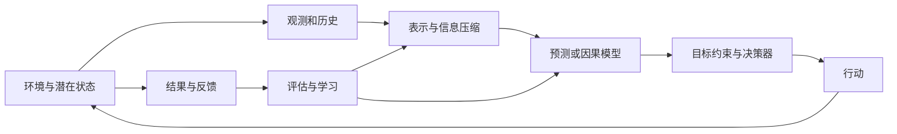
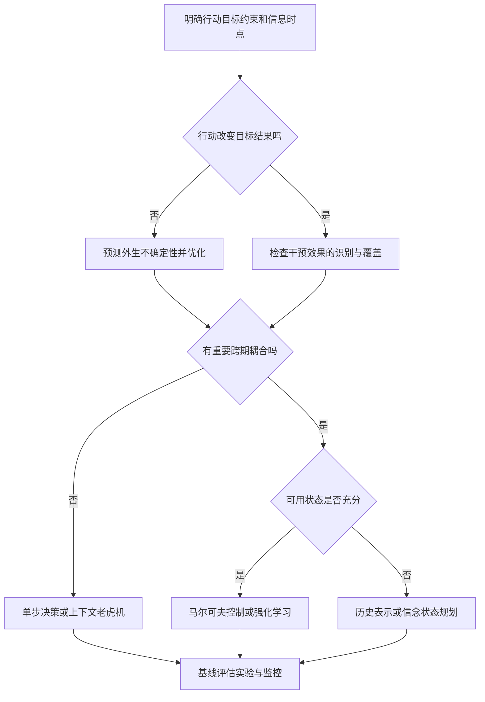

# 决策科学的统一框架：复杂性、结构假设与有限理性

> **面对复杂问题，先明确什么行动值得做，再判断现有信息能支持什么结论，最后选择可计算、可检验的方法。**
>
> 本文的主线是：**决策目标 → 复杂性的来源 → 信息与识别边界 → 结构假设 → 可执行方法 → 决策评价。**

假设你负责一家零售平台，需要回答三个问题：明天备多少货、给哪些用户发券、首页展示哪些商品。表面上，它们分别属于时间序列预测、因果推断和推荐系统；但如果从最终行动出发，会发现它们都在处理同一件事：

**根据有限的信息，在不确定的结果中选择一个行动，让收益与成本的权衡尽可能合理。**

困难也相似。你不知道明天的真实需求，不知道同一位用户“收到券”和“没收到券”分别会怎样，也不可能尝试所有推荐列表。模型的作用，是利用可信的共享规律缩小问题，使有限数据和有限计算足以支持某些有价值的选择。

本文采用“先例子、后概念、再公式与边界”的方式。重要结论用加粗和引用块突出，表格用于比较，推导紧接直观解释。数值例子均为教学示例。正文标题和文件名使用中文；必要的英文术语只作为概念的辅助标注。修订日期：2026-10-15。

**怎样阅读：** 首次阅读可顺着前六章建立概念，再读第八章的完整库存案例；第九章给出决策差距的严格分析。已有基础时，可以直接用第十一章的流程检查自己的项目。

## 阅读导航

1. [一、先看一个例子：预测准确，为什么仍会决策失误](#一先看一个例子预测准确为什么仍会决策失误)
2. [二、统一表达：用信息选择行动，用结果评价策略](#二统一表达用信息选择行动用结果评价策略)
3. [三、问题为什么难：六类复杂性与指数序列空间](#三问题为什么难六类复杂性与指数序列空间)
4. [四、数据能告诉我们什么：信息与因果识别的边界](#四数据能告诉我们什么信息与因果识别的边界)
5. [五、让问题变得可学：结构假设及其收益与代价](#五让问题变得可学结构假设及其收益与代价)
6. [六、怎样压缩历史：状态、信念与决策充分表示](#六怎样压缩历史状态信念与决策充分表示)
7. [七、各种方法分别解决了什么问题](#七各种方法分别解决了什么问题)
8. [八、完整案例：从需求预测走到库存决策](#八完整案例从需求预测走到库存决策)
9. [九、怎样判断做得好不好：决策差距的分解与上界](#九怎样判断做得好不好决策差距的分解与上界)
10. [十、有限理性：什么值得算，什么值得知道](#十有限理性什么值得算什么值得知道)
11. [十一、面对新问题：一套可执行的分析流程](#十一面对新问题一套可执行的分析流程)
12. [十二、参考资料与延伸阅读](#十二参考资料与延伸阅读)

---

## 一、先看一个例子：预测准确，为什么仍会决策失误

### 1.1 从一个容易选错的发券问题开始

你只能给一类用户发券。甲类用户拿到券后有 85% 的概率购买，乙类只有 25%。如果目标是“让领券用户的购买率最高”，选甲似乎很自然。

但假设甲类不发券也有 80% 的概率购买，乙类不发券只有 10%。此时，甲增加 5 个百分点，乙增加 15 个百分点。再算上券成本，给甲发券甚至可能减少利润。

这里有三个不同问题：

1. **预测：** 谁收到券后更可能购买？
2. **因果：** 对谁发券，比不发券增加得更多？
3. **决策：** 考虑成本和预算后，到底应该给谁发？

这三个问题的答案可以不同。先把它们区分开，后面讨论模型能力和方法边界才有明确对象。

### 1.2 三种问题有不同的参照对象

$$
\text{预测： }P(Y\mid X,A),\qquad
\text{因果： }P(Y\mid X,\mathrm{do}(A=a)),\qquad
\text{决策： }\arg\max_a\mathbb E[U(a,Y(a))\mid X].
$$

预测问“类似历史情境通常发生什么”；因果问“主动改变动作会怎样”；决策在此基础上比较收益、成本、风险和约束。预测关联可非常稳定，却仍不等于干预效果。

### 1.3 个性化发券：高购买概率不等于高增量价值

设不发券购买概率为 $p_0(x)$ ，发券购买概率为 $p_1(x)$ ，每单原毛利 $m$ ，购买并核销时承担券成本 $c$ 。在其他因素不变的简化模型中，发券的增量利润为

$$
\Delta(x)=(m-c)p_1(x)-mp_0(x)
=m[p_1(x)-p_0(x)]-cp_1(x).
$$

若券成本在发放时就支付，则成本项应改为 $c$ ；如果存在客单价、跨期购买和商品替代，还需扩展收益模型。

取 $m=100$ 、 $c=10$ ：

| 人群 | 不发券购买率 | 发券购买率 | 增量利润 |
| --- | --- | --- | --- |
| 甲 | 0.80 | 0.85 | $90\times0.85-100\times0.80=-3.5$ |
| 乙 | 0.10 | 0.25 | $90\times0.25-100\times0.10=12.5$ |

甲的发券购买率更高，却主要补贴本来就会购买的人。乙的购买率较低，但增量利润更高。上述概率须来自可识别的估计或实验，不能把选择性发券后的观测购买率直接当作潜在结果概率。

### 1.4 因果效应准确也不自动等于决策最优

即便准确知道购买增量，预算、券额、利润率、频次上限和长期补贴依赖仍可能改变动作。若券额有多个档位，单一二元 CATE 也不够描述整个剂量响应函数。

有预算时可写成

$$
\max_{a_1,\ldots,a_n}\sum_i\Delta_i(a_i)
\quad\text{使得}\quad\sum_i b_i(a_i)\le B.
$$

连续可分问题可以研究拉格朗日乘子；离散券档可能构成背包类问题。简单按“增量价值/成本”排序，只有在特定可分或可分割条件下才保证最优。

### 1.5 并非所有决策都需要完整因果世界模型

若行动不会改变预测目标，可靠预测加已知成本模型就可能足够。随机实验也可以直接比较策略价值，而无需解释所有因果通路。必要的是支撑当前决策比较的有效证据，而不是无条件恢复完整因果图。

---

## 二、统一表达：用信息选择行动，用结果评价策略

### 2.1 把业务问题翻译成五个对象

先不急着看符号。任何决策问题至少应说清五件事：

| 对象 | 通俗含义 | 发券例子 |
| --- | --- | --- |
| 信息 | 行动之前能知道什么 | 已发生的浏览、购买、领券历史 |
| 动作 | 实际能改变什么 | 不发券、发小额券、发大额券 |
| 结果 | 行动之后发生什么 | 是否购买、买多少、以后是否再来 |
| 目标 | 怎样判断行动好不好 | 增量净利润，而非仅看领券转化率 |
| 约束 | 哪些方案不能采用 | 总预算、单人频次、券档范围 |

**策略就是一套“看到什么情况，就采取什么行动”的规则。** 它可以是一条阈值规则、一棵树、一个神经网络，也可以是模型与优化器组成的系统。讨论统一框架时，统一的是这五个对象的关系，而非模型的外形。

如果每天都要决策，今天的行动还会改变明天的情况。例如频繁发券可能形成等待优惠的习惯，这就需要把“未来收益”纳入目标。

### 2.2 决策不是单独的一次模型预测

设时刻 $t$ 的潜在环境状态为 $S_t$ ，决策者观察到 $O_t$ ，选择动作 $A_t$ ，随后获得收益 $R_t$ 。能够用于决策的历史为

$$
H_t=(O_1,A_1,R_1,\ldots,O_{t-1},A_{t-1},R_{t-1},O_t).
$$

策略是从历史到动作分布的映射：

$$
A_t\sim\pi_t(\cdot\mid H_t),\qquad A_t\in\mathcal A_t(H_t).
$$

这里强调**非预见性**：策略只能使用决策时已经可获得的信息。未来价格、最终结算数据、事后修订指标，即使保存在数据库里，也不能直接当作当时已知的特征。

在环境模型 $M$ 下，一个有限期、风险中性的目标为

$$
J_M(\pi)=\mathbb E_{M,\pi}\left[\sum_{t=1}^{T}\gamma^{t-1}R_t\right],\qquad
\pi_M^{\ast}\in\arg\max_{\pi\in\Pi_{\mathrm{feas}}}J_M(\pi),
$$

这个目标式可以按三层阅读：收益先在每条未来轨迹上相加，再对可能发生的轨迹取平均，最后在可行策略中选平均收益最高的规则。这里 $J_M(\pi)$ 是策略价值， $T$ 是决策期数， $\gamma$ 控制远期收益的权重， $\Pi_{\mathrm{feas}}$ 是满足约束的策略集合。模型和策略共同决定轨迹出现的概率。

其中 $0\le\gamma\le1$ 。有限期可以取 $\gamma=1$ ；无限期折扣问题通常要求 $\gamma\lt 1$ 及适当的收益有界性。分布中包含策略，因为动作可能改变未来状态和后续数据。

真实问题还可能有预算、容量、公平性、风险与时延约束，例如

$$
\mathbb E_{M,\pi}\left[\sum_{t=1}^{T}c_t(H_t,A_t)\right]\le B.
$$

期望预算与逐路径预算不同：前者允许部分轨迹超支；若任何时刻都不能超支，应把剩余预算纳入状态并施加逐步可行性约束。

### 2.3 单步决策是这一框架的特例

当行动不影响后续决策问题，给定信息 $X=x$ ，损失最小化形式是

$$
a^{\ast}(x)\in\arg\min_{a\in\mathcal A(x)}\mathbb E[L(a,Y)\mid X=x].
$$

这个写法适用于外生结果 $Y$ 。若行动改变结果，则要写成潜在结果 $Y(a)$ 或干预分布：

$$
a^{\ast}(x)\in\arg\min_{a\in\mathcal A(x)}\mathbb E[L(a,Y(a))\mid X=x].
$$

因此，“预测明天需求”“决定备多少货”“决定是否降价以改变需求”不是同一个统计问题。

| 层次 | 核心对象 | 典型问题 |
| --- | --- | --- |
| 预测 | 观测条件分布 | 已知天气，明天销量可能是多少？ |
| 因果 | 干预后的结果分布 | 若主动降价，销量会增加多少？ |
| 决策 | 带成本与约束的策略价值 | 是否降价、降多少、给谁降？ |
| 学习 | 从数据得到可执行策略 | 有限数据下，怎样可靠地选出策略？ |
| 控制 | 行动与状态的动态闭环 | 今天的行动怎样影响未来库存与需求？ |

### 2.4 统一框架不意味着统一算法

有些系统显式学习环境模型，有些直接学习价值或策略，有些把表示、预测与优化一起训练。统一的是问题分解和评价语言，不是必须使用同一模型架构。

---

## 三、问题为什么难：六类复杂性与指数序列空间

### 3.1 同一家店的六种困难，需要六种不同的处理

设店长想决定明天的订货量。把问题拆开看：

- **状态难：** 不只是今天卖了多少，还要考虑星期、节日、库存、天气和促销。
- **动作难：** 商品种类很多，总预算和仓库容量有限，不能逐个商品独立订货。
- **时间难：** 今天订货三天后才到，今天缺货还可能影响顾客下次是否回来。
- **统计难：** 某些商品只卖过几次，平均销量很不稳定。
- **计算难：** 即使需求分布已知，也可能无法在每天十分钟内解完大规模组合问题。
- **环境难：** 附近新开一家竞争店，过去的需求规律可能不再适用。

**先辨认困难属于哪一类，才能知道下一步应该补数据、改状态、换目标，还是改求解方法。** 如果瓶颈是仓储耦合，换一个更大的需求预测网络并不能自动解开约束。

### 3.2 复杂性不是一个数

| 维度 | 困难来源 | 典型后果 | 常用结构与代价 |
| --- | --- | --- | --- |
| 状态复杂性 | 高维、历史依赖、潜变量、连续状态 | 难以覆盖与区分不同情境 | 表示学习、状态聚合；可能损失决策信息 |
| 动作复杂性 | 海量候选、组合选择、连续控制、耦合约束 | 即使收益已知也难求最优行动 | 召回、分解、松弛；可能漏掉最优解 |
| 时间复杂性 | 延迟收益、长时规划、路径依赖 | 短期有效的行动长期可能有害 | 折扣、截断、层级策略；弱化远期目标 |
| 统计复杂性 | 样本少、噪声大、依赖强、反馈稀疏 | 估计方差、过拟合、探索不足 | 正则化、共享参数、实验；引入偏差或成本 |
| 计算复杂性 | 非凸训练、组合优化、在线时延 | 理论可定义但无法及时求解 | 近似、缓存、蒸馏；损失部分最优性 |
| 环境复杂性 | 漂移、竞争、干扰、机制响应 | 历史规律或策略价值失效 | 在线适应、鲁棒优化；保守或反应滞后 |

这里“时间复杂性”专指**决策跨度和时间耦合**；算法运行时间归入计算复杂性，避免两个概念混用。

### 3.3 表面维度不等于有效复杂性

一个百万维稀疏文本向量可能只有少量决策相关方向；一个只有两维的非平稳系统，也可能很难预测。需要区分：

- **表示维度**：存储一个观测需要多少数值。
- **函数类复杂度**：允许模型表达多少种不同映射。
- **内在结构**：稀疏性、低秩性、光滑性、对称性与局部依赖。
- **分布覆盖**：目标策略会访问的区域是否被数据充分覆盖。
- **目标敏感性**：估计误差是否会改变行动，改变后损失多大。

例如，两个预测模型的均方误差接近，但一个在库存临界分位数附近更准确，另一个在无关区域更准确；它们的业务价值可能显著不同。

### 3.4 难度会在维度之间转移

把完整行为历史压缩为一个向量，减轻了状态表示负担，却增加了“这个表示是否充分”的问题。把动态决策简化为单步排序，降低了计算和探索成本，却引入了忽略长期影响的近似误差。扩大模型降低了函数逼近误差，也可能增加样本需求、推理成本和评估难度。

> 设计方法的实质，是选择哪些复杂性必须保留，哪些可以用可检验的结构假设压缩，哪些风险需要通过实验或约束管理。

### 3.5 为什么“每个用户只有一条历史”会令人担心

假设用户每次只可能进行三种操作：浏览、收藏、购买。长度为 2 的历史有 9 种，长度为 10 已有 59,049 种。再加入商品编号、价格和时间间隔，几乎每个人的完整历史都独一无二。

如果学习规则是“必须见过完全相同的历史，才能预测下一步”，就很难从一个人推广到另一个人。

但我们通常并不需要两条历史完全相同。例如，两个人虽然浏览了不同型号的相机，却都表现出“近期密集比较高价摄影设备”的模式。模型尝试共享的正是这种规律。

> **指数空间带来的核心问题，是怎样合理共享经验。输入组合很多，并不等于每种组合都需要单独学习一套规律。**

### 3.6 为什么序列空间会指数增长

每一步有 $K$ 种离散事件，长度为 $L$ 的序列最多有

$$
N=K^L
$$

种。若 $K=100$ 、 $L=20$ ，则 $N=10^{40}$ 。逐一收集每种序列的多个标签显然不可行。

若把每条序列当成毫无关联的类别，并在均匀分布下独立抽样，至少见到全部类别一次的期望样本量是 coupon collector 数量级：

$$
\mathbb E[n_{\mathrm{cover}}]=N\sum_{j=1}^{N}\frac1j\approx N\log N.
$$

这已经是对每个类别“见过一次”；若每个类别还有噪声，需要更多观测才能估计其均值。非均匀分布中的极罕见类别可能让全覆盖更困难。

### 3.7 不应由此推出任何序列学习都需要指数样本

上述困难来自“每条序列都有独立且任意的响应函数”。如果序列之间存在共享机制，就不必分别估计每条序列。

例如，一阶齐次 Markov 链只需要描述 $K\times K$ 的转移表，其自由参数数目约为 $K(K-1)$ ，而不是 $K^L$ 。固定 $m$ 阶 Markov 假设则约有 $K^m(K-1)$ 个自由参数：对长度 $L$ 不再指数增长，但仍对阶数 $m$ 指数增长。

其他共享机制包括“相似物品有相似影响”“近期行为比远期行为重要”“少数潜在兴趣解释大多数变化”。它们将未经约束的序列函数，限制为较小的函数类。

对有限假设类 $\mathcal F$ 、独立同分布样本以及取值在 $[0,1]$ 的损失，用 Hoeffding 不等式和并合界得到：以至少 $1-\delta$ 的概率，

$$
\sup_{f\in\mathcal F}\left|R(f)-\widehat R_n(f)\right|
\le\sqrt{\frac{\log(2\lvert\mathcal F\rvert/\delta)}{2n}}.
$$

关键量是函数类复杂度，而非输入空间的基数本身。对神经网络需采用不同的复杂度控制或额外结构分析；不能把参数数目机械代入这一有限类公式。

### 3.8 一条轨迹可以生成多个样本，但不是多个独立实验

一段长度为 $L$ 的历史可以构造多个滑动窗口。训练样本行数增加了，但相邻窗口大量重叠，信息并未等比例增长。

对某些平稳、弱依赖过程的样本均值，可用以下启发式衡量自相关影响：

$$
n_{\mathrm{eff}}\approx\frac{n}{1+2\sum_{k=1}^{\infty}\rho_k},
$$

前提包括相关和收敛、长程方差存在等；这不是任意深度学习任务的通用有效样本量公式。不同统计量、混合条件和用户聚类结构需要分别分析。

### 3.9 平均风险与全空间保证不同

实际学习往往希望降低目标分布上的平均损失，不要求每条理论上可能的序列都表现良好。低概率区域可以对平均风险贡献很小，却对安全约束、尾部风险或少数群体表现十分重要。

因此，应同时问：没有覆盖的序列有多常见？目标策略会不会主动进入这些区域？在那里犯错的代价是否很大？模型的泛化来源是可解释的共享结构，还是未经验证的外推？

---

## 四、数据能告诉我们什么：信息与因果识别的边界

### 4.1 为什么无限数据也可能回答不了问题

假设历史系统只给高活跃用户发券。你发现发券用户购买率为 80%，未发券用户为 20%。有两种解释：

- 发券确实带来了很强的购买提升。
- 高活跃用户本来就更可能购买，券的作用很小。

增加一百万条同样方式生成的记录，可以让 80% 和 20% 测得更精确，却不一定能区分这两种解释。因为缺少的是“可比用户在不同动作下的证据”。

**统计误差是估计不够精确；识别问题是即使知道观测分布，也未必能得到唯一答案。** 这决定了该多收集同类数据，还是改变数据收集方式。

### 4.2 把识别条件翻译成业务语言

一致性要求“发券”是定义清楚的干预：5 元券和 50 元券不能不加区分地当作同一种动作。

条件可交换性要求：在控制了已观测信息后，动作分配不再受同时影响结果的遗漏因素干扰。随机实验可以通过设计支持这一点；观测数据分析则需要额外论证。

正值性要求：对我们想作比较的人群，相关动作都有发生机会。若某类用户永远不发券，数据就没有提供这一人群的发券对照。

这些条件合起来，说明为什么“有大量日志”与“有足够决策证据”是两回事。

### 4.3 四种边界应分别处理

| 边界 | 问题 | 增加样本是否一定解决？ |
| --- | --- | --- |
| 信息边界 | 决策时究竟能观察到什么？ | 不能自动得到未观测的当期状态或未来噪声 |
| 识别边界 | 观测分布能否唯一决定目标量？ | 不一定；可能无限数据仍不能识别 |
| 统计边界 | 已识别的目标能否精确估计？ | 常能改善，但受弱信号、依赖与尾部影响 |
| 计算边界 | 已知或已估计目标能否及时优化？ | 更多数据甚至可能增加计算负担 |

“神经网络足够大”主要增加函数表达能力，不会直接突破以上所有边界。

### 4.4 不可约噪声不等于学习造成的决策差距

对平方损失，令 $m(X)=\mathbb E[Y\mid X]$ ，则

$$
\mathbb E[(Y-f(X))^2]
=\mathbb E[\mathrm{Var}(Y\mid X)]+\mathbb E[(m(X)-f(X))^2].
$$

第一项是给定信息下的 Bayes 风险，第二项是相对 Bayes 预测器的超额风险。对于相同信息下的最优决策，无法消除的未来随机性不应再次算作算法没有学好的 regret。

可以通过增加真正有用的观测降低条件方差，但不能保证任何新增特征都能降低有限样本误差。

### 4.5 不可识别性的一个严格反例

令 $U\sim\mathrm{Bernoulli}(1/2)$ ，观测动作 $A=U$ 。考虑两个结构模型：

- 模型一： $Y=A$ ，行动直接决定结果。
- 模型二： $Y=U$ ，行动本身不影响结果。

在观测数据中，两者都满足 $A=Y=U$ ，所以观测联合分布完全一致。可是主动设置动作后：

$$
\mathbb E[Y\mid\mathrm{do}(A=1)]-
\mathbb E[Y\mid\mathrm{do}(A=0)]
=\begin{cases}
1,&\text{模型一},\\
0,&\text{模型二}.
\end{cases}
$$

任何只依赖这份观测分布的算法，都无法知道哪一个因果结论正确。这不是优化不够好，而是数据与假设不足以区分两个世界。

### 4.6 常见因果识别条件

在单次处理、无干扰的设定中，常用条件包括：一致性、条件可交换性 $Y(a)\perp A\mid X$ ，以及对目标人群和目标动作成立的正值性。满足这些条件时，才可将潜在结果均值与适当的观测条件均值联系起来。

这些条件的解释与研究设计可参见 [Hernán 与 Robins 的教材](https://miguelhernan.org/whatifbook)。神经网络可以估计相关函数，但不能凭拟合结果证明无未观测混杂。

正值性表示目标动作在相关情境下确有机会被采用。若某类用户从未拿过优惠券，那么无论记录多少“不发券”的样本，都不能仅凭数据可靠识别其发券响应。模型可以外推，但外推是额外假设。

### 4.7 部分识别也是有用结论

当数据与假设仅将真实模型限制在集合 $\mathcal M(D)$ 内，可以计算策略价值区间：

$$
\underline J(\pi)=\inf_{M\in\mathcal M(D)}J_M(\pi),\qquad
\overline J(\pi)=\sup_{M\in\mathcal M(D)}J_M(\pi).
$$

如果策略甲的下界高于策略乙的上界，即使不能点识别，也足以排序。否则可以选择最坏情形优化、最小最大 regret，或设计新实验缩小不确定性集合。集合本身是否覆盖真实环境，仍取决于假设和构造方式。

---

## 五、让问题变得可学：结构假设及其收益与代价

### 5.1 结构假设究竟在做什么

假设你只有一百条门店销售记录，却想预测所有天气、节日、价格和商品组合。仅靠“记住样本”无法回答没出现过的组合。你必须相信某些规律可以迁移，例如：

**线性假设：** 价格变化的作用可以用少量系数近似。得到的是容易估计的模型，付出的是难以表达复杂阈值与交互。

**低秩假设：** 用户和商品的互动虽然很多，但可以用少数兴趣维度近似。喜欢山地徒步的人，可能对多种户外商品具有可迁移的偏好。得到的是参数共享，付出的是可能忽略罕见兴趣。

**有限记忆假设：** 最近若干次行为已经足够。得到的是更短输入和更稳定估计，付出的是可能遗漏半年前的关键事件。

这些都不是随意省略细节，而是在说：**哪些变化可以合并看待，哪些差别必须保留。**

### 5.2 一个具体的收益与代价比较

考虑同一商品在 100 家门店销售。

- 每家店单独拟合模型：灵活，但新店样本少，估计很不稳定。
- 所有店完全共用一个模型：样本充分，却可能把社区店与景区店混为一谈。
- 共享总体规律，同时保留门店差异：在两者之间折中，但需要假设这些差异具有可学习的结构。

因此，“更个性化”不是越细越好。细分到每个人、每段历史都单独估计，可能因为样本不足反而更差。合理的个性化必须同时回答：**哪些部分共享，哪些部分允许不同。**

### 5.3 学习依赖共享结构

在未经约束的世界里，未观察到的输入可以具有任意输出。能够从旧样本推广到新情境，必然利用某种共享规则。结构假设可以显式写出，也可能隐含在网络架构、损失、数据增强、优化器和预训练数据中。

| 假设或方法 | 认为哪些部分可共享或忽略 | 获得什么 | 代价与失效方式 |
| --- | --- | --- | --- |
| 独立同分布 | 样本来自相同机制且独立 | 简洁估计和泛化理论 | 序列依赖、用户聚类、漂移会破坏条件 |
| 平稳或局部平稳 | 规律在一定时间内不变 | 可以跨时间合并数据 | 制度变化时历史数据产生偏差 |
| 有限阶 Markov | 较远历史在给定近期状态后可忽略 | 压缩序列与递归计算 | 丢失长期记忆与隐变量 |
| 线性或广义线性 | 特征效应按指定形式组合 | 低方差、可解释、易优化 | 复杂交互或阈值结构被遗漏 |
| 稀疏性 | 少量变量或交互决定结果 | 高维下减少估计负担 | 稠密弱信号可能被删去 |
| 低秩与潜因子 | 高维对象由少数潜在因素解释 | 参数共享、协同过滤 | 罕见偏好与局部异常被平滑 |
| 光滑性与局部相似 | 相近输入具有相近响应 | 邻域共享、插值泛化 | 高维距离失效、边界不连续 |
| 对称性与不变性 | 某些变换不改变目标 | 数据效率与稳健性 | 错误不变性会抹去真实信号 |
| 可分性 | 总目标可拆为独立子问题 | 并行计算、简单优化 | 预算竞争、替代与互补被忽略 |
| 折扣与短视近似 | 远期结果权重低或可截断 | 降低规划与评估成本 | 长期信誉、成瘾或库存风险被低估 |
| 无未观测混杂 | 控制变量足以阻断处理选择偏差 | 从观测数据识别干预效果 | 未观测共同原因使估计系统偏离 |
| 策略覆盖 | 历史数据覆盖目标动作 | 可进行离线策略评估 | 稀有动作导致高方差或无法识别 |
| 深度参数共享 | 多情境可用同一可组合表示解释 | 表达复杂规律、跨任务迁移 | 训练昂贵、捷径学习、分布外不稳 |
| 鲁棒不确定性集合 | 真实分布落在指定集合中 | 最坏情形保护 | 集合过大则过于保守，过小则漏风险 |

### 5.4 收益与代价不能简化为“偏差换方差”

偏差—方差只覆盖部分问题。还有信息—隐私、探索—即时收益、规划精度—时延、目标覆盖—反馈成本、最坏情形保障—平均收益等权衡。

假设也存在层级。对称性可能是物理规律，而“未来与过去相同”通常只能近似成立。应记录假设的来源：制度、业务机制、实验设计、统计证据，还是仅为了让模型可训练。

### 5.5 更复杂不必然更少偏差

大模型可以扩大函数类，但仍可能因训练目标、数据选择、上下文窗口和部署约束产生系统性遗漏。增加参数无法修复错误标签定义，也无法让历史不存在的动作对比自动变得可识别。

---

## 六、怎样压缩历史：状态、信念与决策充分表示

### 6.1 用库存例子理解“状态”

如果两家店今天的库存都为 20 件，明天该不该补货？仅看库存无法判断：一家有 100 件商品明天到货，另一家没有在途订单。

所以“当前库存”不是足够的状态。把**现货、在途订单及到货时间**一起记录，才更接近可用于决策的状态。如果商品会过期，还需记录各批次剩余保质期。

这就是状态构造的核心：不是把尽可能多的历史堆进去，而是保留足以判断未来后果的信息。

### 6.2 递推为什么能减少重复计算

假设今天买不买货有两种选择，明天也有两种。直接列出未来一个月的所有动作组合，数量会迅速增长。

但许多不同历史可能走到同一个局面：同样的现货、在途订单、剩余预算和日期。如果这个局面已经包含后续决策所需的信息，我们就不必为每条历史重复计算未来方案，只需为这个状态计算一次后续价值。

**贝尔曼递推的直觉是：当前动作的价值 = 当前收益 + 到达下一状态后的最优剩余价值。** 下面的数学形式把这句话写得精确。

### 6.3 马尔可夫性取决于怎样定义状态

马尔可夫决策过程（MDP）假设存在可观测状态 $S_t$ ，使

$$
P(S_{t+1},R_t\mid H_t,A_t)
=P(S_{t+1},R_t\mid S_t,A_t).
$$

这不是说世界没有记忆，而是说被保留的状态已经包含预测下一步与收益所需的历史信息。完整历史总可以被形式上视为状态，但那并没有解决状态空间增长的问题。

对于有限期、已知模型，令 $V_{T+1}^{\ast}=0$ ，Bellman 递推为

$$
Q_t^{\ast}(s,a)=r_t(s,a)+\gamma\sum_{s'}P_t(s'\mid s,a)V_{t+1}^{\ast}(s'),
\qquad V_t^{\ast}(s)=\max_{a\in\mathcal A_t(s)}Q_t^{\ast}(s,a).
$$

在这组公式里， $r_t(s,a)$ 是当前期望收益， $P_t(s'\mid s,a)$ 是下一状态的概率， $V_t^{\ast}(s)$ 是从当前状态开始的最优剩余价值。 $Q_t^{\ast}(s,a)$ 则要求第一步先采取指定动作，之后再最优行动。对所有动作取最大值，就从动作价值回到状态价值。

枚举长度 $T$ 的开环动作序列有 $\lvert\mathcal A\rvert^T$ 种，而表格型有限期动态规划可通过共享子问题避免这种直接枚举。对稠密转移表，一轮完整有限期递推约需 $O(T\lvert\mathcal S\rvert^2\lvert\mathcal A\rvert)$ 运算。

但这没有消除巨大状态空间、未知转移估计、连续动作优化等困难。动态规划利用的是最优子结构，而不是无条件解决所有序列问题。

### 6.4 部分可观测情形：当前观测并非完整状态

用户真实偏好、设备健康程度和市场隐含状态通常不能直接观测。部分可观测马尔可夫决策过程（POMDP）用信念状态表示历史对潜在状态的后验信息：

$$
b_t(s)=P(S_t=s\mid H_t).
$$

在转移核 $P$ 和观测核 $\Omega$ 已知时，若下一步收到观测 $o'$ ，Bayes 更新为

$$
b_{t+1}(s')=
\frac{\Omega(o'\mid s',a_t)\sum_sP(s'\mid s,a_t)b_t(s)}
{\sum_{\tilde s}\Omega(o'\mid\tilde s,a_t)\sum_sP(\tilde s\mid s,a_t)b_t(s)}.
$$

这里观测可以包含已收到的奖励信号；若奖励也揭示隐藏状态，滤波必须利用该信息。标准已知模型条件下，信念状态可将 POMDP 转成信念空间上的 MDP；参见 [Kaelbling、Littman 与 Cassandra（1998）](https://www.sciencedirect.com/science/article/pii/S000437029800023X)。

即使隐藏状态有限，信念空间通常也是连续单纯形。POMDP 用概率分布整理历史，但求解和准确滤波仍可能昂贵。未知模型还要求估计模型参数，必要时将参数不确定性纳入信念。

### 6.5 一个隐藏状态的数值例子

假设用户可能“对摄影高度感兴趣”，也可能“兴趣较低”，先验概率各为一半。高兴趣用户点击相机内容的概率是 0.8，低兴趣用户为 0.2。观察到一次点击后，高兴趣的后验概率是

$$
P(\text{高兴趣}\mid\text{点击})
=\frac{0.8\times0.5}{0.8\times0.5+0.2\times0.5}=0.8.
$$

我们仍然不知道真实兴趣，但把不确定性从“五五开”更新成“八二开”。这份概率描述就是信念状态的直观含义。

这个计算依赖已知的点击机制。若展示位置也影响点击，或用户兴趣随时间变化，就必须把这些因素纳入模型。不能把“点击了一次”直接等同于“已经知道真实兴趣”。

### 6.6 神经网络的隐藏表示不自动等于充分状态

神经网络表示 $Z_t=\phi_\theta(H_t)$ 可以近似历史压缩，但训练损失下降不足以证明它具备 Markov 性、正确后验或决策充分性。

仅预测下一次点击的表示，可能丢失影响长期留存的信息；在旧推荐策略下充分的表示，切换策略后也可能不充分。需要检查目标、策略覆盖、历史依赖和外推稳定性。

### 6.7 压缩得好不好，要看是否改变行动

给用户发券时，原始历史可能包含上千次浏览。你把它压缩为“近期活跃度、价格敏感度、历史购买”三个特征。这个压缩是否合理，不由向量有多短决定，而由它有没有合并本来应该采取不同动作的人决定。

例如，两位用户都被归为“高购买倾向”：一位无论是否发券都会买，另一位必须有券才会买。若表示把两人完全合并，它对购买预测可能够用，对发券决策却不够用。

反过来，两位用户喜欢不同颜色的同一商品，但发券的增量利润和约束完全相同。针对这次发券任务，颜色细节可能无需保留。

> **决策充分表示保留的是“选择行动所需的信息”。充分与否必须相对于具体目标来判断。**

### 6.8 不必重建世界的每一个细节

对单步损失问题，令 $H$ 为全部可用历史， $Z=\phi(H)$ 为压缩表示，定义条件风险

$$
q(h,a)=\mathbb E[L(a,Y(a))\mid H=h].
$$

给定目标与行动集合，如果存在只依赖 $Z$ 的策略实现完整历史下的最优风险，就称该表示对这一决策任务充分。这里的“充分”不同于参数统计中的充分统计量；它依赖行动、损失和部署分布。

一种较强的充分条件是：对所有可行动作，存在函数 $\widetilde q$ 满足

$$
q(h,a)=\widetilde q(\phi(h),a).
$$

更弱的条件是，映射到同一表示的历史具有至少一个共同最优动作。它们的全部结果分布可以不同，只要不改变最优决策即可。若行动可行域随历史变化，还必须保留足够的约束信息。

### 6.9 均值何时充分，何时不充分

若成本为 $L(a,Y)=a^\top Y$ ，行动集合在给定信息下已知，则

$$
\mathbb E[a^\top Y\mid H]=a^\top\mathbb E[Y\mid H].
$$

此时条件均值足以支持风险中性的最优化。若损失非线性，则通常

$$
\mathbb E[L(a,Y)\mid H]\ne L(a,\mathbb E[Y\mid H]).
$$

库存决策可能需要条件分位数；尾部风险约束需要尾部分布；组合风险通常需要联合依赖关系。只预测每个资产或商品的均值，会丢失关键的协方差或联合尾部信息。

### 6.10 近似充分性的一个决策保证

假设对所有相关历史和可行动作都有

$$
\left|q(h,a)-\widetilde q(\phi(h),a)\right|\le\varepsilon,
$$

并让 $\widehat a(h)$ 最小化 $\widetilde q$ 。若最优动作 $a^{\ast}(h)$ 存在，则

$$
\begin{aligned}
q(h,\widehat a)-q(h,a^{\ast})
&=[q(h,\widehat a)-\widetilde q(z,\widehat a)]\\
&\quad+[\widetilde q(z,\widehat a)-\widetilde q(z,a^{\ast})]\\
&\quad+[\widetilde q(z,a^{\ast})-q(h,a^{\ast})]\\
&\le2\varepsilon.
\end{aligned}
$$

这是教学推导：中间项由优化性质不大于零，其余两项各不超过 $\varepsilon$ 。若求解器只达到 $\eta$ 精度，上界变成 $2\varepsilon+\eta$ 。保证要求动作相关风险的一致误差控制，不能仅凭平均预测误差很小来替代。

### 6.11 动态任务需要更强条件

对多步控制，仅保留当前奖励预测通常不够。一个常用的充分结构是：同一压缩状态下，各动作的期望奖励相同，且下一压缩状态的条件分布相同；并保留可行域。这样才可在压缩空间递推未来价值。

决策充分表示的研究方向，是将压缩与目标相联系；其边界是任务改变后，旧表示可能失效。适合点击预测的表示不一定适合留存优化，适合当前价格机制的表示不一定适合主动调价。

---

## 七、各种方法分别解决了什么问题

### 7.1 用同一组问题看懂不同方法

下面六类对象不在同一个分类层级：深度学习是建模方法，大模型是模型与训练范式，推荐和发券是应用问题，强化学习是序贯学习框架。它们可以组合使用，例如用深度网络学习发券效果，也可以在推荐系统中使用强化学习。

比较时统一问四件事：**它主要压缩了哪种困难？依靠什么结构？需要什么数据？哪些问题仍然没有解决？**

### 7.2 一个推荐系统怎样同时使用多种方法

平台有一百万件商品，但页面只展示十件。可以先用用户与商品表示召回一千件，再预测点击或购买，最后结合库存、多样性和商业约束选出列表。

这里：

- 表示学习帮助从海量物品中共享经验。
- 召回减少后续计算，但可能遗漏真正最优的物品。
- 预测模型估计响应，但标签受到过去曝光策略影响。
- 决策器处理目标和约束。
- 如果当前展示会改变未来兴趣，才进一步涉及动态策略学习。

一个系统是否做好，不能只看其中某个模型分数。需要检查整个“数据—候选—估计—行动—反馈”过程。

| 方法或领域 | 主要解决什么 | 关键收益 | 付出的成本 | 主要边界 |
| --- | --- | --- | --- | --- |
| 深度学习 | 复杂映射与表示共享 | 降低手工特征依赖，表达非线性交互 | 数据、算力、调参、可解释性负担 | 不自动解决因果识别、分布漂移和目标错误 |
| 大模型 | 大规模序列建模与跨任务迁移 | 共享语言知识和通用任务接口 | 预训练与推理成本、评测复杂度 | 生成合理文本不等于事实、干预或长期策略正确 |
| 推荐系统 | 大规模候选下的个性化匹配 | 高效召回排序、用户与物品共享统计强度 | 多阶段近似、反馈偏差、在线实验成本 | 曝光决定标签，短期点击不等于长期福利 |
| 个性化发券 | 有限预算下的增量响应分配 | 减少无效补贴，提升增量利润 | 随机探索、因果假设、稀疏反馈 | 混杂、重叠不足、跨用户或跨期干扰 |
| 量化投资 | 噪声环境中的仓位、风险与执行 | 将信号转为受约束行动 | 交易成本、模型风险、研究选择偏差 | 低信噪比、漂移、市场冲击、容量和竞争 |
| 强化学习 | 行动影响未来时的序贯优化 | 联合考虑长期收益和信息获取 | 交互样本、探索风险、信用分配难度 | 奖励设定、覆盖、模拟误差、隐藏状态 |

### 7.3 深度学习：用共享函数结构替代逐格估计

深度网络用参数化函数 $f_\theta(x)$ 在大量输入之间共享统计强度。它能把复杂输入映射到任务相关表示，但成功依赖训练目标、优化过程和数据分布之间的匹配。

神经网络可以作为预测器、结果回归器、倾向模型、价值函数或策略。它的角色由学习目标和数据生成过程决定。“因果神经网络”若只有普通预测损失，不能仅凭名称产生因果识别。

### 7.4 大模型：序列概率分解不等于枚举全部序列

自回归语言模型采用

$$
P_\theta(x_{1:L})=\prod_{t=1}^{L}P_\theta(x_t\mid x_{\lt t}),
\qquad
\mathcal L(\theta)=-\sum_t\log P_\theta(x_t\mid x_{\lt t}).
$$

链式分解本身是概率恒等式；能够学习和泛化，还依赖跨位置、跨序列共享参数及数据中的规律。Transformer 的自注意力提供了一种内容依赖的信息聚合机制，参见 [Vaswani 等（2017）](https://arxiv.org/abs/1706.03762)。

预测下一个 token 是训练接口，不意味着模型只能学局部词频；它可能形成可迁移表示。但同样不能由预训练目标推导出所有下游任务的正确性保证。工具调用、检索、规划和反馈可扩展系统能力，仍需分别验证信息来源、行动后果和任务成功率。

### 7.5 推荐系统：召回本身就是决策限制

推荐通常先召回候选，再排序与重排。若最优物品没有进入候选集合，排序器再准确也无法选中它。于是需要同时评估候选覆盖、排序质量、约束满足和整体在线价值。

历史曝光策略决定哪些物品有反馈。未曝光不等于用户不喜欢，点击还受位置、展示方式和既有策略影响。把离线点击预测分数直接解释成任意新策略下的收益，可能产生偏差。

当动作只影响当期收益且不改变后续情境分布时，可用 contextual bandit 近似；若推荐影响未来兴趣、疲劳和留存，则应研究动态效应，或明确承认短视近似。

### 7.6 个性化发券：估计和分配应分开审视

第一步识别各动作的增量净价值；第二步在预算下分配；第三步通过独立评估判断整体政策是否改善。弱异质性和高噪声情况下，复杂个性化可能比统一规则更不稳定。

应同时比较“不发券”“统一发券”“简单分群”“复杂策略”，并报告价值差的不确定性。CATE 模型拟合优度并不能直接替代策略价值评估。

### 7.7 量化投资：预测优势必须通过成本和约束检验

一个简化的单期组合目标是

$$
\max_{w\in\mathcal W}\left\lbrace \widehat\mu^\top w
-\frac\lambda2w^\top\widehat\Sigma w
-C(w-w_{\mathrm{prev}})\right\rbrace .
$$

在无约束、无交易成本且 $\widehat\Sigma$ 正定时，一阶条件给出

$$
w^{\ast}=\frac1\lambda\widehat\Sigma^{-1}\widehat\mu.
$$

如果协方差矩阵有很小的特征值，对均值的小误差就可能被逆矩阵放大。这说明更准确的平均预测指标不一定产生更稳定的仓位；正则化、仓位限制与风险估计本身具有决策价值。

实际研究必须考虑信息时点、存活者偏差、多重尝试、交易成本、冲击、融资与容量。历史回测选择出的最好策略，不等于真实最优策略。

### 7.8 强化学习：把行动改变未来纳入优化

强化学习关注长期价值与探索。探索不仅产生当期收益，也改变未来可获得的信息。若不存在重要动态影响或探索价值，强行使用 RL 可能徒增估计和验证负担。

离线 RL 尤其依赖历史策略覆盖。对数据没有支持的动作，价值函数可能乐观外推；优化器又倾向选择这些高估动作，从而放大误差。保守估计和行为约束可以缓和问题，但不能无条件恢复缺失的反事实证据。参见 [Levine 等（2020）](https://arxiv.org/abs/2005.01643)。

---

## 八、完整案例：从需求预测走到库存决策

### 8.1 将前面的主线完整走一遍

现在回到“明天备多少货”。先暂时假设只有一种商品、一天一个订货周期、需求不受订货量影响，商品没卖完需要承担积压成本，没货可卖需要承担缺货代价。

这组假设不是问题天然如此，而是为了建立一个能解释清楚的起点。之后再逐步加入提前期、库存截断、多个商品和价格变化。

**我们要的最终输出是订货量。** 预测需求是为了支持这个动作，因此预测什么统计量，应由缺货和积压的代价决定。

### 8.2 从决策开始定义预测任务

假设一家零售商每天预测未来七天需求，用于补货。首先应确定：补货提前期、订货时点、库存状态、缺货损失、积压成本、容量与商品保质期。

预测目标可能是单日需求、提前期累计需求，或者整个联合路径。若提前期为七天，分别预测七个边际均值，未必足以推导累计需求的高分位数，因为跨日相关性也很重要。

对预测本身，可写成

$$
\widehat F_{t,h}(y)=\widehat P(Y_{t+h}\le y\mid\mathcal I_t),
$$

其中 $\mathcal I_t$ 必须只包含时点 $t$ 已知的信息。天气预报可以使用当时发布版本，不能使用未来真实天气替代；促销计划已知与实际执行结果已知也不同。

### 8.3 先判断目标变量是否被行动截断

销量不一定等于需求。若缺货，销量可能满足

$$
\mathrm{Sales}_t=\min(D_t,I_t),
$$

其中 $D_t$ 为潜在需求， $I_t$ 为可售库存。低库存时期的低销量不能直接解释为低需求。若价格和促销由历史策略选择，需求模型还包含政策选择机制。

因此，“预测观测销量”“预测不缺货需求”“预测改价后的需求”需要不同数据与假设。单纯换成更复杂的时间序列网络，不能消除截断与选择偏差。

### 8.4 用六类复杂性检查任务

| 维度 | 零售案例中的具体问题 | 首轮处理 |
| --- | --- | --- |
| 状态 | 多商品、多门店、节日、历史库存 | 分层特征与门店商品共享参数 |
| 动作 | 订货量、供应商、运输与容量 | 明确可行域，先解简化库存问题 |
| 时间 | 提前期、保质期、滚动补货 | 区分单周期近似与多期库存控制 |
| 统计 | 需求噪声、促销稀少、窗口重叠 | 分组评估、时间切分、分布预测 |
| 计算 | 大量序列每天重训与预测 | 简单基线、批量推断、适度更新 |
| 环境 | 新品、消费趋势、供应链变化 | 漂移监控、分场景回测与回退 |

### 8.5 基线的作用是检验结构收益

可依次比较季节性朴素预测、指数平滑或线性模型、树模型、跨序列共享的神经网络。每次升级都应回答新增结构解决了什么：非线性交互？跨商品共享？长依赖？未知季节模式？

例如自回归模型

$$
Y_t=\alpha+\sum_{j=1}^{p}\beta_jY_{t-j}+\varepsilon_t
$$

假设有限滞后与线性作用；加入节日和促销变量可缓解部分遗漏，但若策略主动改变价格，外生性不能自动成立。共享神经模型可能帮助短序列，但也可能让异常门店受到不合适的平均规律影响。

### 8.6 从损失推导真正需要的预测量

先考虑无跨期耦合、需求外生的单周期订货问题，损失为

$$
L(q,D)=c_u(D-q)_++c_o(q-D)_+,
$$

其中 $c_u\gt 0$ 为单位缺货代价， $c_o\gt 0$ 为单位积压代价。若条件需求分布连续，其期望损失导数为

$$
\frac{\partial}{\partial q}\mathbb E[L(q,D)\mid\mathcal I_t]
=-c_u[1-F(q\mid\mathcal I_t)]+c_oF(q\mid\mathcal I_t).
$$

令其为零，得到

$$
F(q^{\ast}\mid\mathcal I_t)=\frac{c_u}{c_u+c_o}.
$$

若 $c_u=9,c_o=1$ ，最优订货量对应条件第 90 百分位，而不是均值。离散需求使用广义分位数：选择满足 $F(q^- )\le0.9\le F(q)$ 的适当最优订货量，并考虑整数约束。

对于多期库存、有提前期和未到货订单的系统，上述分位数只是一种单周期近似。状态需包含现货、在途、剩余保质期等信息，可能需要动态规划或其他库存策略。

**为什么缺货越贵，最优分位数越高？**

多订一件商品有两种后果：如果需求超过现有订货量，这一件能避免一次缺货；如果需求已经被满足，这一件会变成积压。

当“避免缺货的期望收益”大于“新增积压的期望代价”，就值得继续加库存。最优点正是两者相等的位置。上面的导数公式描述的就是这个边际比较。

因此，需求分布没有变化，成本结构变了，最优订货量也会变化。只训练一个与业务成本无关的点预测，再把它当成订货量，会漏掉这一层决策关系。

### 8.7 两个均值相同的需求分布可导出不同动作

考虑分布甲：需求恒为 100；分布乙：需求以 0.8 概率为 80、以 0.2 概率为 180。两者均值都为 100，但在上述成本下，最优订货分别为 100 和 180。

乙分布下，订货 100 的期望成本为

$$
0.8\times20\times1+0.2\times80\times9=160,
$$

订货 180 的期望成本为

$$
0.8\times100\times1=80.
$$

这个案例说明：均值预测完全正确，仍可能缺少决策所需的分布信息。它不是均值模型训练失败，而是预测对象与决策目标不匹配。

### 8.8 验证必须重现真实信息时序

采用滚动预测起点：在时刻 $t$ 用当时可用数据拟合或更新，预测未来，再向后滚动。训练窗口、归一化、缺失填补和特征选择都必须仅使用当时可用数据。可参考 [Forecasting: Principles and Practice 的时间序列交叉验证说明](https://otexts.com/fpp3/toolbox.html#time-series-cross-validation)。

若样本标签覆盖未来七天，跨分割边界的训练标签可能触及验证时期；是否清除或留间隔，应由标签区间与数据发布时间决定。随机打乱窗口通常不能模拟上线场景。调整模型时使用验证区间；最终测试区间不应反复用于选择模型。

| 评价层 | 指标示例 | 不能替代什么 |
| --- | --- | --- |
| 点预测 | MAE、RMSE、相对基线误差 | 分布校准和实际库存成本 |
| 分布预测 | 分位数损失、区间覆盖与宽度 | 约束下的整体决策表现 |
| 决策 | 缺货、积压、净利润、服务水平 | 因果识别与漂移检验 |
| 系统 | 时延、计算成本、失败率 | 长期业务目标与用户体验 |

依赖数据的区间估计应考虑时间或用户聚类；块 bootstrap 也需要合理块长及依赖条件，不能把任意重采样都视为有效。极端促销、异常供应与新品应单独检查，避免总体平均掩盖局部失效。

### 8.9 根据误差来源决定下一步

如果均值已经稳定但尾部订货错误，应改进分布预测；如果缺货截断严重，应先修正需求观测；如果模型只在旧促销机制有效，应重审识别与外推；如果预测改善却收益未改善，应检查决策阈值、成本函数与求解器。

> 时间序列建模的第一步，是确定“何时知道什么、为了哪个动作预测哪个量”。模型架构选择应在这些问题之后。

---

## 九、怎样判断做得好不好：决策差距的分解与上界

### 9.1 先用金额说明“差距”究竟指什么

假设一个库存策略平均每天损失 120 元。在相同信息和约束下，最优策略平均损失 80 元，那么它的决策差距是 40 元。

如果有一个事先知道明天真实需求的“先知”，平均损失可以降到 20 元，我们不能把 120 减 20 的全部 100 元都归咎于学习算法。这里有：

- 60 元来自决策时不知道未来；
- 40 元来自在已有信息下还没选好策略。

本文把相对于指定基准的这类差距称为**决策差距（regret）**。不同文献的基准可能不同，所以读到一个 regret 结论，第一步必须问“和谁比”。

### 9.2 拆分差距，是为了决定下一步改哪里

再把同信息下的 40 元分开。假设：

| 可用策略范围 | 最低平均损失 |
| --- | --- |
| 可以使用完整历史 | 80 元 |
| 只能使用压缩后的特征 | 90 元 |
| 还限制为当前模型能够表达的规则 | 100 元 |
| 实际训练并部署的规则 | 120 元 |

那么 40 元恰好拆成 10 + 10 + 20：

**第一个 10 元**是信息压缩丢失了有用差别；**第二个 10 元**是模型规则不够灵活；**最后 20 元**是在已有策略类中还没选好，可能涉及估计和优化。

这个例子中的最优值是假设已知的教学数字，实际项目通常无法直接测出。它的价值在于说明：只增加模型参数，未必能修复特征压缩造成的损失。

### 9.3 必须先固定比较基准

以下主要采用损失最小化。令部署分布下策略风险为 $R(\pi)$ ，全历史可行策略类为 $\Pi_H$ 。相同信息条件下的 Bayes 最优风险为

$$
R_H^{\ast}=\inf_{\pi\in\Pi_H}R(\pi),\qquad
\mathrm{Reg}(\widehat\pi)=R(\widehat\pi)-R_H^{\ast}.
$$

如果比较对象提前知道结果 $Y$ ，则单步外生结果问题中的事后最优风险为

$$
R_{\mathrm{PI}}=\mathbb E\left[\min_{a\in\mathcal A(X)}L(a,Y)\right].
$$

于是

$$
R(\widehat\pi)-R_{\mathrm{PI}}
=[R_H^{\ast}-R_{\mathrm{PI}}]+[R(\widehat\pi)-R_H^{\ast}].
$$

第一项是完全信息价值对应的差距，第二项才是相同信息下的学习与决策差距。这个公式假定各项在同一环境、损失与可行域下定义；动态事后先知还必须明确定义其额外信息。

### 9.4 表示与策略类的非负分解

令 $\Pi_Z\subseteq\Pi_H$ 是仅使用表示 $Z$ 的可行策略， $\Pi_F\subseteq\Pi_Z$ 是实际采用的函数类。定义

$$
R_Z^{\ast}=\inf_{\pi\in\Pi_Z}R(\pi),\qquad
R_F^{\ast}=\inf_{\pi\in\Pi_F}R(\pi).
$$

若最终策略 $\widehat\pi\in\Pi_F$ ，则严格恒等式为

$$
R(\widehat\pi)-R_H^{\ast}
=\underbrace{R_Z^{\ast}-R_H^{\ast}}_{\text{表示限制}}
+\underbrace{R_F^{\ast}-R_Z^{\ast}}_{\text{策略类限制}}
+\underbrace{R(\widehat\pi)-R_F^{\ast}}_{\text{类内选择差距}}.
$$

三个项因集合嵌套而非负。这里把表示和策略类视为固定；若它们由数据选择，可逐次条件化理解恒等式，但统计保证需要覆盖这种选择，不能忽略额外的模型搜索。

### 9.5 估计与优化：精确恒等式不意味着每项都非负

令 $\widehat R$ 为训练使用的风险估计， $\pi_F^{\ast}$ 为真实类内最优， $\widehat\pi$ 为算法输出，假设最优值达到。加减同样的量得到

$$
\begin{aligned}
R(\widehat\pi)-R(\pi_F^{\ast})
&=[R(\widehat\pi)-\widehat R(\widehat\pi)]\\
&\quad+[\widehat R(\widehat\pi)-\widehat R(\pi_F^{\ast})]\\
&\quad+[\widehat R(\pi_F^{\ast})-R(\pi_F^{\ast})].
\end{aligned}
$$

首尾是带符号的估计偏差项；中间项也可能为负，不能直接命名成一个必然非负的“优化 regret”。若经验优化误差满足

$$
\widehat R(\widehat\pi)\le\inf_{\pi\in\Pi_F}\widehat R(\pi)+\varepsilon_{\mathrm{opt}},
$$

且定义一致估计误差

$$
\Delta=\sup_{\pi\in\Pi_F}\left|R(\pi)-\widehat R(\pi)\right|,
$$

才可推出上界

$$
R(\widehat\pi)-R_F^{\ast}\le2\Delta+\varepsilon_{\mathrm{opt}}.
$$

因此，“表示误差 + 逼近误差 + 两倍估计误差 + 优化误差”是有条件的**上界**，不是普遍成立的非负精确分解。

**为什么上界里会出现两倍估计误差？**

假设真实成本最低的方案是甲，算法却选了乙。估计可能同时把甲看得过贵、把乙看得过便宜。若每个方案的估计偏差至多为 3 元，这两端合起来最多造成 6 元的错误比较；若求解器还允许 1 元的经验目标差距，总界便是 7 元。

这就是两倍一致误差加优化误差的直觉。这里要求对整个候选策略类控制误差；只说明某个固定策略的估计准确，不能保证从很多策略中挑出的赢家也准确。

### 9.6 将模型偏差、统计误差和环境漂移纳入同一上界

为避免混用分布，令 $R_D$ 为部署风险， $R_0$ 为参考环境的真实风险， $\widetilde R_0$ 为理想化模型或代理目标， $\widehat R_n$ 为其样本估计。在同一策略类 $\Pi_F$ 上定义

$$
\begin{aligned}
\Delta_{\mathrm{env}}&=\sup_{\pi\in\Pi_F}|R_D(\pi)-R_0(\pi)|,\\
\Delta_{\mathrm{model}}&=\sup_{\pi\in\Pi_F}|R_0(\pi)-\widetilde R_0(\pi)|,\\
\Delta_{\mathrm{stat}}&=\sup_{\pi\in\Pi_F}|\widetilde R_0(\pi)-\widehat R_n(\pi)|.
\end{aligned}
$$

由三角不等式及上一节推导，得到

$$
R_D(\widehat\pi)-R_{D,H}^{\ast}
\le(R_{D,Z}^{\ast}-R_{D,H}^{\ast})+(R_{D,F}^{\ast}-R_{D,Z}^{\ast})
+2(\Delta_{\mathrm{env}}+\Delta_{\mathrm{model}}+\Delta_{\mathrm{stat}})
+\varepsilon_{\mathrm{opt}}.
$$

这些量是分析工具，不保证都能由数据估计。不可识别会使模型误差无法验证；分布外覆盖不足会使统计控制失效；环境剧变会使漂移项巨大。无依据地把所有差距都标成“随机噪声”，会掩盖结构问题。

若用正则化目标训练，应明确正则项属于实际优化目标，并把它与部署风险之间的差异计入分析。不能把正则化优化误差与原风险优化误差直接混同。

### 9.7 动作排序与价值间隔比总体均方误差更直接

对两个动作，令净收益差为 $\Delta(x)$ ，估计为 $\widehat\Delta(x)$ ，策略在估计差为正时采取动作 1。固定平局规则后，条件 regret 在选错动作时等于 $|\Delta(x)|$ ，选对时为零。

若 $|\widehat\Delta(x)-\Delta(x)|\le\varepsilon$ ，则只有 $|\Delta(x)|\le\varepsilon$ 的情境可能选错；在动作价值差很大时，排序较稳定。这解释了为何模型误差的**位置与方向**比一个整体分数更有决策含义。

若分别估计两个动作价值且各自误差至多 $\varepsilon$ ，则差值误差最多为 $2\varepsilon$ ；两种误差定义不能混用。

### 9.8 在线累积决策差距是另一个对象

在线学习常与事后最好的固定策略比较：

$$
\mathrm{Reg}_T^{\mathrm{static}}
=\sum_{t=1}^{T}\ell_t(a_t)-\min_{a\in\mathcal A}\sum_{t=1}^{T}\ell_t(a).
$$

动态 regret 则与每期最优动作比较。后者通常需要限制环境变化，否则无法获得有意义的次线性保证。

在 RL 中动作会改变未来状态，不能直接把上述外生损失序列公式搬过来。常见 episodic RL regret 是各回合最优策略价值与执行策略价值之差的和，还需说明初始状态、反馈方式和环境是否固定。

### 9.9 离线价值评估连接识别与统计误差

对单步 contextual bandit，数据为 $(X_i,A_i,R_i)$ ，行为策略概率为 $\mu(a\mid x)$ ，目标策略为 $\pi(a\mid x)$ 。在一致性、适当无混杂和覆盖下，逆倾向加权估计为

$$
\widehat V_{\mathrm{IPS}}(\pi)
=\frac1n\sum_{i=1}^{n}\frac{\pi(A_i\mid X_i)}{\mu(A_i\mid X_i)}R_i.
$$

若 $\mu$ 很小，权重可能很大，估计方差随之上升。权重截断降低方差但引入偏差；不能既截断又不加条件地宣称无偏。

令 $\widehat m(x,a)$ 为结果回归，可构造双重稳健估计：

$$
\widehat V_{\mathrm{DR}}(\pi)=\frac1n\sum_i
\left[\sum_a\pi(a\mid X_i)\widehat m(X_i,a)
+\frac{\pi(A_i\mid X_i)}{\widehat\mu(A_i\mid X_i)}
\bigl(R_i-\widehat m(X_i,A_i)\bigr)\right].
$$

双重稳健性是在相应识别、覆盖和估计条件下，结果模型或倾向模型正确可支持一致估计；不是对任意隐藏混杂或任意有限样本都稳健。复杂辅助模型宜配合样本分割或交叉拟合；从许多策略中择优还需要独立评估或统一误差控制。参见 [Dudík 等（2014）](https://arxiv.org/abs/1503.02834)。

多步策略评估还涉及状态访问分布变化和累积权重，不能将单步公式直接视为完整 RL 评估方法。

**为什么要除以历史动作概率？**

假设某类情境下，历史系统只有 10% 的概率展示物品甲，而目标策略总想展示甲。要估计目标策略价值，就需要把历史中少见的“展示甲”样本按比例放大；权重为 1 除以 0.1，即 10。

但如果历史概率只有 0.001，一个样本就可能带上 1000 倍权重。少数偶然结果便会主导估计。这说明策略覆盖不仅关系“能不能识别”，也关系“估计是否稳定”。

双重稳健估计的直觉是：先用结果模型给出预测，再用实际观测与预测之间的残差作加权修正。它利用两类信息互相补充，但不会创造从未出现过的动作证据。

---

## 十、有限理性：什么值得算，什么值得知道

### 10.1 更精确的计算，何时反而不值得

假设一个订货系统在一分钟内可以得到预计成本 100 元的方案，额外搜索一小时可能降到 99.8 元。如果这会错过供应商截单时间，继续优化就没有实际价值。

另一种情形是，订单当天都能及时提交，额外计算成本仅 0.01 元，而且节省的 0.2 元可靠存在。此时继续计算可能值得。

**有限理性讨论的是资源约束下的合理选择。** 它要求把模型、计算和信息收集也当成有成本的行动来比较，而不是永远追求一个无法及时实现的理想最优解。

### 10.2 理想最优策略与可执行策略不同

即使问题完全已知，决策者也可能没有时间搜索所有方案。有限理性不只是“人会犯错”，也包括任何系统受到数据、记忆、计算、时延与沟通资源的约束。

若算法 $\mathcal A$ 使用数据 $D$ 产生策略，可形式化比较

$$
\max_{\mathcal A}\left\lbrace \mathbb E_D[J_M(\pi_{\mathcal A,D})]-\lambda C(\mathcal A)\right\rbrace ,
$$

其中 $C$ 可表示计算费用、延迟或交互成本；用乘子合并时，需要说明成本如何换算为效用。也可直接规定硬资源上限。

### 10.3 计算、信息和行动都有机会成本

继续搜索可能找到更优方案，但也可能错过执行窗口。收集更多样本能降低不确定性，却可能延迟服务。选择一个探索动作会牺牲当期利润，但可能改善未来策略。

单步问题中，新增观测 $W$ 的期望信息价值可写为

$$
\mathrm{VOI}=\mathbb E_X\left[
\mathbb E_{W\mid X}\max_a\mathbb E[U(a,Y)\mid X,W]
-\max_a\mathbb E[U(a,Y)\mid X]\right].
$$

在信息免费、行动集合不变且可以忽略新增信息的理想条件下，VOI 非负。实际是否收集，还需扣除采集、延迟和隐私等成本。有限样本下使用不稳定的估计，也可能让新特征降低实际表现。

### 10.4 合理的近似应与误差来源匹配

| 主要瓶颈 | 更合理的投入方向 |
| --- | --- |
| 缺少关键状态 | 改进观测、记录与状态构造 |
| 因果不可识别 | 实验设计、工具变量等额外识别路径或部分识别 |
| 样本噪声大 | 增加有效样本、共享结构、正则化 |
| 优化难 | 利用可分性、松弛、近似求解、缩小动作空间 |
| 推理时延高 | 蒸馏、缓存、分层决策与离线预计算 |
| 环境变化快 | 缩短评估反馈周期、稳健策略、监控与回退 |

更多计算只有在计算误差是重要瓶颈时才最有效。若真正缺少的是反事实信息，把同一观测数据训练更久通常不能解决根本问题。

---

## 十一、面对新问题：一套可执行的分析流程

### 11.1 先写出一段可以被业务和研究共同检查的话

以发券为例：

> 每晚根据当天结束前已经产生的用户信息，在不发券、5 元券和 10 元券中选择一个动作。目标是未来七天的增量净利润，总券成本不能超出预算。用随机探索日志估计响应，在未参与训练选择的用户上评估，并继续观察长期复购和补贴依赖。

这段话明确了信息时点、动作、目标、约束、证据与反馈。若这些内容都说不清，直接问“用哪个模型最好”通常没有确定答案。

随后再用下面的清单检查遗漏。清单是帮助完善问题定义，不是要求所有项目都使用最复杂的方法。

### 11.2 一页问题规格

先完成以下十项，再决定模型：

1. **目标**：收益或损失如何定义，时间尺度是什么，是否存在多个冲突目标？
2. **行动**：能实际改变什么，哪些行动合法且可执行，是否有不行动选项？
3. **信息**：决策时已知什么，信息发布时间与修订情况如何？
4. **动态性**：行动是否改变未来状态、信息或后续可行域？
5. **观测机制**：标签来自何种策略，是否有截断、缺失、选择与延迟？
6. **识别**：目标量依赖什么条件，哪里缺少覆盖，哪些结论只靠外推？
7. **结构**：采用哪些压缩与共享假设，失效时会怎样？
8. **资源**：有效样本、反馈成本、训练预算与上线时延分别是多少？
9. **评估**：比较基准、数据切分、不确定性、离线与在线指标如何设定？
10. **部署**：漂移阈值、回退策略、责任人与重新评估机制是什么？

### 11.3 用决策树选择问题范式

该图用于识别建模重点，不是唯一分类。需求外生的库存问题仍可有动态库存耦合；有因果效应的单步任务也不一定需要探索式 bandit，已有随机实验可能足够。

### 11.4 建立假设登记表

| 假设 | 支持证据 | 可能失效的信号 | 应对措施 |
| --- | --- | --- | --- |
| 近期历史足够 | 长滞后增量预测检验、机制知识 | 特定长周期场景持续误差 | 扩展状态或显式潜变量 |
| 历史策略覆盖目标动作 | 动作概率、分群支持度 | 极端权重、无人尝试的动作 | 限制目标策略或补充实验 |
| 机制在部署期稳定 | 分时段表现与制度背景 | 校准、价值或特征关系突变 | 重估、缩小有效窗口、回退 |
| 代理指标对应真实目标 | 实验与长期跟踪 | 点击升而利润或留存降 | 重定义目标和奖励 |

检验不拒绝不等于假设被证明。尤其无混杂等条件往往不能仅靠观测数据验证，应结合设计知识和敏感性分析。

### 11.5 实施顺序

建立可执行基线，修复信息泄漏和标签机制，明确识别，再增加模型复杂度。逐步分别改善表示、预测、决策优化和动态建模，通过消融判断收益来自哪里。

对关键策略，保留与训练选择独立的评估；对于高方差价值差，报告区间而非只报均值；对于未覆盖动作，明确限制推断范围。上线后继续评估实际行动分布与反馈机制，因为部署本身可能改变数据。

相关专题可继续阅读仓库已有的 [DFL 理论笔记](决策导向学习-DFL理论.md)、[端到端决策学习](端到端决策学习-以金币档位为例.md) 和 [现代统计思想](现代统计思想-复杂理论背后的统计哲学.md)。

### 11.6 用常见误区反查自己的方案

| 常见说法 | 更严谨的表述 |
| --- | --- |
| 序列空间指数大，所以任何学习都必须指数样本 | 无结构逐序列估计有此困难；共享结构和目标分布可降低有效复杂度 |
| 深度模型没有假设 | 假设存在于架构、目标、训练过程与数据中 |
| MDP 假设世界没有记忆 | 假设所选状态包含相关历史信息 |
| 预测准确就能做对决策 | 还需损失、约束、干预效果和动态影响匹配 |
| 神经网络可以直接发现因果 | 表达能力不能替代识别条件和研究设计 |
| 大模型能够生成答案，所以知道行动的真实后果 | 生成表现与干预正确性需要分别验证 |
| RL 总比监督学习高级 | 是否需要 RL 取决于动态耦合、反馈与探索价值 |
| regret 就是所有误差项相加 | 必须定义比较基准；区分非负恒等分解、带符号恒等式与上界 |
| 多做回测就更可信 | 反复择优会引入选择偏差，需独立验证与搜索控制 |
| 更大算力总能解决困难 | 识别缺失、信息缺失和目标错误不由算力自动修复 |

统一框架提供的是一种研究顺序：先确定需要做什么决定，再确定什么信息足以支持它；随后检查数据能否识别相关量，选择可辩护的结构假设，并在统计、计算与环境约束下寻找可执行方案。

> 好的模型不是保留世界全部细节的模型，而是在明确适用范围内，保留足够决策信息、利用可信结构、承担可解释代价，并能够被实际反馈检验的模型。

---

## 十二、参考资料与延伸阅读

以下是代表性原始论文、作者教材及官方格式说明，供核对概念与进一步学习。本文的统一组织、教学案例及加减项推导是综合阐释，不将其表述为某篇论文的独有定理。

1. Kaelbling, L. P., Littman, M. L., & Cassandra, A. R. (1998). [Planning and acting in partially observable stochastic domains](https://www.sciencedirect.com/science/article/pii/S000437029800023X). *Artificial Intelligence*, 101, 99–134。用于理解 POMDP、信念状态与规划。
2. Hernán, M. A., & Robins, J. M. (2020). [Causal Inference: What If](https://miguelhernan.org/whatifbook)。用于区分观测关联、干预目标与识别条件；作者网站提供更新版本。
3. Dudík, M., Erhan, D., Langford, J., & Li, L. (2014). [Doubly Robust Policy Evaluation and Optimization](https://arxiv.org/abs/1503.02834). *Statistical Science*, 29(4), 485–511。链接为后续 arXiv 版本。
4. Levine, S., Kumar, A., Tucker, G., & Fu, J. (2020). [Offline Reinforcement Learning: Tutorial, Review, and Perspectives on Open Problems](https://arxiv.org/abs/2005.01643)。用于理解离线 RL 的覆盖、分布偏移与策略改进困难。
5. Vaswani, A., et al. (2017). [Attention Is All You Need](https://arxiv.org/abs/1706.03762)。用于理解 Transformer 的基本架构，不作为因果识别或普适决策能力的证明。
6. Hyndman, R. J., & Athanasopoulos, G. [Forecasting: Principles and Practice, 3rd edition — The forecaster’s toolbox](https://otexts.com/fpp3/toolbox.html)。用于基线、预测分布与滚动交叉验证。
7. GitHub Docs. [Writing mathematical expressions](https://docs.github.com/en/get-started/writing-on-github/working-with-advanced-formatting/writing-mathematical-expressions)。本文行内公式使用单美元分隔符，独立公式使用双美元分隔符，示意图使用 Mermaid 围栏。

---

**复习问题：** 面对一个新任务，能否明确说出最优策略的比较基准、决策时的信息集合、识别所需条件、最重要的结构假设，以及继续增加数据或算力究竟会减少哪一部分差距？如果这些问题尚未清楚，直接比较模型排行榜通常为时过早。
