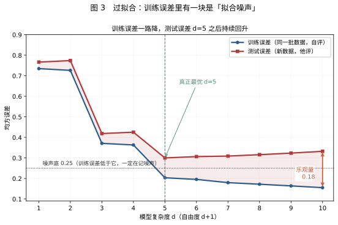
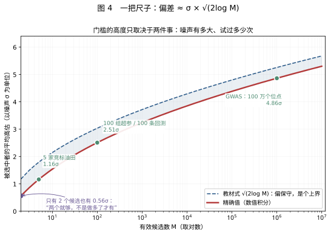

# 赢家诅咒：为什么“最好的那个”总是不如看起来那么好

1960 年代末，墨西哥湾的石油租约拍卖。几家石油公司对同一片海域各自做地震勘探、各自估价，出价最高的拿走开采权。几年后有人统计中标项目的回报率，发现它们系统性低于石油行业的资金成本——**赢了拍卖的公司，平均在亏钱。**

不是他们算错了地质数据。每一家的勘探报告单独看都没问题。问题出在“谁赢了”这件事上。

这就是赢家诅咒（winner's curse）。它后来被发现不是拍卖的特例，而是一切“先筛选、再估计”的场景的通用结构：筛出来的基金、上线后回落的 A/B 变体、复现失败的基因位点、样本内漂亮样本外崩掉的策略、训练集上完美测试集上平庸的模型——都是同一件事。

本文只讲这一条主线。所有例子、所有数字，都服务于同一个问题：

> **当你手上的这个观测，是从一堆候选中“赢”出来的，它还能直接当作对真值的估计吗？**

答案是不能，而且偏差有确定的方向和量级。全文分八节：前两节把机制算清楚（拍卖、显著性筛选），第三节说明它有多少个名字，第四节给出一把尺子，第五、六节讨论它意味着什么、怎么办，第七、八节是误解与速查。**非正态分布的影响放在最后的附录 A**，它是补充，不影响主线。

> **两篇的分工。** 本文只回答“偏不偏、偏多少、怎么办”，落点在统计推理与实务判断，不展开算法内部的推导。最大化的条件化证明、次高斯上界、honesty 的条件化恒等式、Neyman 正交性与 Double/Debiased ML 这些形式化的部分，见同目录的[《算法内部的选择—估计分离》](现代统计学习-选择与估计分离.md)。那一篇处理的是“一阶误差如何传播”，与本文的“同一份噪声被用了几次”是两条平行链——可以同时存在，也可以各自单独存在。本文第 3.2、3.6 与 6.2 节只在需要划清界限时提到它们。

> 文中全部数值由 `figures/make_winfig.py` 现算，没有从文献转录；改参数重跑即可，不要手改 SVG。

---

## 一、一笔能算清的账

### 1.1 设定

一片油田，真实价值 $`V`$ 事先不知道。行业根据地质资料给出的先验判断是：均值 100、标准差 20（单位：百万）。

你是竞标方之一。你派地质队做了勘探，得到一个读数 $`x`$。勘探有误差，读数围绕真值上下浮动 10 左右：

```math
x=V+\varepsilon,\qquad \varepsilon\sim N(0,\,10^{2})
```

现在你读到 $`x=115`$。这块地对你值多少？

### 1.2 第一层：只看自己，答案是 112

如果这次勘探是**随机抽出来的一次测量**，最优估计不是 115，而是 112：

```math
\mathbb{E}[V\mid x=115]=100+0.8\times(115-100)=112
```

那个 0.8 是“信号占多少”：先验的方差 400 除以总方差 400+100，等于 0.8。读数里混了噪声，所以真值应该比读数更靠近先验一点。噪声越小，这个系数越接近 1，你就越该相信读数。

**到这一步为止，一切正确。112 是一个无偏的、教科书式的答案。**

### 1.3 第二层：你不是随机的一个，你是赢家

关键的一步在这里：**你只有出价最高，才能拿到这块地。**

所以“我出 112 并且中标”这件事，本身就意味着：其他所有竞标者的读数都低于 112。

这件事是关于“你的读数偏高”的证据。

想清楚这个逻辑：油田的真实价值只可能是一个数。如果你的读数比真值高了 15，你就有很大概率报出全场最高价；如果你的读数比真值低了 15，你几乎不可能赢。**“我赢了”这个事实，把“我的噪声为正”变成了大概率事件。** 而 $`V=x-\varepsilon`$，噪声为正，$`V`$ 就偏小。

这就是全部机制。不需要博弈论，不需要心理因素，只需要注意到：**中标的那个读数，是从所有读数里挑出来的最大值。**

### 1.4 把“我赢了”算进去

同一批设定，只改变竞标人数 $`n`$：

| 竞标人数 $`n`$ | 条件于赢之后，油田的期望价值 | 出价 112 平均高估多少 |
|---:|---:|---:|
| 1（没有竞争） | 112.00 | 0.00 |
| 2 | 108.06 | 3.94 |
| 3 | 105.82 | 6.18 |
| 5 | 103.12 | 8.88 |
| 8 | 100.79 | 11.21 |
| 15 | 97.88 | 14.12 |
| 30 | 94.95 | 17.05 |

$`n=1`$ 时偏差严格为零——没有竞争，就没有“赢”这个事件，也就没有可条件化的东西。**这是检验你有没有用对公式的最好判据。**


左图是后验分布：不条件于输赢时中心在 112.00；条件于赢，$`n=5`$ 时移到 103.12，$`n=15`$ 时移到 97.88。橙色点划线是你打算出的价 112——在 15 家竞争的情形下，它已经落在后验主体之外。右图把高估幅度画成竞标人数的函数：人越多，赢家的读数里“运气”成分越大。

### 1.5 模拟一遍：人越多，亏得越多

把上面的设定跑 40 万次：每轮抽一个真实价值、抽 $`n`$ 个带噪声的读数、让读数最高的人按 112 的规则出价，再看他实际赚了多少。

| 竞标人数 | 天真出价者的期望利润 | 零利润出价者的期望利润 |
|---:|---:|---:|
| 2 | −4.53 | −0.015 |
| 4 | −8.24 | −0.001 |
| 8 | −11.40 | −0.014 |
| 16 | −14.13 | −0.003 |
| 32 | −16.56 | −0.000 |

第二列是假设每个人都正确地把“赢”这个条件算进去的结果——期望利润恰好为零，残差全在 2 个标准误以内，说明公式没写错。

两个容易漏掉的点：

**第一，正确打折只能把利润压到零，不能让你赚钱。** 这不是一个“学会就好”的技巧。在所有人都理性、信息对称的共同价值拍卖里，均衡状态下中标者的期望利润就是零。你能做的只是不亏。

**第二，现实中的折扣总是不足。** Bazerman 和 Samuelson 在 1983 年做过一个干净的实验：公开宣布罐内硬币的总面值，然后让人竞拍。正确答案就写在黑板上，被试依然系统性出价过高，赢家平均亏钱。这说明这个偏差不是“信息不足”造成的，而是**条件化的直觉盲区**——人很难把“我赢了”当成一条信息。Kagel 和 Levin 在 1986 年进一步发现：竞标人数从 3 增加到 6，亏损显著扩大；公布一些公共信息能缓解，但消不掉。

### 1.6 这一节只要记住一句话

> **112 回答的问题是“随便挑一个竞标者，当他的读数是 115 时，这块地值多少”。**
> **你需要回答的问题是“赢家的读数是 115 时，这块地值多少”。**

没有人算错。所有人都在用正确的公式回答错误的问题。这是赢家诅咒最常见的形态，也是它难以自查的原因：**错的不是公式，是公式所依附的那个参考集。**

---

## 二、把“最高价”换成“最显著”

### 2.1 同一个规则

拍卖里“赢”是出价最高；统计里“赢”是 $`p`$ 值最小。其余的完全一样。

设想 100 万个候选基因位点。每个位点的真实效应是 $`\beta`$，你从样本里估出 $`\hat\beta`$，除以标准误得到 $`Z`$ 值。只有 $`|Z|`$ 超过 5.45（对应双侧 $`p<5\times10^{-8}`$）的位点才会被写进论文。

**“过阈值”就是“赢”。**

现在的问题是：那些过了阈值的位点，报告的效应量平均比真值大多少？

### 2.2 三个具体读数

保持阈值 5.45 不变，只改真实效应 $`\delta=\beta/\sigma`$（真值是几个标准误）：

| 真实效应 $`\delta`$ | 检出概率 power | 报告值 $`\mathbb{E}[\lvert\hat\beta\rvert/\sigma\mid\text{过线}]`$ | 膨胀倍数 |
|---:|---:|---:|---:|
| 0（完全没用） | 0 | **5.62** | — |
| 1.0 | 0.000004 | 5.66 | ×5.66 |
| 3.0 | 0.007 | 5.78 | ×1.93 |
| 4.0 | 0.073 | 5.90 | ×1.47 |
| 5.0 | 0.326 | 6.11 | ×1.22 |
| 7.0 | 0.939 | 7.13 | ×1.02 |
| 10.0 | 1.000 | 10.00 | ×1.00 |

三个读数值得逐一停一下：

- **第一行**：真实效应是零，纯噪声。但只要它越过阈值被报告，平均报出来是 5.62——**比阈值本身还高**。这不是矛盾，是必然：能被选中的，都是噪声恰好偏大的那些。
- **第三行**：真实效应 3 个标准误，相当可观的效应。报告出来是 5.78，夸大了近一倍。
- **最后一行**：真实效应 10 个标准误，power 接近 1，报告值就是真值，没有偏差。

**膨胀的严重程度，完全由 power 决定。** power 越低，被选中的那些越是“靠运气过线”，报告值就越是钉在阈值附近，与真值脱钩。

### 2.3 为什么会这样：看一眼就懂

图 2 是同一件事的直接演示。造 2200 个候选位点，真实效应从 0 到 5 均匀分布，每个加上正态噪声算出一个 $`Z`$。灰色点是“做出来了但没过线”的，红色点是“过线了、会被报告”的。


看图时注意两件事：

1. **红色点全部在阈值线以上。** 这不用说。
2. **红色点形成的是一条几乎水平的带。** 横跨真实效应 3.2 到 5.0，但纵轴都在 5.5 到 7 之间。

第二条是关键。真实效应 3.2 的位点和真实效应 5.0 的位点，报出来的数几乎一样。**报告值主要由“过没过线”决定，而不是由真值决定。**

在这组设定里，被报告者的真实效应平均是 4.46，报告值平均是 5.93，虚增 1.47 个标准误。

（这组参数是为了把机制画清楚而设的，不代表任何真实研究的参数。真实 GWAS 里绝大多数位点的 $`\delta`$ 在 2 到 4 之间，过线比例远低于图上的 4%。）

### 2.4 反过来看：报告 5.7，真值可能是 1.9

如果只有报告值，能不能倒推真值？可以，用期望值反解：

| 报告值 | 反解出的真值 $`\delta`$ | 缩水幅度 |
|---:|---:|---:|
| 5.50 | **无解** | — |
| 5.60 | **无解** | — |
| 5.70 | 1.90 | 67% |
| 6.00 | 4.56 | 24% |
| 6.50 | 6.03 | 7% |
| 7.00 | 6.83 | 2% |
| 8.00 | 7.98 | 0.2% |

两个“无解”比任何一行数字都重要。纯噪声（$`\delta=0`$）过线后的期望报告值已经是 5.62，所以当你看到一个 5.5 或 5.6 的位点，它完全落在“纯噪声也能产生”的范围内。**数据无法区分这个位点是 $`\delta=0`$ 还是 $`\delta=2`$。** 这不是算法不够好，是信息量的硬边界。

5.7 那一行同样刺眼：报告 5.7 个标准误的位点，真值可能只有 1.9 个标准误，缩水三分之二，而它已经通过了最严格的显著性阈值。

### 2.5 一个反直觉的推论：阈值越严，高估越重

同一批数据、同一个真实效应，只改变报告标准：

| 真实效应 $`\delta`$ | $`p<0.05`$ 时报什么 | $`p<10^{-3}`$ 时报什么 | GWAS 阈值时报什么 |
|---:|---:|---:|---:|
| 2.0 | 2.77（×1.39） | 3.76（×1.88） | 5.71（×2.85） |
| 3.0 | 3.27（×1.09） | 3.99（×1.33） | 5.78（×1.93） |
| 4.0 | 4.05（×1.01） | 4.41（×1.10） | 5.90（×1.47） |
| 6.0 | 6.00（×1.00） | 6.01（×1.00） | 6.49（×1.08） |

真实效应是 3 个标准误时：用 $`p<0.05`$ 报告 3.27，只高估 9%；用 GWAS 阈值报告 5.78，高估 93%。

**为了压低假阳性而抬高阈值，会让“命中者”的效应量被高估得更厉害。** 这两件事可以同时发生：一个研究可以做到零假阳性，同时每一个报告出来的效应量都翻了一倍。这不是“多重检验校正做得不够”，恰恰相反，是做了校正之后的副作用。Ioannidis 2008 年的核心论点就在这里。

### 2.6 小结

拍卖和基因定位，一个用钱结算，一个用论文结算，结构完全一样：

| | 拍卖 | 显著性筛选 |
|---|---|---|
| 谁在“赢” | 出价最高者 | $`p`$ 值最小的那个 |
| 噪声是什么 | 勘探误差 | 抽样误差 |
| 被高估的是什么 | 油田的真实价值 | 该位点的真实效应 |
| 后果 | 中标即亏损 | 显著但复现不了 |

**判断某个现象是不是赢者诅咒，只需回答三个问题：谁在“赢”？噪声是什么？被高估的是什么？** 下面这张清单，就是把这套问题往十个场景里套一遍的结果。

---

## 三、它有多少个名字

### 3.1 一张清单

| 场景 | 谁在“赢” | 噪声来源 | 被高估的量 | 后果 |
|---|---|---|---|---|
| 石油租约 | 出价最高者 | 地质勘探误差 | 油田真实价值 | 中标即亏损 |
| 选基金 | 过去 3 年收益第一 | 3 年窗口的运气 | 基金经理的真实能力 | 买入后跑输 |
| A/B 实验 | 20 个变体里转化率最高 | 实验期随机波动 | 该变体的真实提升 | 全量上线后回落 |
| 招聘 | 面试表现最好的人 | 面试当天的状态 | 候选人真实水平 | 入职后落差 |
| 并购 | 出价最高的买家 | 对协同效应的估计误差 | 目标公司的真实协同价值 | 支付过高溢价 |
| IPO 申购 | 中签的不知情投资者 | 新股定价的不确定性 | 中签股票的真实价值 | 中签即亏，要求折价补偿 |
| 基因定位 | 最显著的那个位点 | 抽样误差 | 该位点的真实效应 | 复现失败 |
| 超参数搜索 | 验证集表现最好的那组 | 验证集的抽样波动 | 该组的真实泛化能力 | 上线后掉点 |
| 策略回测 | 样本内 Sharpe 最高的那条 | 历史区间的运气 | 该策略的真实收益率 | 实盘回撤 |
| 模型复杂度选择 | 训练误差最小的那个模型 | 训练集的噪声 | 它的真实预测能力 | 过拟合 |

前七行属于“自然替你完成选择”，后三行属于“你自己在搜”——但机制是同一个。

几条值得单独说：

**选基金。** 这是普通人最容易亲身遇到的版本。你看到某只基金三年收益排名第一，它大概率确实有不错的策略——但也大概率赶上了有利的市场环境。三年窗口结束的那一刻，正是“运气”这一项被最大化挑出来的时刻。Thaler 1988 年在《经济学展望杂志》的专栏里专门讲过这个。

**并购。** Roll 1986 年提出“自负假说”：在一个共同价值的资产上，出价最高的人必然是最乐观的那个人。注意，这不等于“CEO 愚蠢”。即使每个 CEO 都做了严谨的估值，只要估值的误差是独立的，中标者的估值误差就系统性地偏乐观。**偏差来自结构，不来自性格。**

**IPO 折价。** Rock 1986 年的模型更微妙：知情投资者只在新股被低估时申购，不知情者因此“配到即亏”。理性的不知情者会要求一个折价作为补偿——所以新股折价不是市场无效，而是市场对赢者诅咒的定价。这是一个把诅咒“算进价格里”的漂亮例子。

**Beavis effect。** 1994 年 Beavis 在玉米 QTL 实验中发现：显著的 QTL 其效应估计是真实值的数倍，样本越小越夸张。这在遗传学里被单独命名，但机制与上面每一行完全相同。

### 3.2 多重检验：亲戚，不是同一件事

这是最常被混淆的一对。

| | 多重检验 | 赢者诅咒 |
|---|---|---|
| 关心的问题 | 至少出现一个假阳性的概率 | 被选中者的估计偏差 |
| 手段 | 抬高阈值、控制 FWER/FDR | 换评价数据 |
| 只做一次检验时存在吗 | 不存在 | **存在**（只要有阈值筛选） |
| 校正之后会消失吗 | 会 | **不会，反而加重**（§2.5） |
| 一句话 | 守门 | 门内的人有多高 |

判据很简单：**去掉“多次”这个条件，现象还在不在？** 多重检验立刻消失，赢者诅咒还在——只要这一次检验是带阈值筛选的，它就在。

两者的关系是：多重检验负责“别放进来太多假货”，赢者诅咒负责告诉你“放进来的这批货，标价虚高多少”。**守门守得越严，门内那批货的标价越不可信。**

**另一个容易混淆的亲戚：正交化 / 双重机器学习。** 它处理的是另一件事——用机器学习估干扰参数时，估计误差会污染你要估的因果参数，那是**误差传播**问题，不是选择偏差。两者可以同时存在，也可以各自单独存在。**用了 DML 不等于消除了赢者诅咒**，因为它并没有改变“选择和评价用同一份噪声”这个结构。

这条链的推导（矩条件的一阶展开、Neyman 正交性、Robinson 残差化、二阶余项）见[《算法内部的选择—估计分离》](现代统计学习-选择与估计分离.md)第 9、10 两节。判断自己遇到的是哪一类，只看一个问题：**是“同一份噪声被用了两次”，还是“第一阶段的估计误差传进了第二阶段”？** 前者是本文，后者是那一篇。

### 3.3 过拟合：连续版的赢者诅咒

过拟合通常被当成“模型太复杂”，其实它是同一台机器。

把“候选”从离散的位点换成连续的参数：对每个复杂度 $`d`$，你都拟合出一个模型，然后挑训练误差最小的那个。**“训练误差最小”就是“赢”。**



设定：30 个样本点，噪声标准差 0.5（噪声底 $`0.5^2=0.25`$），用 1 到 10 阶多项式拟合同一个函数。

| 阶数 $`d`$ | 训练误差（自评） | 测试误差（他评） | 乐观量 |
|---:|---:|---:|---:|
| 1 | 0.735 | 0.767 | 0.032 |
| 3 | 0.371 | 0.418 | 0.048 |
| 5 | **0.203** | **0.300** | 0.097 |
| 7 | 0.180 | 0.309 | 0.129 |
| 10 | 0.155 | 0.332 | **0.177** |

三点：

1. **训练误差一路下降，测试误差在 $`d=5`$ 之后持续回升。** 多出来的那些参数，拟合的是噪声。
2. **训练误差从 $`d=5`$ 起就低于 0.25（噪声底）**，说明模型已经开始记忆噪声了。这是一条硬判据：**训练误差低于噪声方差，一定在过拟合，不管交叉验证多好看。**
3. 乐观量 0.177，与理论值 $`2p\sigma^2/n`$（$`p=d+1=11`$ 个参数，$`2\times11\times0.25/30=0.183`$）吻合。

**为什么说它是同一个机制？** 你从 10 个模型里挑了训练误差最小的那个，那个模型的误差里必然含着一次“负向的运气”——这跟挑出读数最高的那个竞标者，是同一件事。区别只在于：拍卖里候选是离散的 $`n`$ 个人，过拟合里候选是连续的 $`d`$ 条曲线。

一个被叫“模型太复杂”，一个被叫“选择偏差”，数学上都是 **argmax 的噪声**。

### 3.4 超参数搜索：最容易被低估的 M

网格搜索 100 组超参数，取验证集 AUC 最高的那组。

验证集 AUC 的标准误大约是 0.009（取决于验证集大小与正负样本比例）。100 组候选，被选中那组的期望虚增是 $`0.009\times2.51\approx0.023`$。

**这意味着：两组超参数的真实差距小于 0.023 时，你选谁基本靠运气。** 而你看到的那 0.02 的提升，恰好就在这个量级上。

这也是为什么“随机搜索往往不比网格搜索差”——不是随机搜索更聪明，而是**网格搜索多出来的那些候选并没有提供你想要的信息**，只是把 $`M`$ 抬高了。

### 3.5 回测：M 最大，而且通常不被记录

金融是这个问题最严重的地方，原因有三：样本短（$`\sigma`$ 大）、搜索空间大（$`M`$ 大）、搜索过程不留痕迹（$`M`$ 数不清）。

年化 Sharpe 的估计标准误，在收益率近似独立同分布、真实 Sharpe 接近零时约 $`1/\sqrt{T}`$。五年数据：$`1/\sqrt5=0.447`$。

| 回测年数 | $`\sigma_{SR}`$ | 试 10 个策略 | 试 100 个 | 试 1000 个 |
|---:|---:|---:|---:|---:|
| 2 | 0.71 | 1.09 | 1.77 | 2.29 |
| 3 | 0.58 | 0.89 | 1.45 | 1.87 |
| 5 | 0.45 | 0.69 | **1.12** | 1.45 |
| 10 | 0.32 | 0.49 | 0.79 | 1.02 |

**5 年数据、试 100 个策略，最好的那条曲线的期望 Sharpe 是 1.12——而这段历史里完全没有 alpha。**

这个数不是拟合出来的，是极值分布的算术结果。它大概也是很多“实盘前看起来很神”的策略的真实来源。

反着读也有用：**只试过 10 个策略、有 10 年数据，门槛是 0.49**——这时 Sharpe 1.0 才真正有信息量。

**三个放大器。** 第一，$`M`$ 不被记录：改了参数重跑、觉得不好再删掉，这些全计入 $`M`$，而研究者的自述 $`M`$ 通常严重低估。第二，$`\sigma`$ 大：金融样本短、信噪比低，这是回测过拟合比一般机器学习过拟合更严重的原因。第三，选择维度是乘积：5 个因子 × 10 个窗口 × 5 个止损 × 3 个仓位 = 750 组，而且往往分阶段做，每一阶段都是一次新的选择。

**有效试验数可能远小于名义值。** 有人做过模拟：在零漂移的随机游走上跑双均线，快线 2–28 天、慢线 20–210 天，共 275 组合法参数，每条独立价格路径上取最优。若按 275 次独立试验算，预期最大 Sharpe 应明显高于实测值；实测只有理论预期的一半左右。原因是参数高度相关——10 日/200 日和 12 日/200 日不是两个想法，是同一个想法的两次抖动。那组实验里平均两两相关约 0.65，275 组大约只相当于 10 次独立试验。

好消息是 $`M_{\text{eff}}`$ 比名义 $`M`$ 小，偏差没那么吓人；坏消息是**你通常不知道 $`M_{\text{eff}}`$ 是多少**，而它决定偏差的大小。

**把 $`M`$ 折进基准。** Bailey 与 López de Prado (2014) 的做法不是修正 Sharpe，而是换基准：不问“Sharpe 是否大于 0”，而问“Sharpe 是否大于 $`M`$ 次试验下纯噪声能产生的最大值”（Deflated Sharpe Ratio）。式子和第四节那把尺子是同一个。

**行业门槛为什么在往上走。** Harvey, Liu 与 Zhu (2016) 综述数百个已发表因子后提出：考虑研究者的搜索强度，新因子的 $`t`$ 值门槛应该从 2.0 提到 3.0。这不是统计学的新发现，是同一把尺子的直接应用。

### 3.6 算法内部：偏差不只在“分析结果”上

这一点容易被忽略：选择偏差不只发生在你分析结果的时候，它嵌在算法内部。

**DQN 的最大化偏差。** 强化学习里，DQN 的目标是 $`r+\gamma\max_a \widehat Q(s',a)`$。这个 $`\max`$ 同时干了两件事：选出动作、报出它的价值。而 $`\widehat Q`$ 有估计误差，所以 $`\max_a \widehat Q`$ 系统性地高于真实的 $`\max_a Q^\star`$。

只有两个动作时高估就有 $`0.56\sigma`$，四个动作 $`1.03\sigma`$，十个动作 $`1.54\sigma`$。而且它随每一次 bootstrap 反复发生、通过 Bellman 更新累积下去。

Double DQN 的改动只有一处：**让在线网络决定“选哪个动作”，让目标网络只负责“评价这个动作”。** 一个选、一个评，噪声就不再共用。注意一个常见误解：目标网络在 DQN 里本来就有，Double DQN 不是“新增第二个网络”。

**因果森林的 honesty。** 决策树在建树时要搜索切分点，让节点内损失最小——这也是 argmax。普通随机森林同样有这个偏差，但它可以用观测到的 $`Y`$ 在新样本上直接检验预测效果；因果森林要估的是个体处理效应，而个体的两个潜在结果不可同时观测，没法直接验。所以因果森林把样本拆成两半：一半选切分结构，一半估叶内效应（honesty）。这就是 6.2 节要讲的“分开”。

**cross-fitting 与 nested CV。** 交叉验证选模型时，如果“选模型”和“报性能”用的是同一批数据，报出来的性能就是虚高的。做法是把评价放到外层：内层选模型，外层用没参与选择的折报告性能（nested CV），或者用 K 折轮流做袋外预测（cross-fitting）。

这一节只给结论。DQN 的目标式与条件证明、普通随机森林与因果森林的对照、honesty 的条件化恒等式、cross-fitting 的折构造与分折禁忌，在[《算法内部的选择—估计分离》](现代统计学习-选择与估计分离.md)第 3 至 8 节逐条展开。

### 3.7 三个问题，识别任何场景

碰到一个新场景，问三句话就够了：

1. **谁在“赢”？** 是出价最高的人、$`p`$ 值最小的位点、验证集最好的模型，还是样本内 Sharpe 最高的策略？
2. **噪声是什么？** 勘探误差、抽样误差、验证集波动、历史区间的运气？
3. **被高估的是什么？** 是“赢家”本身的价值，还是“赢家比其他人好多少”？

第三问最容易被漏掉。**你要的往往不是“赢家有多好”，而是“赢家比第二名好多少”**——后者的偏差更大，因为两个带噪估计相减，噪声会叠加。

---

## 四、它有多大：一把尺子

### 4.1 只有两个候选，偏差就有 0.56 个标准差

先破一个常见的误会：这不是“候选太多才有”的问题。

两个候选、取较大的那个，其期望值比单个候选的均值高 $`0.56\sigma`$（精确值 $`1/\sqrt\pi=0.564`$）。**只要存在比较，偏差就存在。** 候选变多只是把它放大。

### 4.2 一般情形：噪声 × 搜索规模

把候选数记为 $`M`$，噪声标准差记为 $`\sigma`$，被选中者的平均高估可以近似写成

```math
\text{偏差}\;\approx\;\sigma\sqrt{2\log M}
```

这个式子只要记住两件事：**偏差和噪声同比例**（噪声翻倍，偏差翻倍）；**偏差随 $`M`$ 增长得很慢**（对数）。$`M`$ 从 100 涨到 100 万，只多了约一倍。（式中的 log 是自然对数；换成以 2 为底只是差个常数。）



| 场景 | 噪声 $`\sigma`$ | 候选数 $`M`$ | 平均高估 | 要有把握选对，真实差距至少 |
|---|---|---:|---:|---|
| 5 家公司竞标油田 | 10（百万） | 5 | 1.16σ ≈ 12 | 约 12（百万） |
| 100 组超参数 | 0.009（AUC 的 SE） | 100 | 2.51σ ≈ 0.023 | AUC 差 0.023 |
| 5 年 100 条回测 | 0.45（Sharpe 的 SE） | 100 | 2.51σ ≈ 1.12 | Sharpe 差 1.1 |
| GWAS 全基因组 | 1（Z 尺度） | 100 万 | 4.86σ | δ 约 5 |

这张表最有用的一列是最后一列：**它告诉你，在你的场景里，真实差距要多大才配得上“谁赢”这个判断。** 如果真实差距小于它，你看到的排名基本是噪声排的。

顺带说清一个容易混淆的地方：表里 GWAS 那一行是 4.86σ，而 §2.2 说纯噪声过线后平均报 5.62。这两个数不矛盾，问的是两件事——4.86 是“100 万个噪声里最大的那个”的平均值；5.62 是“已经越过 5.45 的那些”的平均值。后者的条件更强，所以更高。

### 4.3 三个用法

**用法一：反推你实际搜了多少。** 如果你看到的最大值是 3 个标准差，反解 $`\sqrt{2\log M}=3`$ 得 $`M\approx90`$。换言之，一个 $`t=3`$ 的结果，只有在“你总共只认真试过 90 个左右的东西”时才站得住。这也解释了 Harvey–Liu–Zhu 为什么把门槛提到 3.0：现实中没有人只试过七个（$`t=2`$ 对应 $`M\approx7`$）。

**用法二：判断排名能不能信。** 真实差距小于上表最后一列时，排名不可信；大于它时，排名基本可靠，但那个“第一名”的数值仍然偏高——**排序对，标尺错**（见 §5.5）。

**用法三：判断能不能忽略。** 当真实差距远大于 $`\sigma\sqrt{2\log M}`$ 时，噪声改变不了排序，偏差可以不管。这是少数可以放心的情形。

### 4.4 两个必须说清的提醒

**第一，$`\sqrt{2\log M}`$ 偏保守，它是个上界，不是等式。** $`M=100`$ 时它给 3.03，精确值是 2.51，高估 21%；$`M=2`$ 时它给 1.18，精确值是 0.56，高出一倍多。用它做判断是安全的（宁可高估），但不要把它当精确公式引用。表里的数用的是精确值。

**第二，$`M`$ 要用“有效候选数”，不是名义候选数。** 高度相关的候选不算独立候选。回测里 275 组参数可能只相当于 10 次独立试验；深度学习里超参数近似连续，$`M`$ 根本数不清。**这是这把尺子最大的软肋：它要求你知道一个你通常不知道的数。**

---

## 五、它暴露了什么问题

前面都是算术。真正值得想的是它暴露的七个问题。

### 5.1 样本不是自然界给你的事实，而是筛选的产物

经典统计的隐含图像是：自然界按某个分布吐出数据，我们接收，然后推断参数。样本被当作既定的输入。

赢者诅咒说：不是的。**你手上的这批数据，经过了至少一道门。**

门是谁开的、开多大、按什么标准筛，是数据生成过程的一部分。一个模型可以把“数据服从正态分布”“估计量无偏”每一个字都写对，却仍然错得离谱——因为它漏掉了“这些数据是先过了一道门才到我手上的”。

这也是为什么这个偏差不能用“更精确的估计量”修掉。它不是估计环节的问题，是**数据到达你手上这个环节**的问题。

### 5.2 偏差不是估计量的属性，是“估计量 + 参考集”的属性

这是全篇最硬的一条。

同一个 $`\hat\beta`$ 这一个数，在“全体位点”上的分布，和在“显著位点”上的分布，是两个不同的分布。它在第一个分布下的均值等于真值，在第二个分布下的均值大于真值。

所以“这个估计量有没有偏”这个问题，如果不指定参考集，是没有答案的。

看拍卖那个例子：112 在“随机一个竞标者”的参考集里完全无偏，在“15 家竞争的赢家”这个参考集里高估 14。**两个陈述都为真，因为它们是关于两个不同分布的陈述。**

统计学里管这个叫**条件化**。Cox 1958 年提出的条件化原则是：如果一个事件与待估参数独立、但携带关于参数的信息，推断就应该条件于这个事件，而不是把它平均掉。“我赢了”完全符合这个描述：给定真实价值，赢或输是随机的；但一旦知道赢了，关于价值的推断必须改变。

**所以“赢者诅咒是不是一种偏差”这个问法本身是不完整的。** 更准确的说法是：它是**条件化对象的错配**——你用“全体”的分布去解释一个“被筛过”的观测。

这也解释了为什么它难以自查：错的不是公式，是公式所依附的那个参考集，而参考集不在数据里，在你的头脑里。

### 5.3 $`p`$ 值回答“有没有”，不回答“有多少”

Fisher 设计显著性检验时，本来就没打算让它给出效应量。它的任务是回答“如果零假设为真，出现这么极端的数据的概率有多大”。这是**反证**的逻辑，不是**度量**的逻辑。

把 $`p`$ 值当成效应大小的证据，是范畴错误。在筛选场景下，这个错误会被放大到荒谬的程度：当真实效应远小于阈值时，报告值几乎钉在阈值附近，**几乎等于阈值本身，与真值无关**。Göring 等人在 2001 年的原话是 "can even be virtually independent of the true effect size"。

此时你看到 $`Z=5.6`$，它告诉你零假设极不可能是对的；但“5.6 个标准误”这个数，几乎不告诉你效应有多大——纯噪声过线也能报出 5.62。**存在性与大小彻底分离了。**

这是很多“显著但复现不了”的研究的根本原因：显著性是真的，效应量是筛出来的。

### 5.4 贝叶斯不是免死金牌

一个常见的回避方式是“我们用贝叶斯，不做 $`p`$ 值”。这不够。

**平坦先验 + 忽略选择。** 后验基本等于似然，高估照旧。原因很微妙：平坦先验在**全体参数空间**上是平的，但在“被选中的那个子集”上不是平的——选择事件本身已经给参数加了权重。忽略它，等于少乘了一个因子。

**用文献值做先验。** 更糟。文献里的效应量已经被赢者诅咒污染过一轮，用它做先验，等于把前一次的偏差当成这一次的知识。偏差会自我复制，而且看起来很有依据。

**用全体候选估计边际分布（经验贝叶斯）。** 这是对的。Efron 的 Tweedie 公式说：如果你知道所有候选（包括没被选中的）的估计值分布，就能直接算出每个观测值的后验均值，收缩量自动随观测值的位置调整。妙处在于它不需要你写出选择机制。

结论值得单独记一句：

> **决定你会不会重蹈覆辙的，不是用频率派还是贝叶斯，而是你把哪些数据放进了推断。**
> **如果只把“赢家”喂给模型，任何算法都会给出偏大的答案。**

### 5.5 决策正确 ≠ 数值正确

这是最容易被忽略、也最实用的一条。

你从 20 个 A/B 变体里选了转化率最高的那个上线。这个**选择**可能是完全正确的——它确实是期望最高的那个。错的只是你以为它的提升是 +3.2%，而实际可能只有 +0.8%（这两个数是示意的）。

**排序可以是对的，标尺是错的。**

大部分时候这没关系：你要的就是“选最好的那个”。但有两种情况会要命：

**一，当你用估计值做阈值决策。** 如果规则是“提升超过 2% 才上线”，那么标尺错会直接导致决策错——你上线了一个实际只有 0.8% 的变体，还可能挤掉了真正更好的那个。

**二，当你用估计值做承诺。** 预算、产能、招人计划都按 +3.2% 排，实际来 0.8%，全线失配。

拍卖把这个道理推到极致：$`n=30`$ 时你出 112 拿到标的，在竞争意义上**完全理性**——不出这个价你就拿不到。但平均亏 17。

**理性竞争与系统性亏损可以共存。** 这正是“诅咒”这个词的含义：不是有人犯了错，而是结构本身让参与者集体受损，而每个人单独看都做了正确的事。

### 5.6 文献不是自然界的样本，是可发表性的样本

数据层筛一次，期刊层再筛一次。你读到的每一个“显著发现”，都是两次筛选的结果。

叠加之后会发生什么？**meta 分析的汇总值也会偏高**，除非它专门对发表偏倚建模（漏斗图、p-curve、PET-PEESE 之类）。因为它的输入全是筛过的数。

这解释了一件常被误解的事：**复制危机的主要来源不是造假。** 两批独立数据各自筛选，筛出来的数都偏大，方向一致、幅度不同——于是出现“原始研究报告 2 倍，复制研究只有 1.3 倍”这样的落差。两边都没有作弊，这是筛选的必然结果。

推论可以写成一句话：

> **你读到的“平均效应量”，衡量的是“能被发表的效果的分布”，不是“自然界的效应的分布”。**

### 5.7 有些问题，数据本身回答不了

回到那个报告 5.5 个标准误的位点。它的真值可以是 0，也可以是 2，数据无法区分。

这不是方法不够精巧。任何更聪明的估计量，输入都是同一批数据，都跨不过这个信息边界。**可识别性有硬上限。**

统计的诚实不在于给出一个数，而在于说清这个数能承受到什么程度。这也是为什么 Zöllner 和 Pritchard 在提出修正方法时，明确主张报**置信区域**而不是单点估计——他们知道自己能给出什么，也知道自己给不出什么。

---

## 六、怎么办：把选择和估计分开

### 6.1 一句话版本

**换一批没被筛过的数据去量。**


### 6.2 六种分法

| 做法 | 怎么分 | 能消除偏差吗 | 代价 |
|---|---|---|---|
| 独立样本重估 | 另做一次研究/实验 | 能 | 成本；发现可能不复现 |
| 样本分割 | 一半选，一半评 | 能（在评价集上） | 每半数据变少，方差变大 |
| honesty（因果森林） | 一半选结构，一半估效应 | 能 | 同上；树要更多 |
| cross-fitting（K 折袋外） | 轮流：用其余折选，用这一折评 | 能（在折独立时） | 计算量；折不能按依赖结构乱切 |
| nested CV | 内层选模型，外层报性能 | 能 | 计算量成倍 |
| Double Q | 一个网络选动作，另一个评价 | 大幅减弱，通常不宣称归零 | 两套估计仍共享训练轨迹 |

前三行是“换数据”，后三行是“换角色”。共同点只有一个：**让“挑”和“量”用的不是同一份噪声。**

必须说清边界：Double Q 的在线网络与目标网络共享训练轨迹，只是没有共享当次噪声，所以只能说减弱；cross-fitting 要求分折按依赖结构切（时间序列不能随机切）；honesty 解决的是自适应估计，**不会自动解决未观测混杂**——因果推断的可识别性要靠另外三个条件（一致性、条件可忽略性、重叠性）。

这几条边界的完整推导（含“条件无偏 ≠ 无条件无偏”的证明、honest tree 的假异质性机制、K 折 OOF 的构造）见[《算法内部的选择—估计分离》](现代统计学习-选择与估计分离.md)。本文只需记住一句：**分开能切断噪声复用，不能替代识别假设。**

### 6.3 预注册与“记录 M”

预注册不改变统计结构，但改变一件关键的事：**它让选择规则在你看到数据之前就定死了。** 这样选择事件与数据独立，偏差的来源被切断。代价是它只能防未来，救不了已有数据。

对已经做完的分析，最有用的补救是**如实记录 $`M`$**：包括所有没写进论文的尝试、所有改完重跑的版本、所有“看了一眼就否掉”的方向。数不清 $`M`$，就没有任何修正方法能救你。

### 6.4 修正方法的可靠性排序

“换数据”那两类最可靠，因为它们不依赖任何模型假定。其余方法都只在模型写对时成立：

| 方法 | 能消除偏差吗 | 需要什么 | 代价 |
|---|---|---|---|
| 条件似然修正 | 大幅降低，不能消除 | 已知完整的选择规则 | 依赖模型假定；区间变宽 |
| 经验贝叶斯收缩 | 收缩，不是消除 | 全体候选的估计（含未入选） | 需要较多候选 |
| 矩匹配反解 | 部分 | 同上 | 阈值附近无解 |
| 后选择推断 | 不修点估计，修区间 | 能写出的选择事件 | 区间宽；计算量大 |

最后一行值得单独解释：Lee 等 (2016) 的做法是不修点估计，而是构造**条件于选择事件**的精确区间——把“被选中”写成一个约束，然后在截断分布下算区间。区间通常更宽、不对称，但覆盖率是名义的。这类方法诚实的地方在于：它承认点估计修不了。

### 6.5 五个无效做法

- **加大样本量。** 只在它能提高 power 时有帮助。膨胀倍数里根本没有 $`n`$ 这个符号。
- **用更严的阈值。** 反而加重（§2.5）。
- **控制 FDR / FWER。** 解决的是另一个问题（§3.2）。
- **在同一批数据上重算 $`p`$ 值、做 bootstrap。** 条件化还在，做什么都在。
- **把校正公式套到未筛选的估计上。** 这会人为引入向下的偏差，把本来无偏的估计改坏。这是实际分析里最常见的误用。

---

## 七、五个常见误解

**① “这是多重检验问题。”**

不是。判据：只做一次检验时，它存在吗？多重检验不存在，赢者诅咒存在——只要这一次检验是带阈值筛选的。更刺眼的是方向：控制 FWER/FDR 的做法是抬高阈值，而抬高阈值会让赢者诅咒**更严重**。一个研究可以同时做到“零假阳性”和“所有报告效应量高估一倍”。

**② “样本大了自然就好了。”**

只对了一半。正确的因果链是：样本大 → 标准误小 → $`\delta`$ 大 → power 高 → 膨胀小。$`n`$ 是通过 power 间接起作用的，没有独立作用。如果某个领域的真实效应量随样本量增长而同步变小（探索性研究里很常见），$`\delta`$ 可以长期停在 2 到 4 之间，那么无论样本多大，偏差都在。

**③ “这就是回归到均值。”**

相关，但不是同一件事。判据还是那个：去掉“筛选/竞争”这一步，现象还在不在？回归到均值还在（只要按第一次测量分组就会出现，不需要选择规则）；赢者诅咒不在（$`n=1`$ 时偏差严格为零）。

**④ “所以这个发现是假的。”**

不是。它只说明**报告值偏高**，不说明效应为零。一个被高估两倍的效应，完全可能是真实存在的。这两件事必须分开说，否则会走向另一个极端——把所有显著结果都当成噪声。

**⑤ “用机器学习 / 贝叶斯就不会有这个问题。”**

问题在数据，不在算法。你把“赢家”喂给任何模型，它都会忠实地告诉你赢家有多好。要改的是喂什么，不是怎么算。

---

## 八、一页速查

| 问题 | 回答 |
|---|---|
| 偏差从哪来 | 估计与筛选用了同一份噪声，估计量的分布被截断在“赢”这个事件上 |
| 偏差有多大 | 约 $`\sigma\sqrt{2\log M}`$；两个候选就有 0.56σ |
| 什么时候最危险 | power 低于 0.2 的发现；刚过线的发现；候选极多且 $`M`$ 数不清的筛选 |
| 大样本能解决吗 | 只能通过提高 power 间接缓解 |
| 更严的阈值能解决吗 | 不能，反而加重 |
| 多重检验校正能解决吗 | 不能，那是另一个问题 |
| 最可靠的办法 | 独立样本重估，且复制时不按显著性筛 |
| 最容易被忽略的 | 排序对不代表数值对；校正后的点估计不确定性更大 |
| 一句话记住 | 你能看到的数据是被一道门筛过的；用它们估计“被筛出来的人有多强”，答案必然偏大 |

---

## 附录 A（补充）：如果噪声不是正态的

> 这一节是补充。主线结论——**存在性、方向、以及“换数据才能修”**——不依赖任何分布假设。依赖分布的只有偏差的**具体倍数**。如果你只关心“该怎么办”，可以跳过。

### A.1 三层回答

| 层次 | 是否依赖分布 | 说明 |
|---|---|---|
| 偏差存在、方向由选择规则决定 | **不依赖** | 偏好大值就高估，偏好小值就低估 |
| 偏差的**量级** $`\sqrt{2\log M}`$ 型 | 只依赖“薄尾” | 正态、$`t(30)`$ 都算薄尾；指数型尾变成 $`\log M`$ 型；幂律尾更陡 |
| 具体系数（4.86σ、2.51 等） | **依赖** | 换分布最多能差 30 倍 |

一句话：**“会不会偏”与分布无关；“偏多少”与分布有关。**

### A.2 一个量就能排序：局部尾厚度

对候选数 $`M`$，定义工作点 $`x^\ast`$ 为“大约每 $`M`$ 个候选才出现一次”的那个值，再定义

```math
r=\frac{\text{在该点以上的概率}}{\text{在该点的密度}}
```

$`r`$ 度量的是“尾巴有多厚”：$`r`$ 小说明尾巴迅速衰减，$`r`$ 大说明远处还有大量概率。同一个 $`M=100`$ 万下：

| 分布 | $`r`$ | 平均高估 |
|---|---:|---:|
| 均匀（有界） | ≈0 | 1.73σ |
| 正态 | 0.20 | 4.86σ |
| $`t(30)`$ | 0.36 | 5.87σ |
| Logistic | 0.55 | 7.94σ |
| 指数 | 1.00 | 14.39σ |
| $`t(5)`$ | 4.99 | 22.35σ |
| Pareto(3) | 33.3 | 157σ |
| $`t(3)`$ | 34.4 | 80.7σ |


**排序大体由 $`r`$ 决定**，与“属哪个极值类型”关系不大。这一点有实际意义：你不需要判断数据属于哪个渐近族，只需要知道尾巴厚不厚。

有一处例外值得知道：Pareto(3) 的 $`r`$ 略低于 $`t(3)`$，倍数却高出一倍。原因是表里按各自的标准差归一化，而 Pareto(3) 的 σ 只有 0.87（$`t(3)`$ 是 1.73）——**重尾会把 σ 自己撑大，用它归一化会系统性地低估相对偏差。** 原始尺度上，两者的期望最大值几乎相同（136 对 139.5）。

### A.3 什么时候不必担心

常见的担心是“我的数据稍微偏离正态，结论还成立吗”。答案是：**轻微污染几乎无影响，因为要影响结果，重尾点必须有机会成为最大值。**

设混入重尾成分的权重是 $`\epsilon`$，候选数 $`M`$，起作用的门槛大约是 $`\epsilon M`$ 要接近 1 到 10。$`M=10^6`$ 时，$`\epsilon`$ 要在 $`10^{-5}`$ 到 $`10^{-4}`$ 量级才开始明显抬升结果；$`\epsilon=10^{-8}`$ 完全无所谓。

反过来说：**“大体正态”在很多场合确实够用，但理由不是“中心极限定理”，而是“污染权重的量级不够”。** 这两句话的区别在于，后者告诉你什么时候会失效——当你做的是百万级、千万级的筛选时。

### A.4 顺带一提：阈值本身也是按正态算的

$`5\times10^{-8}`$ 这个数，是 $`\Phi^{-1}`$ 算出来的。如果真实的零分布尾巴比正态厚，同一个 5.45 的实际水平会差很远：$`t(30)`$ 下是 $`6.5\times10^{-6}`$，是名义值的 130 倍；要维持 $`5\times10^{-8}`$ 得用 7.21。

而中心极限定理在这里帮不上忙：Berry–Esseen 的误差界在 $`n=10^4`$ 时是 $`5\times10^{-3}`$，比你要估的 $`5\times10^{-8}`$ 大五个数量级。**CLT 能为 2σ 背书，不能为 5σ 背书。**

### A.5 一句话

**换分布，倍数会变，机制不变。** 该做的事还是那一件：把选择与估计分开。

---

## 参考文献

**原始与经济学**

1. Capen, E. C., Clapp, R. V., & Campbell, W. M. (1971). Competitive bidding in high-risk situations. *Journal of Petroleum Technology*, 23(6), 641–653.
2. Wilson, R. (1977). A bidding model of perfect competition. *Review of Economic Studies*, 44(3), 511–518.
3. Bazerman, M. H., & Samuelson, W. F. (1983). I won the auction but don't want the prize. *Journal of Conflict Resolution*, 27(4), 618–634.
4. Kagel, J. H., & Levin, D. (1986). The winner's curse and public information in common value auctions. *American Economic Review*, 76(5), 894–920.
5. Thaler, R. H. (1988). Anomalies: The winner's curse. *Journal of Economic Perspectives*, 2(1), 191–202.
6. Rock, K. (1986). Why new issues are underpriced. *Journal of Financial Economics*, 15(1–2), 187–212.
7. Roll, R. (1986). The hubris hypothesis of corporate takeovers. *Journal of Business*, 59(2), 197–216.

**统计学与遗传学**

8. Cox, D. R. (1958). Some problems connected with statistical inference. *Annals of Mathematical Statistics*, 29(2), 357–372.
9. Beavis, W. D. (1994). The power and deceit of QTL experiments. *Proceedings of the 49th Annual Corn and Sorghum Industry Research Conference*, 250–266.
10. Göring, H. H. H., Terwilliger, J. D., & Blangero, J. (2001). Large upward bias in estimation of locus-specific effects from genomewide scans. *American Journal of Human Genetics*, 69(6), 1357–1369.
11. Zöllner, S., & Pritchard, J. K. (2007). Overcoming the winner's curse: estimating penetrance parameters from case-control data. *American Journal of Human Genetics*, 80(4), 605–615.
12. Ioannidis, J. P. A. (2008). Why most discovered true associations are inflated. *Epidemiology*, 19(5), 640–648.
13. Efron, B. (2011). Tweedie's formula and selection bias. *JASA*, 106(496), 1602–1614.
14. Lee, J. D., Sun, D. L., Sun, Y., & Taylor, J. E. (2016). Exact post-selection inference, with application to the lasso. *Annals of Statistics*, 44(3), 907–927.

**机器学习与量化**

15. van Hasselt, H., Guez, A., & Silver, D. (2016). Deep reinforcement learning with double Q-learning. *AAAI-16*.
16. Athey, S., Tibshirani, J., & Wager, S. (2019). Generalized random forests. *Annals of Statistics*, 47(2), 1148–1178.
17. Chernozhukov, V., et al. (2018). Double/debiased machine learning for treatment and structural parameters. *Econometrics Journal*, 21(1), C1–C68.
18. Bailey, D. H., & López de Prado, M. (2014). The deflated Sharpe ratio. *Journal of Portfolio Management*, 40(5), 94–107.
19. Harvey, C. R., Liu, Y., & Zhu, H. (2016). … and the cross-section of expected returns. *Review of Financial Studies*, 29(1), 5–68.

> 两处常见口径错误：Göring 2001 的第三作者是 **Blangero**，不是 Ott；$`p<5\times10^{-8}`$ 对应双侧 $`|Z|=5.4517`$，不是 5.0（按 5.0 算会低估膨胀量约 8%）。

---

*全部数值由 `figures/make_winfig.py` 现算：E[max] 用数值积分 $`\int z\,M\varphi(z)\Phi(z)^{M-1}\mathrm{d}z`$，筛选场景用截断正态的精确条件期望，过拟合用 600 次重复的蒙特卡洛。改参数后重跑即可，不要手改 SVG。*
