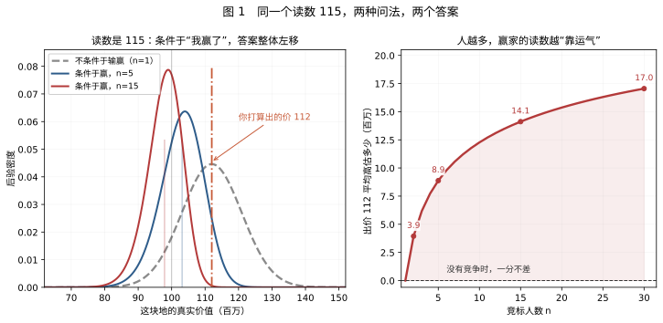
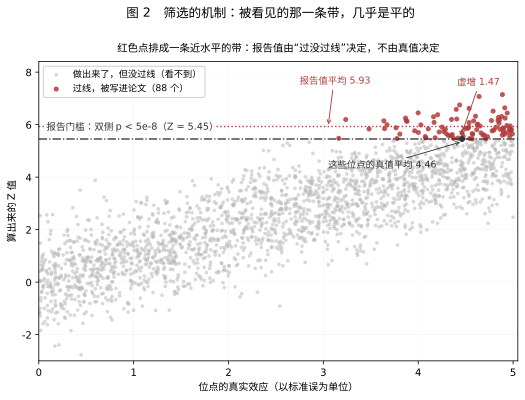
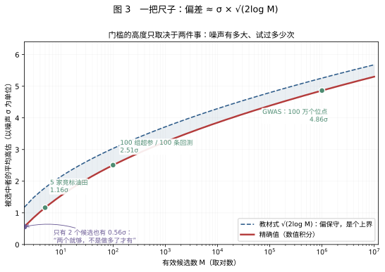
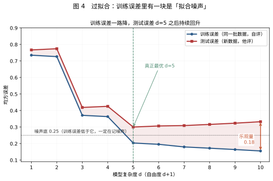
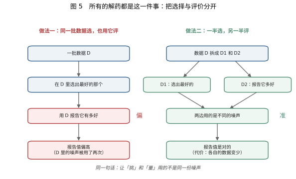
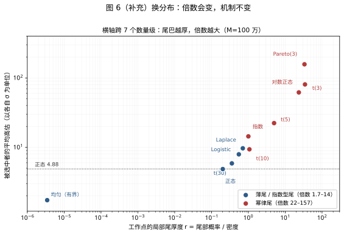

# 选择与估计分离

> 当同一份噪声既参与“选出谁”，又参与“他值多少”，被选出者的估计就会系统性地偏向有利噪声。

1960 年代末，墨西哥湾的石油租约拍卖。几家石油公司对同一片海域各自做地震勘探、各自估价，出价最高的拿走开采权。几年后有人统计中标项目的回报，发现它们系统性低于石油行业的资金成本——**赢了拍卖的公司，平均在亏钱。**

每家公司的勘探报告单独看都没有问题。问题出在“谁赢了”这件事上：中标者的读数，是从所有读数里挑出来的最大值。

这就是赢家诅咒。它后来被发现不是拍卖的特例，而是一切“先筛选、再估计”场景的通用结构：筛出来的基金、上线后回落的 A/B 变体、复现失败的基因位点、样本内漂亮样本外崩掉的策略、训练集上完美测试集上平庸的模型，都是同一件事。修法只有一句话：**把选择与估计分开。**

本文有两个主角。一个是上面这场拍卖——它讲清机制；另一个是量化读者每天面对的场景：**你试了 100 条策略、各跑 5 年回测，挑出样本内 Sharpe 最高的那条，它的期望 Sharpe 是 1.12——而这段历史里可以完全没有 alpha**（§4.5 会算出这个数从哪来）。拍卖的主角是“别人替你选”（市场完成选择），回测的主角是“你自己搜”（选择过程不留痕迹、还常被低估）；两个主角在 §4 合流成同一把尺子，在 §11 各自收尾。

全文围绕这一条线，分四部分：

| 部分 | 回答的问题 | 主要小节 |
|---|---|---|
| 一、机制 | 偏差从哪里来 | §1 拍卖 · §2 显著性筛选 · §3 一般形式 |
| 二、量级与识别 | 偏多少，怎么认出来 | §4 一把尺子 · §5 十个名字与三个邻居 |
| 三、分离 | 怎么修 | §6 六种分法 · §7 算法内部 |
| 四、后果 | 它改变了哪些看法 | §8 四类误差 · §9 四条假设 · §10 清单 |

这个结构有意只讲一条链：**“同一份噪声被用了两次”。** 另一条容易被混进来的链——用机器学习估干扰参数时，第一阶段的估计误差一阶传进第二阶段——放在附录 B。它同样是一种“分离”，但修法（正交得分）与主线几乎不重叠，放在正文会同时稀释两边。判断遇到的是哪一条，只看一个问题：**是同一份噪声用了两次，还是第一阶段误差传进了第二阶段？**

数值全部由 `figures/make_winfig.py` 现算，没有从文献转录。若只想要结论与做法，读 §4、§6、§10。

**先统一符号**，后文不再重复解释：

| 符号 | 含义 | 备注 |
|---|---|---|
| $`M`$ | 候选个数 | 竞标人数、位点数、模型数、策略数都记作 $`M`$ |
| $`\sigma`$ | 单个候选的估计噪声标准差 | 与 $`\theta`$ 同单位 |
| $`\theta,\ \widehat\theta`$ | 真实值与估计值 | $`\widehat\theta=\theta+\varepsilon`$ |
| $`\varepsilon`$ | 估计误差 | 默认 $`\mathbb{E}[\varepsilon]=0`$ |
| $`J`$ | 被选中的编号 | $`J=\mathrm{argmax}_j\widehat\theta_j`$，是随机变量 |
| $`\delta`$ | 效应量，以标准误为单位 | $`\delta=\beta/\sigma`$ |
| $`\varphi,\ \Phi`$ | 标准正态的密度与分布函数 | $`\Phi(z)=\Pr(Z\leq z)`$ |
| $`c`$ | 报告阈值 | 双侧 $`\lvert Z\rvert\geq c`$ |

---

## 第一部分　机制：偏差从哪里来

两个具体场景把机制算到小数点后两位，再抽出一般形式。三节是同一件事的三个层次：一个竞标者、一个检验、一条抽象的选择规则。

### 1. 一笔能算清的账

#### 1.1 设定

一片油田，真实价值 $`V`$ 事先不知道。行业根据地质资料给出的先验判断是：均值 100、标准差 20（单位：百万）。

你是竞标方之一。你派地质队做了勘探，得到一个读数 $`x`$。勘探有误差，读数围绕真值上下浮动 10 左右：

```math
x=V+\varepsilon,\qquad \varepsilon\sim N(0,\,10^{2})
```

现在你读到 $`x=115`$。这块地对你值多少？

#### 1.2 第一层：只看自己，答案是 112

如果这次勘探是**随机抽出来的一次测量**，最优估计不是 115，而是 112：

```math
\mathbb{E}[V\mid x=115]=100+0.8\times(115-100)=112
```

这个 0.8 不是估出来的，是两步代数算出来的。

- **先换算成精度。** 方差的倒数是精度。先验的精度是 $`1/400`$，读数的精度是 $`1/100`$。把 $`V`$ 当作未知量、把读数当作关于 $`V`$ 的一次观测，两个精度直接相加：后验精度 $`1/400+1/100=1/80`$，即后验方差 80、后验标准差约 8.94。它比先验的 20 小，也比读数的 10 小——两份信息合起来比任何一份都准，这正是“按精度加权”的定义，不需要额外假设。
- **再写均值。** 后验均值 $`=80\times(100/400+115/100)=80\times1.4=112`$。
- **验算两种写法一致。** 后验方差也能写成 $`\tau^2s^2/(\tau^2+s^2)=400\times100/500=80`$，均值也能写成 $`100+0.8\times(115-100)`$，其中 $`0.8=\tau^2/(\tau^2+s^2)=400/500`$。两条路子给出同一个数，说明没算错。

那个 0.8 的含义是“**读数在最终答案里占多大权重**”：噪声越小（$`s^2`$ 越小），它越接近 1，你就越该相信读数；噪声越大，它越接近 0，答案越退回先验的 100。

**到这一步为止，一切正确。** 112 是给定读数时的后验均值；在“随机抽一个竞标者”这个参考集上，它以真值为中心。

#### 1.3 第二层：你不是随机的一个，你是赢家

关键的一步在这里：**你只有出价最高，才能拿到这块地。**

所以“我出 112 并且中标”这件事，本身就意味着：其他所有竞标者的读数都低于 112。这是一条关于“你的读数偏高”的证据。

想清楚这个逻辑：油田的真实价值只可能是一个数。如果你的读数比真值高了 15，你就有很大概率报出全场最高价；如果你的读数比真值低了 15，你几乎不可能赢。**“我赢了”这个事实，把“我的噪声为正”变成了大概率事件。** 而 $`V=x-\varepsilon`$，噪声为正，$`V`$ 就偏小。

这就是全部机制。不需要博弈论，不需要心理因素，只需要注意到：**中标的那个读数，是从所有读数里挑出来的最大值。**

#### 1.4 把“我赢了”算进去

同一批设定，只改变竞标人数 $`n`$：

| 竞标人数 $`n`$ | 条件于赢之后，油田的期望价值 | 出价 112 平均高估多少 |
|---:|---:|---:|
| 1（没有竞争） | 112.00 | 0.00 |
| 2 | 108.06 | 3.94 |
| 3 | 105.82 | 6.18 |
| 5 | 103.12 | 8.88 |
| 8 | 100.79 | 11.21 |
| 15 | 97.88 | 14.12 |
| 30 | 94.95 | 17.05 |

**这张表怎么算的。** 每一行是同一个积分，只是 $`n`$ 不同。把条件写成“赢家的读数恰好是 115”，它对 $`V`$ 的似然是三件事相乘：

- 先验密度 $`\varphi\bigl((V-100)/20\bigr)`$：$`V`$ 本身大概在哪里；
- 你的读数落在 115 处的密度 $`\varphi\bigl((115-V)/10\bigr)`$：若真实值是 $`V`$，你的读数要正好高到 115；
- 其余 $`n-1`$ 家都没超过 115 的概率 $`\Phi\bigl((115-V)/10\bigr)^{n-1}`$：这是“你赢了”的全部含义。

（前面还有一个常数 $`n`$，表示“$`n`$ 家里哪一家是你”，与 $`V`$ 无关，不影响后验形状。）后验均值就是 $`\int V\cdot p(V)\,\mathrm{d}V\big/\int p(V)\,\mathrm{d}V`$，在 $`V\in[20,200]`$ 上取 40 万点做梯形积分：$`n=2`$ 时得 108.06，$`n=5`$ 时得 103.12，表中每一行都是这样算出来的。

$`n=1`$ 时偏差严格为零：此时 $`\Phi`$ 的零次方为 1，“其余人都不超过 115”这一项消失，条件退化成“读数就是 115”，后验均值必须回到 112.00，实测正是 112.00。**这是检验有没有用对公式的最好判据**——一个错的式子几乎不可能在 $`n=1`$ 处刚好给出 112。它的现实含义也直白：没有竞争，就没有“赢”这个事件，也就没有可条件化的东西。



左图是后验分布：不条件于输赢时中心在 112.00；条件于赢，$`n=5`$ 时移到 103.12，$`n=15`$ 时移到 97.88。橙色点划线是你打算出的价 112——在 15 家竞争的情形下，它已经落在后验主体之外。右图把高估幅度画成竞标人数的函数：人越多，赢家的读数里“运气”成分越大。

#### 1.5 模拟与两个提醒

把上面的设定跑 40 万次。每一轮固定四步：抽一个真实价值 $`V`$；抽 $`n`$ 个独立读数；让读数最高的那家成为赢家；算他的利润 $`V-`$报价。两种报价规则各跑一遍：

| 竞标人数 | 天真出价者的期望利润 | 零利润出价者的期望利润 |
|---:|---:|---:|
| 2 | −4.53 | −0.015 |
| 4 | −8.24 | −0.001 |
| 8 | −11.40 | −0.014 |
| 16 | −14.13 | −0.003 |
| 32 | −16.56 | −0.000 |

**“天真”指什么：** 他把自己这一次读数当作随机抽到的样本，按 §1.2 的规则报价 $`100+0.8\times(\text{读数}-100)`$——也就是“只看自己”的那个答案。**“零利润”指什么：** 同一个赢家，改用 $`\mathbb{E}[V\mid\text{我赢了}]`$ 报价，即 §1.4 表里的数。

这两列的对照本身就是一次校验：后者期望利润恰好为零，残差全在 2 个标准误以内。**如果条件化公式写错了，这一列不会正好落在 0 上。**

顺带说清一处容易混的口径：$`n=8`$ 的 $`-11.40`$ 与 §1.4 表里的 11.21 不是同一个量。11.21 是“赢家读数恰为 115”时的高估，是**条件值**；11.40 是把所有可能的赢家读数都平均之后的亏损，是**期望值**。两者量级一致，但不该相等。

**第一，正确打折只能把利润压到零，不能让你赚钱。** 在所有人都理性、信息对称的共同价值拍卖里，均衡状态下中标者的期望利润就是零。你能做的只是不亏。

**第二，现实中的折扣总是不足。** Bazerman 和 Samuelson 在 1983 年做过一个干净的实验：公开宣布罐内硬币的总面值，然后让人竞拍。正确答案就写在黑板上，被试依然系统性出价过高。这说明偏差不是“信息不足”造成的，而是**条件化的直觉盲区**——人很难把“我赢了”当成一条信息。Kagel 和 Levin 在 1986 年进一步发现：竞标人数从 3 增加到 6，亏损显著扩大。

#### 1.6 这一节只要记住一句话

> **112 回答的是“随便挑一个竞标者，当他读数是 115 时，这块地值多少”。**
> **你需要回答的是“赢家的读数是 115 时，这块地值多少”。**

没有人算错。所有人都在用正确的公式回答错误的问题。**错的不是公式，是公式所依附的那个参考集**（§9.1 给出这条的完整含义）。

### 2. 换个结算单位：显著性筛选

#### 2.1 同一个规则

拍卖里“赢”是出价最高；统计里“赢”是 $`p`$ 值最小。其余的完全一样。

设想 100 万个候选基因位点。每个位点的真实效应是 $`\beta`$，你从样本里估出 $`\hat\beta`$，除以标准误得到 $`Z`$ 值。只有 $`|Z|`$ 超过 5.45 的位点才会被写进论文——这个门槛对应双侧 $`p<5\times10^{-8}`$，精确值是 $`|Z|=5.4517`$，5.45 只是习惯写法。**“过阈值”就是“赢”。**

现在的问题是：那些过了阈值的位点，报告的效应量平均比真值大多少？

#### 2.2 三个读数

保持阈值 5.45 不变，只改真实效应 $`\delta=\beta/\sigma`$（真值是几个标准误）：

| 真实效应 $`\delta`$ | 检出概率 power | 报告值 $`\mathbb{E}[\lvert\hat\beta\rvert/\sigma\mid\text{过线}]`$ | 膨胀倍数 |
|---:|---:|---:|---:|
| 0（完全没用） | 0 | **5.62** | — |
| 1.0 | 0.000004 | 5.66 | ×5.66 |
| 3.0 | 0.007 | 5.78 | ×1.93 |
| 4.0 | 0.073 | 5.90 | ×1.47 |
| 5.0 | 0.326 | 6.11 | ×1.22 |
| 7.0 | 0.939 | 7.13 | ×1.02 |
| 10.0 | 1.000 | 10.00 | ×1.00 |

三个读数值得逐一停一下：

- **第一行**：真实效应是零，纯噪声。但只要它越过阈值被报告，平均报出来是 5.62——**比阈值本身还高**。这不是矛盾，是必然：能被选中的，都是噪声恰好偏大的那些。
- **第三行**：真实效应 3 个标准误，相当可观的效应。报告出来是 5.78，夸大了近一倍。
- **最后一行**：真实效应 10 个标准误，power 接近 1，报告值就是真值，没有偏差。

**这三个数来自一个公式。** 设真实效应为 $`\delta`$（以标准误为单位），阈值 $`c=5.4517`$。被报告的 $`Z`$ 是在 $`|Z|\geq c`$ 这个条件下观察到的，它的条件期望有闭式：当 $`Z\sim N(\delta,1)`$ 时，

```math
\mathbb{E}\bigl[|Z|\mid|Z|\geq c\bigr]
=\delta+\frac{\varphi(c-\delta)}{1-\Phi(c-\delta)} .
```

这不是凑出来的。右尾的积分可以算：

```math
\int_c^{\infty} z\,\varphi(z-\delta)\,\mathrm{d}z
=\delta\bigl(1-\Phi(c-\delta)\bigr)+\varphi(c-\delta),
```

两边同除 $`1-\Phi(c-\delta)`$ 即得（左尾在 $`\delta\geq0`$ 时可忽略，因为 $`\Phi(-c-\delta)`$ 小到 1e-8 以下）。代入 $`\delta=3`$：$`c-\delta=2.4517`$，$`\varphi=0.0197`$，$`1-\Phi=0.00711`$，比值 2.78，加到 3 上得 5.78，就是表里第三行。代入 $`\delta=0`$ 得 $`\varphi(c)/(1-\Phi(c))=5.62`$——这是“纯噪声也能报出的最小值”。

power 也在同一框架里：$`\Pr(|Z|\geq c)=1-\Phi(c-\delta)+\Phi(-c-\delta)`$，$`\delta=3`$ 时等于 0.007。

**膨胀的严重程度，完全由 power 决定。** power 越低，被选中的那些越是“靠运气过线”，报告值就越是钉在阈值附近，与真值脱钩。

#### 2.3 看一眼图就懂



造 2200 个候选位点，真实效应从 0 到 5 均匀分布，每个加上正态噪声算出一个 $`Z`$。灰色点是“做出来了但没过线”的，红色点是“过线了、会被报告”的。注意两件事：红色点全部在阈值线以上（这不用说）；**红色点形成的是一条几乎水平的带**——横跨真实效应 3.2 到 5.0，纵轴都在 5.5 到 7 之间。

第二条是关键。真实效应 3.2 的位点和真实效应 5.0 的位点，报出来的数几乎一样。**报告值主要由“过没过线”决定，而不是由真值决定。** 在这组设定里，被报告者的真实效应平均是 4.46，报告值平均是 5.93，虚增 1.47 个标准误。

（参数是为了把机制画清楚而设的，不代表任何真实研究。真实 GWAS 里绝大多数位点的 $`\delta`$ 在 2 到 4 之间，过线比例远低于图上的 4%。）

#### 2.4 反过来看：报告 5.7，真值可能是 1.9

用 §2.2 那个公式反解。它在 $`\delta`$ 上单调递增——$`\delta`$ 越大，报告值一定越大，所以给定报告值有唯一解，数值上用二分法即可：

| 报告值 | 反解出的真值 $`\delta`$ | 缩水幅度 |
|---:|---:|---:|
| 5.50 | **无解** | — |
| 5.60 | **无解** | — |
| 5.70 | 1.90 | 67% |
| 6.00 | 4.56 | 24% |
| 6.50 | 6.03 | 7% |
| 7.00 | 6.83 | 2% |
| 8.00 | 7.98 | 0.2% |

两个“无解”比任何一行数字都重要。**为什么是无解，而不是“解很小”：** 那个公式的最小值出现在 $`\delta=0`$，等于 5.62；5.50 和 5.60 低于这个下限，任何真实效应都产生不了。所以问题不是“反解失败”，是这对数据里**根本没有能产生它的真值**。

这也解释了另一个常见困惑：一个 5.5 或 5.6 的位点完全落在“纯噪声也能产生”的范围内，**数据无法区分它是 $`\delta=0`$ 还是 $`\delta=2`$**。这不是算法不够好，是信息量的硬边界。

#### 2.5 一个反直觉的推论：阈值越严，高估越重

同一批数据、同一个公式，只换阈值 $`c`$：$`p<0.05`$ 对应 $`c=1.96`$，$`p<10^{-3}`$ 对应 $`c=3.2905`$，GWAS 对应 $`c=5.4517`$。括号里是膨胀倍数 $`\mathbb{E}[|Z|\mid|Z|\geq c]/\delta`$。

| 真实效应 $`\delta`$ | $`p<0.05`$ 时报什么 | $`p<10^{-3}`$ 时报什么 | GWAS 阈值时报什么 |
|---:|---:|---:|---:|
| 2.0 | 2.77（×1.39） | 3.76（×1.88） | 5.71（×2.85） |
| 3.0 | 3.27（×1.09） | 3.99（×1.33） | 5.78（×1.93） |
| 4.0 | 4.05（×1.01） | 4.41（×1.10） | 5.90（×1.47） |
| 6.0 | 6.00（×1.00） | 6.01（×1.00） | 6.49（×1.08） |

真实效应是 3 个标准误时：用 $`p<0.05`$ 报告 3.27，只高估 9%；用 GWAS 阈值报告 5.78，高估 93%。

**为了压低假阳性而抬高阈值，会让“命中者”的效应量被高估得更厉害。** 这两件事可以同时发生：一个研究可以做到零假阳性，同时每一个报告出来的效应量都翻了一倍。这不是“多重检验校正做得不够”，恰恰相反，是做了校正之后的副作用。Ioannidis 2008 年的核心论点就在这里。

#### 2.6 结构对照

| | 拍卖 | 显著性筛选 |
|---|---|---|
| 谁在“赢” | 出价最高者 | $`p`$ 值最小的那个 |
| 噪声是什么 | 勘探误差 | 抽样误差 |
| 被高估的是什么 | 油田的真实价值 | 该位点的真实效应 |
| 后果 | 中标即亏损 | 显著但复现不了 |

**判断某个现象是不是赢者诅咒，只需回答三个问题：谁在“赢”？噪声是什么？被高估的是什么？** §5 把这套问题往十个场景里套一遍。

### 3. 一般形式

前两节的数字都可以手算，但结论不依赖“拍卖”或“$`Z`$ 值”。这一节把结构抽出来。记三个假设，后文按编号引用：

- **A1（逐项无偏）**：$`\mathbb{E}[\varepsilon_j]=0`$，对每个 $`j`$ 成立。
- **A2（同分布）**：$`\varepsilon_1,\ldots,\varepsilon_M`$ 独立同分布于 $`N(0,\sigma^2)`$。仅 §3.3、§3.4 的精确式使用。
- **A3（真实值相同）**：$`\theta_1=\cdots=\theta_M`$。仅 §3.5 使用。

#### 3.1 记号与两个不同的问题

设有 $`M`$ 个候选对象——动作、树的切分、子群、模型、因子或超参数。第 $`j`$ 个的真实值为 $`\theta_j`$，数据给出的估计为

```math
\widehat\theta_j=\theta_j+\varepsilon_j,
\qquad
\mathbb{E}[\varepsilon_j]=0,
\qquad
j=1,\ldots,M .
```

如果 $`j`$ 在看数据之前就固定，上式意味着 $`\widehat\theta_j`$ 无偏。但实际流程常常是先选 $`J=\mathrm{argmax}_{1\leq j\leq M}\widehat\theta_j`$，再报告 $`\widehat\theta_J`$。此时 $`J`$ 是数据的函数，与噪声向量相关。特别是在真实值接近时，一个对象获胜，常常部分因为其噪声刚好偏大。

必须区分两个问题：

1. **被选对象的真实值是多少？** 这是 $`\theta_J`$。选择可以让它确实比一般候选高——这一点选择本身没有骗你。
2. **用原数据给出的赢家估计是否还准确？** 这是比较 $`\widehat\theta_J`$ 与 $`\theta_J`$。它们的差是 $`\varepsilon_J`$，而 $`\mathbb{E}[\varepsilon_J]`$ 未必为零。

文献里的 *adaptive bias*、*winner's curse*、*data snooping*、*double dipping*、*post-selection bias* 都指向第二个问题，但目标量与推断保证并不完全相同。

> **记忆方式**：逐项无偏，是对一个事先固定的编号说的；赢家无偏，是对一个由数据选择的随机编号说的。两者之间隔着一个选择事件。

#### 3.2 第一步：Jensen 不等式，不需要独立

$`f(x_1,\ldots,x_M)=\max_j x_j`$ 是凸函数。若各变量可积，Jensen 不等式给出

```math
\mathbb{E}\left[\max_j X_j\right]\;\geq\;\max_j\mathbb{E}[X_j].
```

令 $`X_j=\theta_j+\varepsilon_j`$，在 A1 下得到 $`\mathbb{E}[\max_j\widehat\theta_j]\geq\max_j\theta_j`$；对最小值有反向不等式。两个不等式**不需要候选估计相互独立**（证明见 §C.1，只有三行）。

**重要限定**：上式比较的是“最大估计值的期望”与“最大真实值”，并不自动断言对任意真实值配置都有 $`\mathbb{E}[\varepsilon_J]>0`$。如果真实值差距很大，选择几乎固定，赢家噪声的平均可以很小。所有 $`\theta_j`$ 相同的情形（A3）最清楚地展示纯粹由噪声造成的乐观偏差。

#### 3.3 两个候选：可以精确算出来

在 A2、A3 下取 $`M=2`$。由 $`\max(a,b)=\frac{a+b+|a-b|}{2}`$ 可得

```math
\mathbb{E}\left[\max(\widehat\theta_1,\widehat\theta_2)\right]-\theta
=\frac12\mathbb{E}|\varepsilon_1-\varepsilon_2|
=\frac{\sigma}{\sqrt\pi}\;\approx\;0.564\,\sigma .
```

这里 $`\varepsilon_1-\varepsilon_2\sim N(0,2\sigma^2)`$，而若 $`Z\sim N(0,v)`$，则 $`\mathbb{E}|Z|=\sqrt{2v/\pi}`$（每一步见 §C.2）。

这个数值得记住，因为它破掉一个常见误会：**这不是“候选太多才有”的问题。只要存在比较，偏差就存在。**

#### 3.4 大规模搜索：$`\sqrt{2\log M}`$ 从哪里来，为什么它只是上界

在 A2 下，极值理论给出首阶渐近式

```math
\mathbb{E}\left[\max_{1\leq j\leq M}\varepsilon_j\right]
=\sigma\sqrt{2\log M}+o\left(\sqrt{\log M}\right),
\qquad M\to\infty .
```

它表示**增长量级**，不是小 $`M`$ 下的精确期望。把它当精确公式用是常见误用：$`M=2`$ 时该式给 $`1.18\sigma`$，而 §3.3 的精确值只有 $`0.564\sigma`$；$`M=100`$ 时它给 3.03，精确值是 2.51，高估 21%。用它做判断是安全的（宁可高估），但不要把它当等式引用。

若每个 $`\varepsilon_j`$ 满足次高斯矩母函数界 $`\mathbb{E}[e^{t\varepsilon_j}]\leq e^{\sigma^2t^2/2}`$，则由 $`e^{t\max_j\varepsilon_j}\leq\sum_j e^{t\varepsilon_j}`$ 与 Jensen，对任意 $`t>0`$ 有 $`\mathbb{E}[\max_j\varepsilon_j]\leq\frac{\log M}{t}+\frac{\sigma^2t}{2}`$，取 $`t=\sqrt{2\log M}/\sigma`$ 即得

```math
\mathbb{E}\left[\max_j\varepsilon_j\right]\leq \sigma\sqrt{2\log M}.
```

这个证明（§C.3）允许估计之间相关——代价是把等式降成上界。**依赖性的作用**：高度相关的候选不会像同样数量的独立候选那样提供完整的 $`M`$ 次机会，有效搜索规模可能远小于名义候选数。

#### 3.5 条件化：偏差到底从哪里进来

在 A3 下，$`J=\mathrm{argmax}_j\varepsilon_j`$，于是

```math
\mathbb{E}[\varepsilon_J]=\mathbb{E}\left[\max_j\varepsilon_j\right]>0
```

（非退化、至少两个相互竞争的候选时）。但每个固定的 $`j`$ 仍满足 $`\mathbb{E}[\varepsilon_j]=0`$。

两个式子都是对的。差别在于：**选择事件改变了我们正在平均的样本集合。** 统计推断从“对固定对象的无条件分布”，进入“这个对象因表现最好而被选中后的分布”。

这就是全部机制。它只用到条件化对象的替换——**不依赖正态、不依赖独立、不依赖 $`M`$ 很大。** 偏差的**具体数值**才依赖这些（附录 A 处理）。

---

## 第二部分　量级与识别：偏多少，怎么认出来

机制回答了“有”，这一部分回答“多大”和“长什么样”：一把可算的尺子（§4），加上一套认人用的正例与反例（§5）。

### 4. 一把尺子

#### 4.1 尺子的形式

把候选数记为 $`M`$、噪声标准差记为 $`\sigma`$，被选中者的平均高估近似为

```math
\text{偏差}\;\approx\;\sigma\sqrt{2\log M}.
```

记两件事：**偏差和噪声同比例**（噪声翻倍，偏差翻倍）；**偏差随 $`M`$ 增长得很慢**（对数）——$`M`$ 从 100 涨到 100 万，只多约一倍。式中 log 是自然对数。

它是上界尺度的量级，不是小 $`M`$ 下的等式（§3.4）。下面表格用精确值算。



#### 4.2 四个场景的换算

| 场景 | 噪声 $`\sigma`$ | 候选数 $`M`$ | 平均高估 | 要有把握选对，真实差距至少 |
|---|---|---:|---:|---|
| 5 家公司竞标油田 | 10（百万） | 5 | 1.16σ ≈ 12 | 约 12（百万） |
| 100 组超参数 | 0.009（AUC 的 SE） | 100 | 2.51σ ≈ 0.023 | AUC 差 0.023 |
| 5 年 100 条回测 | 0.45（Sharpe 的 SE） | 100 | 2.51σ ≈ 1.12 | Sharpe 差 1.1 |
| GWAS 全基因组 | 1（Z 尺度） | 100 万 | 4.86σ | δ 约 5 |

最有用的是最后一列：**它告诉你，在你的场景里真实差距要多大才配得上“谁赢”这个判断。** 小于它，排名基本是噪声排的。

超参数那一行补一句：网格搜索 100 组、取验证集 AUC 最高的那组，那 0.02 的提升恰好等于“选 100 个里的最大值”的典型虚增。这也是为什么“随机搜索往往不比网格搜索差”——不是随机搜索更聪明，而是**网格多出来的候选没有提供你想要的信息，只是把 $`M`$ 抬高了**。

顺带说清一个易混处：表里 GWAS 是 4.86σ，而 §2.2 说纯噪声过线后平均报 5.62。两者不矛盾——4.86 是“100 万个噪声里最大的那个”的平均值，5.62 是“已经越过 5.45 的那些”的平均值，后者的条件更强。

#### 4.3 三个用法

**反推你实际搜了多少。** 最大值是 3 个标准差时，反解 $`\sqrt{2\log M}=3`$ 得 $`M\approx90`$：一个 $`t=3`$ 的结果，只有在“总共只认真试过 90 个左右的东西”时才站得住。$`t=2`$ 对应 $`M\approx7`$。

**判断排名能不能信。** 真实差距小于上表最后一列时，排名不可信；大于它时排名基本可靠，但“第一名”的数值仍偏高——**排序对，标尺错**（§9.4）。

**判断能不能忽略。** 当真实差距远大于 $`\sigma\sqrt{2\log M}`$ 时，噪声改变不了排序，偏差可以不管。问题不是“偏不偏”，而是“偏得是否影响你的决定”。

#### 4.4 这把尺子的两个软肋

**$`M`$ 要用“有效候选数”。** 高度相关的候选不算独立候选：回测里 275 组参数可能只相当于 10 次独立试验（§4.5），深度学习里超参数近似连续，$`M`$ 根本数不清。**它要求你知道一个你通常不知道的数**，这是最大的软肋。

**$`\sigma`$ 也常被低估。** 偏差与 $`\sigma`$ 成正比，而实务中的标准误往往漏掉了自相关、聚类、样本内估参带来的额外波动。两个低估相乘，尺子给出偏小的偏差——方向依然是“比你算的更糟”。

#### 4.5 最严重的场合：$`M`$ 大、$`\sigma`$ 大，而且 $`M`$ 不被记录

金融同时占三条：样本短（$`\sigma`$ 大）、搜索空间大（$`M`$ 大）、搜索过程不留痕迹（$`M`$ 数不清）。

**为什么标准误是 $`1/\sqrt{T}`$。** 设年化收益率独立同分布，真实均值 $`\mu`$、标准差 $`\sigma`$，$`T`$ 年数据给出均值估计 $`\hat\mu`$。独立同分布时方差可加，故 $`\mathrm{SE}(\hat\mu)=\sigma/\sqrt T`$。Sharpe 是 $`\mu/\sigma`$，把 $`\sigma`$ 当作已知（样本足够长时它的估计误差是二阶小量），于是

```math
\mathrm{SE}(\widehat{SR})\approx\frac{\mathrm{SE}(\hat\mu)}{\sigma}=\frac{1}{\sqrt T}.
```

$`T=5`$ 得 0.447，$`T=2`$ 得 0.71，正是下表第一列。更精确的式子是 $`\sqrt{(1+SR^2/2)/T}`$（Lo 2002）：真实 Sharpe 不为零时略大，接近零时退化为 $`1/\sqrt T`$——而这里关心的恰恰是“零 alpha 下能刷出多少”，所以用简化式。

| 回测年数 | $`\sigma_{SR}`$ | 试 10 个策略 | 试 100 个 | 试 1000 个 |
|---:|---:|---:|---:|---:|
| 2 | 0.71 | 1.09 | 1.77 | 2.29 |
| 3 | 0.58 | 0.89 | 1.45 | 1.87 |
| 5 | 0.45 | 0.69 | **1.12** | 1.45 |
| 10 | 0.32 | 0.49 | 0.79 | 1.02 |

**5 年数据、试 100 个策略，最好的那条曲线的期望 Sharpe 是 1.12——而这段历史里完全没有 alpha。** 这不是拟合出来的，是极值分布的算术结果。反着读也有用：只试过 10 个策略、有 10 年数据，门槛是 0.49，这时 Sharpe 1.0 才真正有信息量。

三个放大器：$`M`$ 不被记录（改了重跑、觉得不好就删掉，全计入 $`M`$，而自述 $`M`$ 通常严重低估）；$`\sigma`$ 大（金融样本短、信噪比低）；选择维度是乘积（5 个因子 × 10 个窗口 × 5 个止损 × 3 个仓位 = 750 组，且往往分阶段做，每一阶段都是一次新的选择）。

**有效试验数可能远小于名义值。** 在零漂移的随机游走上跑双均线，快线 2–28 天、慢线 20–210 天，共 275 组合法参数，每条路径上取最优：若按 275 次独立试验算，预期最大 Sharpe 应明显高于实测值，实测只有理论预期的一半左右。原因是参数高度相关——10 日/200 日和 12 日/200 日不是两个想法，是同一个想法的两次抖动；那组实验里平均两两相关约 0.65，275 组大约只相当于 10 次独立试验。

好消息是 $`M_{\text{eff}}`$ 比名义 $`M`$ 小；坏消息是**你通常不知道 $`M_{\text{eff}}`$ 是多少**，而它决定偏差的大小。Bailey 与 López de Prado (2014) 的做法是换基准而不修 Sharpe：不问“Sharpe 是否大于 0”，而问“Sharpe 是否大于 $`M`$ 次试验下纯噪声能产生的最大值”。Harvey、Liu 与 Zhu (2016) 综述数百个已发表因子后把新因子的 $`t`$ 门槛从 2.0 提到 3.0——同一把尺子的直接应用。

### 5. 认出它：十个名字、一个连续版、三个邻居

#### 5.1 十个名字

| 场景 | 谁在“赢” | 噪声来源 | 被高估的量 | 后果 |
|---|---|---|---|---|
| 石油租约 | 出价最高者 | 地质勘探误差 | 油田真实价值 | 中标即亏损 |
| 选基金 | 过去 3 年收益第一 | 3 年窗口的运气 | 基金经理的真实能力 | 买入后跑输 |
| A/B 实验 | 20 个变体里转化率最高 | 实验期随机波动 | 该变体的真实提升 | 全量上线后回落 |
| 招聘 | 面试表现最好的人 | 面试当天的状态 | 候选人真实水平 | 入职后落差 |
| 并购 | 出价最高的买家 | 对协同效应的估计误差 | 目标公司的真实协同价值 | 支付过高溢价 |
| IPO 申购 | 中签的不知情投资者 | 新股定价的不确定性 | 中签股票的真实价值 | 中签即亏，要求折价补偿 |
| 基因定位 | 最显著的那个位点 | 抽样误差 | 该位点的真实效应 | 复现失败 |
| 超参数搜索 | 验证集表现最好的那组 | 验证集的抽样波动 | 该组的真实泛化能力 | 上线后掉点 |
| 策略回测 | 样本内 Sharpe 最高的那条 | 历史区间的运气 | 该策略的真实收益率 | 实盘回撤 |
| 模型复杂度选择 | 训练误差最小的那个模型 | 训练集的噪声 | 它的真实预测能力 | 过拟合 |

前七行属于“自然替你完成选择”，后三行属于“你自己在搜”——机制是同一个。

表里有四条注脚值得知道，都指向同一个结构：**选基金**（Thaler 1988）是普通人最容易亲身遇到的版本，三年窗口结束的那一刻正是“运气”被最大化挑出来的时刻；**并购**（Roll 1986 的“自负假说”）说明偏差来自结构而非性格——即使每个 CEO 都严谨估值，只要误差独立，中标者的误差就系统性偏乐观；**IPO 折价**（Rock 1986）是唯一把诅咒“算进价格里”的例子——知情者只在新股低估时申购，不知情者因此“配到即亏”，于是要求折价补偿，折价不是市场无效而是定价；**Beavis effect**（1994）在玉米 QTL 实验里被单独命名，机制与每一行相同。

再给三条当代的注脚。**A/B 实验**：Kohavi 在微软的实验平台复盘中反复报告过同一个模式——工程团队提出的想法里，只有约三分之一在受控实验中显示正收益，能存活并产生可观收益的是极少数；这不是团队平庸，而是“想法被实现的那一刻”正是它的验证集运气被挑出来之前，20 个变体里挑转化率最高者，其上线后的回落（§4.2 第二行）是制度化的赢者诅咒。**招聘**：面试表现是“真实水平 + 当天状态/评委口味”的噪声观测，取最高分意味着系统性地把噪声正实现者招进来——结构化面试、多位独立评委取平均，全都是在压 $`\sigma`$ 而不是换公式。**模型复杂度**：那行“训练误差最小”与 §5.2 是同一件事，$\S$5.2 会把它的乐观量精确算出来（$`2p\sigma^2/n`$），证明这不是比喻而是可复算的算术。

#### 5.2 过拟合：同一台机器的连续版

过拟合通常被当成“模型太复杂”，其实它是同一台机器。把“候选”从离散的位点换成连续的参数：对每个复杂度 $`d`$ 你都拟合一个模型，然后挑训练误差最小的那个。**“训练误差最小”就是“赢”。**



设定要写全，因为它是可以复算的：真实函数 $`f(x)=\sin(5x)+0.5x`$，在 $`[-1,1]`$ 上取 30 个等距点；噪声标准差 $`\sigma=0.5`$，噪声底 $`\sigma^2=0.25`$；用切比雪夫基拟合 1 到 10 阶，$`d`$ 阶有 $`p=d+1`$ 个参数；训练误差在原来那 30 个点上算，测试误差在 1200 个新点上算，且新点的 $`y`$ 重新加一次噪声；整体重复 600 次取平均，随机种子 11。

| 阶数 $`d`$ | 训练误差（自评） | 测试误差（他评） | 乐观量 |
|---:|---:|---:|---:|
| 1 | 0.735 | 0.767 | 0.032 |
| 3 | 0.371 | 0.418 | 0.048 |
| 5 | **0.203** | **0.300** | 0.097 |
| 7 | 0.180 | 0.309 | 0.129 |
| 10 | 0.155 | 0.332 | **0.177** |

三点，逐条说明依据。

**第一，训练误差一路下降，测试误差在 $`d=5`$ 之后持续回升。** 这不是“模型越复杂越差”，而是多出来的参数在拟合噪声：$`d`$ 从 5 增到 10 多了 5 个参数，训练误差降了 0.048，测试误差反而升了 0.032。

**第二，训练误差从 $`d=5`$ 起低于 0.25（噪声底）。** 这是一条可以当场用的判据：**训练误差低于噪声方差，就一定在记忆噪声**，不管交叉验证多好看。理由很直接——测试误差至少包含噪声底 $`\sigma^2`$（因为新样本的 $`y`$ 本身带噪声），训练误差低于它就说明那份误差里有一部分不是真实误差，而是被模型拟合掉的噪声。

**第三，乐观量 0.177 可以用公式解释。** 对线性平滑器（$`p`$ 个参数），最小二乘把 $`p`$ 个自由度用于拟合噪声，所以训练误差的期望比噪声底低约 $`p\sigma^2/n`$；而样本外误差的期望比噪声底高约 $`p\sigma^2/n`$（$`p`$ 个参数各自的估计方差）。两者相减：

```math
\text{乐观量}\approx\frac{p\sigma^2}{n}+\frac{p\sigma^2}{n}=\frac{2p\sigma^2}{n}.
```

代入 $`p=11`$、$`\sigma^2=0.25`$、$`n=30`$：$`2\times11\times0.25/30=0.183`$，与实测的 0.177 差 3%。

**为什么是同一个机制？** 你从 10 个模型里挑了训练误差最小的那个，那个模型的误差里必然含着一次“负向的运气”——跟挑出读数最高的那个竞标者，是同一件事。区别只在于：拍卖里候选是离散的 $`n`$ 个人，过拟合里候选是连续的 $`d`$ 条曲线。一个被叫“模型太复杂”，一个被叫“选择偏差”，数学上都是 **argmax 的噪声**。

#### 5.3 第三问最容易被漏掉：你要的是差值，不是水平

回到 §2.6 那三个问题，第三问“被高估的是什么”有两个答案：“赢家有多好”是水平量，“赢家比第二名好多少”是差值。多数决策要的是后者——A/B 上线要比基线好，招人要比备选好，换策略要比现有策略好。

而**差值的偏差更大**。理由是一步方差计算：若两个估计各自带独立噪声、方差都是 $`\sigma^2`$，则

```math
\mathrm{Var}\bigl(\widehat\theta_A-\widehat\theta_B\bigr)=\sigma^2+\sigma^2=2\sigma^2,
```

（相关性为零时协方差项为 0）。所以差值的噪声标准差是单个的 $`\sqrt2`$ 倍；把 §4.1 尺子里的 $`\sigma`$ 换成 $`\sqrt2\sigma`$，偏差也跟着乘 $`\sqrt2`$。**“赢家比第二名好多少”这个数的偏差，比“赢家有多好”更大。**

这解释了一种很常见的落差：“它确实比别的都强，但没强那么多。”

#### 5.4 三个邻居

用排除法定义主题，比再加十个例子有效。三个邻居都真实存在、都值得单独处理，但都不是“同一份噪声被用了两次”。

**多重检验：守门，不是标价。**

| | 多重检验 | 赢者诅咒 |
|---|---|---|
| 关心的问题 | 至少出现一个假阳性的概率 | 被选中者的估计偏差 |
| 手段 | 抬高阈值、控制 FWER/FDR | 换评价数据 |
| 只做一次检验时存在吗 | 不存在 | **存在**（只要有阈值筛选） |
| 校正之后会消失吗 | 会 | **不会，反而加重**（§2.5） |
| 一句话 | 守门 | 门内的人有多高 |

判据很简单：**去掉“多次”这个条件，现象还在不在？** 多重检验立刻消失，赢者诅咒还在。两者的关系是：多重检验负责“别放进来太多假货”，赢者诅咒负责告诉你“放进来的这批货，标价虚高多少”。**守门守得越严，门内那批货的标价越不可信。**

**回归到均值：亲戚，但不需要选择规则。** 去掉“筛选/竞争”这一步，回归到均值还在（只要按第一次测量分组就会出现，挑出最高的一组，第二次自然回落），赢者诅咒不在（$`n=1`$ 时偏差严格为零）。一句话区分：回归到均值说“极值会回落”，赢者诅咒说“极值本来就不该那么高”——前者是时间上的现象，后者是同一时刻的标价错误。

**误差传播：另一条链。** 正交化与双重机器学习（DML）处理的是——用机器学习估干扰参数时，那些估计误差会污染你要估的因果参数。那是**误差传播**问题，不是选择偏差，**用了 DML 不等于消除了赢者诅咒**，因为它没有改变“选择和评价用同一份噪声”这个结构。判断只看一个问题：**是同一份噪声用了两次，还是第一阶段误差传进了第二阶段？** 前者是本文，后者是附录 B。

---

## 第三部分　分离：怎么修

问题的形状已经清楚：不是估计量不够好，而是**估计量所依附的参考集被选择事件改写过**。所以修法不可能是“换个更好的估计量”，只能是**换一批没被改写的参考集**，或者**把改写本身纳入计算**。

### 6. 把选择与估计分开

#### 6.1 两条思路

面对同一份被搜索污染的数据，有两条路：

1. **分离信息**：让评价使用没有参与选择的数据——独立样本、honesty、外层 CV、前瞻性验证。
2. **把搜索纳入推断**：承认搜索发生了，把它造成的额外不确定性算进区间或门槛——多重性校正、选择后条件推断、同时有效区间、去偏估计。

实际研究往往两条都用。但要注意：**若同一数据被反复审视并修改规则，表面上的“一次独立测试”也会变成新一轮搜索的一部分**（§7.2 给出这个失效的具体形态）。

主线是第一条，因为它不依赖任何模型假定；第二条作为补充放在 §6.5。

#### 6.2 一句话与六种分法

**换一批没被筛过的数据去量。**



| 做法 | 怎么分 | 能消除偏差吗 | 代价 |
|---|---|---|---|
| 独立样本重估 | 另做一次研究/实验 | 能 | 成本；发现可能不复现 |
| 样本分割 | 一半选，一半评 | 能（在评价集上） | 每半数据变少，方差变大 |
| honesty（因果森林） | 一半选结构，一半估效应 | 能 | 同上；树要更多 |
| cross-fitting（K 折袋外） | 轮流：用其余折选，用这一折评 | 能（在折独立时） | 计算量；折不能按依赖结构乱切 |
| nested CV | 内层选模型，外层报性能 | 能 | 计算量成倍 |
| Double Q | 一个网络选动作，另一个评价 | 大幅减弱，通常不宣称归零 | 两套估计仍共享训练轨迹 |

前五行都是“换数据”——换一个新样本、一个新折、一棵新子树，本质相同。最后一行换的不是数据而是估计源（同一批转移，两套参数），所以只能减弱、不能归零。**共同点只有一个：让“挑”和“量”用的不是同一份噪声。** Double Q 见 §7.1，honesty 见 §7.3–§7.4，cross-fitting 见 §7.5；前两行没有技术，只有纪律——真的另起一份数据。

nested CV 的要点：内层完成选择，外层只评价“训练加调参”这整个流程。外层若也被反复查看并据此改方案，它又变成新一轮的选择数据。

**样本分割不是唯一的省法：data carving。** Fithian、Sun 与 Taylor（2014, [arXiv:1410.2597](https://arxiv.org/abs/1410.2597)）提出一条介于「全数据选择+事后修正」与「对半分割」之间的第三条路：先用一小部分数据做选择，再用**全部数据**对选出的目标做推断——选择用的那一小份样本被自然排除在评价噪声之外，而推断阶段保留了全样本的信息量，比机械对半省样本。代价是推断仍需按选择事件修正。它与 §6.2 表中各行的关系：目标是同一个（评价噪声不得复用选择噪声），只是付独立性的方式更精细。

#### 6.3 三条边界

这张表看起来像“选了就没事”，实际不是。三处必须说清：

- **Double Q 只是减弱。** 在线网络与目标网络共享训练轨迹，只是没有共享当次噪声（§7.1）。
- **cross-fitting 的分折不能乱切。** 时间序列不能随机切，同一用户的重复记录不能按行切——否则表面袋外，实际泄漏（§7.5）。
- **honesty 不解决混杂。** 它解决的是自适应估计，不会自动解决未观测混杂；因果推断的可识别性要靠另外三个条件，见 §7.3。

一句话：**分开能切断噪声复用，不能替代识别假设。**

#### 6.4 预注册与“记录 $`M`$”

预注册不改变统计结构，但改变一件关键的事：**它让选择规则在你看到数据之前就定死了。** 这样选择事件与数据独立，偏差的来源被切断。代价是它只能防未来，救不了已有数据。

对已经做完的分析，最有用的补救是**如实记录 $`M`$**：所有没写进论文的尝试、所有改完重跑的版本、所有“看了一眼就否掉”的方向。$`M`$ 不是一个管理学数字，它是偏差公式里的自变量。

**$`M`$ 的极限情形：岔路花园。** Gelman 与 Loken（2014, *American Scientist*）指出一个更隐蔽的情形：有些分析**只跑了一次**，但「候选空间」依然存在——换一个合理的样本切法、换一个合理的控制变量组合、换一个合理的函数形式，本来也可能得到不同的结果。此时 $`M`$ 既不可数也不可记录，因为其他的岔路你根本没走。Simmons、Nelson 与 Simonsohn（2011, *Psychological Science*）用实验演示了这种自由的后果：在没有任何真实效应的数据上，通过一系列每一步都「合理」的选择（选一首歌的日期当自变量、只取特定子样本、交互项后补），让「听披头士的歌让人年轻 1.5 岁」过了显著性线。这不是说那些选择做错了，而是说**「只跑一次」不等于「只存在一种跑法」**——岔路花园里，$`M`$ 是路径数，不是你实际走的步数。对它的实用防御不是记录 $`M`$（记不了），而是 specification curve 分析：把所有合理规格都跑一遍，看结论是普遍成立还是恰好活在某个角落（Simonsohn et al. 2020）。

#### 6.5 校正类方法的可靠性排序

“换数据”这条路最可靠，因为它不依赖任何模型假定。下表四种都只在模型写对时成立：

| 方法 | 能消除偏差吗 | 需要什么 | 代价 |
|---|---|---|---|
| 条件似然修正 | 大幅降低，不能消除 | 已知完整的选择规则 | 依赖模型假定；区间变宽 |
| 经验贝叶斯收缩 | 收缩，不是消除 | 全体候选的估计（含未入选） | 需要较多候选 |
| 矩匹配反解 | 部分 | 同上 | 阈值附近无解 |
| 后选择推断 | 不修点估计，修区间 | 能写出的选择事件 | 区间宽；计算量大 |

最后一行值得单独解释：Lee 等 (2016) 的做法是不修点估计，而是构造**条件于选择事件**的精确区间——把“被选中”写成一个约束，然后在截断分布下算区间。区间通常更宽、不对称，但覆盖率是名义的。这类方法诚实的地方在于：它承认点估计修不了。

最典型的误用则是：先用数据挑变量，再把挑出的变量当作事先指定，对同一批数据跑普通 OLS 的 $`t`$ 检验。选择事件被完全忽略，$`p`$ 值系统性偏小，“显著变量”里混进了纯粹因为噪声刚好偏大而入选的那些。

#### 6.6 五个无效做法

- **加大样本量。** 只在它能提高 power 时有帮助。正确的因果链是：样本大 → 标准误小 → $`\delta`$ 大 → power 高 → 膨胀小。$`n`$ 全部通过 power 间接生效；若真实效应随样本量同步变小，$`\delta`$ 可以长期停在 2 到 4 之间，样本再大偏差也在。
- **用更严的阈值。** 反而加重（§2.5）。
- **控制 FDR / FWER。** 解决的是另一个问题（§5.4）。
- **在同一批数据上重算 $`p`$ 值、做 bootstrap。** 条件化还在，做什么都在。
- **把校正公式套到未筛选的估计上。** 这会人为引入向下的偏差，把本来无偏的估计改坏。这是实际分析里最常见的误用。

### 7. 算法内部：偏差藏在哪个算子里

前面把偏差当成“分析结果时的错误”，好像只有人在挑。其实选择偏差也嵌在算法内部，而且更隐蔽——没有人“手动”选，是 $`\max`$、$`\mathrm{argmin}`$、$`\mathrm{argmax}`$ 替你选的。

按“偏差藏在哪个算子里”排开三种情形：DQN 的 $`\max`$、树的分裂搜索、两阶段流程里训练与估计的复用。

#### 7.1 DQN：$`\max`$ 同时当选票和价签

对固定下一状态 $`s'`$，设动作价值估计为 $`\widehat Q(s',a)=Q^{\star}(s',a)+\varepsilon_a`$，且 $`\mathbb{E}[\varepsilon_a\mid s']=0`$。若用同一套估计选择和评价动作，bootstrap 项为 $`\max_a\widehat Q(s',a)`$，由 §3.2 的 Jensen 不等式，

```math
\mathbb{E}\left[\max_a\widehat Q(s',a)\mid s'\right]\geq \max_a Q^{\star}(s',a).
```

当真实 $`Q`$ 值彼此接近时，谁成为最大值很大程度取决于 $`\varepsilon_a`$。这个高估不是一次性的：它进入 Bellman 目标后，会通过连续的 bootstrap 更新反复发生、逐层累积。用 §3.3 的精确值换算：两个动作高估 $`0.56\sigma`$，四个 $`1.03\sigma`$，十个 $`1.54\sigma`$。

经典 DQN 的目标为 $`Y_{\mathrm{DQN}}=r+\gamma\max_a Q_{\theta^-}(s',a)`$。Double DQN 只改一处：让在线网络决定选哪个动作，让目标网络只评价这个动作，

```math
\begin{aligned}
A^{\star}&=\mathrm{argmax}_a Q_\theta(s',a),\\
Y_{\mathrm{DDQN}}&=r+\gamma Q_{\theta^-}(s',A^{\star}).
\end{aligned}
```

**一个常见误解**：目标网络在 DQN 里本来就有，Double DQN 不是“新增第二个网络”，它是改变 $`\mathrm{argmax}`$ 与取值的分工。

在理想化的独立评价模型中，记选择噪声为 $`\varepsilon^{\mathrm{sel}}`$、评价噪声为 $`\varepsilon^{\mathrm{eval}}`$；若评价噪声对整个选择信息条件均值为零，则 $`\mathbb{E}[\varepsilon^{\mathrm{eval}}_{A^{\star}}\mid A^{\star}]=0`$，这去掉了“被选动作的评价误差也因为选择而偏高”的机制（证明见 §C.7）。

但两件事必须一起说：$`A^{\star}`$ 仍可能选错动作，因此 $`Q^{\star}(s',A^{\star})`$ 可能小于 $`\max_a Q^{\star}(s',a)`$——消除一种高估来源，不等于最终目标处处无偏；而上面的条件比“两套网络参数不同”强得多，现实 Double DQN 的两个网络共享训练轨迹、后者还定期由前者复制，一般并不独立。零条件期望是解释机制的**理想条件**，不是实际算法的严格性质。

#### 7.2 普通随机森林：也在自适应切分，但有一张可验的卷子

普通 CART 搜索候选切分 $`s`$，使节点内经验预测损失尽可能小：$`s^{\star}=\mathrm{argmin}_s\widehat R_{\mathrm{train}}(s)`$。如果尝试许多分割，训练集上“最优”分割也可能部分由噪声决定。随机森林通过子抽样、特征随机化与多树平均改善预测稳定性，但这些不证明自适应偏差消失。

关键差异在**最终要回答的问题**。普通回归森林估 $`m(x)=\mathbb{E}[Y\mid X=x]`$，关注样本外预测风险 $`\mathbb{E}[(Y-\widehat m(X))^2]`$。新样本的 $`Y`$ 可以观测，因此可用独立测试集或 OOB 设计检验最终预测效果。**但测试集若反复用于调参，也会失去独立裁判的作用**——每看一眼测试集再改一次方案，就是一次新的选择。

因果森林的目标是 CATE：$`\tau(x)=\mathbb{E}[Y(1)-Y(0)\mid X=x]`$。对一个个体，$`Y(1)`$ 与 $`Y(0)`$ 不能同时观察，因此 $`\tau_i=Y_i(1)-Y_i(0)`$ 不是现成的监督学习标签，也不能直接在普通测试集上计算逐个体误差 $`(\widehat\tau(X_i)-\tau_i)^2`$。

| 问题 | 普通回归森林 | 因果森林 |
|---|---|---|
| 主要目标 | 预测 $`m(x)`$ | 估计 $`\tau(x)`$ 与异质性 |
| 个体目标标签 | 结果 $`Y`$ 可观测 | 两个潜在结果的差不可同时观测 |
| 直接测试损失 | 可对 $`Y`$ 计算 | 不可对个体效应直接计算 |
| 自适应切分的风险 | 泛化变差、训练误差乐观 | 假异质性、效应估计和区间失真 |
| 常见外部检查 | OOB、独立测试、交叉验证 | 独立实验样本、校准、组效应与设计型检验 |

所以正确说法是：**普通随机森林也面对自适应选择；因果森林的目标和推断用途，使相同的噪声复用更值得专门处理。**

#### 7.3 因果森林：先确认能识别，再谈切分

令 $`T\in\{0,1\}`$ 为处理、$`X`$ 为处理前协变量、$`Y(1),Y(0)`$ 为潜在结果，观测结果 $`Y=T Y(1)+(1-T)Y(0)`$。若满足一致性、条件可忽略性 $`\{Y(1),Y(0)\}\perp T\mid X`$ 与重叠性 $`0<e(x)=\Pr(T=1\mid X=x)<1`$，则 $`\tau(x)`$ 可由组间均值差识别。随机对照试验由随机化保证可忽略性；观察性研究必须对条件可忽略性作实质性论证。**honesty 解决的是自适应估计问题，不会自动解决未观测混杂。**

确认能识别之后，才轮到一个真实效应处处为常数的节点 $`\tau(x)=\tau_0`$。对候选切分 $`s`$，记左右叶效应估计之差为

```math
\widehat\Delta(s)=\widehat\tau_L(s)-\widehat\tau_R(s)=\xi_s,
\qquad \mathbb{E}[\xi_s]=0 .
```

如果选择 $`s^{\star}=\mathrm{argmax}_s|\widehat\Delta(s)|`$，则获胜切分的 $`|\widehat\Delta(s^{\star})|`$ 会系统性偏大——这就是**假异质性**。一个直观的平方评分揭示了即使不搜索也存在的噪声奖励：

```math
\mathbb{E}[\widehat\Delta(s)^2]=\Delta(s)^2+\mathrm{Var}(\widehat\Delta(s)).
```

当 $`\Delta(s)=0`$，评分期望仍为正；再从许多切分中取最大，会进一步挑中方差实现值异常高的一项。实际分裂准则还会考虑叶大小、处理比例与估计方差，上式只用来揭示机制。

**honest tree 的做法**是把数据分成互不重叠的两部分：先用 $`\mathcal{D}_{\mathrm{split}}`$ 选择分割 $`\widehat\Pi`$，再用 $`\mathcal{D}_{\mathrm{est}}`$ 估计叶内效应。若两部分来自独立随机样本，那么条件于前者，分割对后者而言已经固定。在随机试验中，叶节点 $`\ell`$ 的估计是 $`\widehat\tau_\ell=\overline Y_{1,\ell}-\overline Y_{0,\ell}`$；给定已选分割，它估计该叶的平均处理效应，而不再复用驱动切分选择的同一份结果噪声。观察性研究还需调整倾向得分与结果模型，不能直接把它当成无混杂估计。

**代价是方差。** 拆分使单棵树用于选结构与估叶效应的样本都变少，某些叶难以估计。大量树的子抽样与平均可以缓和方差，但不是“先增加方差、再自动完全抵消”的定理。

#### 7.4 条件化原理：honesty 到底保证了什么

前三小节是具体算法，这一小节把共同点写成命题。令 $`S(\mathcal{D})`$ 为数据依赖的结构选择器，$`\widehat\theta(s,\mathcal{D})`$ 为给定结构 $`s`$ 的估计器。复用同一批数据时，最终量为

```math
\widehat\theta_{\mathrm{adaptive}}=\widehat\theta\bigl(S(\mathcal{D}),\mathcal{D}\bigr).
```

许多经典方差推导假设 $`s`$ 固定；把数据选出的 $`S(\mathcal{D})`$ 直接当固定，便漏掉选择噪声与估计噪声的相关性——这正是 §3.5 的条件化问题在算法层面的样子。

样本拆分把它改成：用 $`\mathcal{D}_1`$ 选出 $`\widehat S`$，用独立的 $`\mathcal{D}_2`$ 做估计。若对每个固定 $`s`$ 都有 $`\mathbb{E}[\widehat\theta(s,\mathcal{D}_2)]=\theta(s)`$，则条件于 $`\mathcal{D}_1`$，$`\widehat S`$ 固定，于是

```math
\mathbb{E}[\widetilde\theta\mid\mathcal{D}_1]=\theta(\widehat S).
```

这条等式（§C.4）**只说明估计阶段没有继承选择样本的评价噪声**。它并不说明：

- 选出的结构一定是真实最优；
- 选出结构的参数与事先固定的目标参数相同；
- 对随机目标 $`\theta(\widehat S)`$ 的无条件区间可以套用任意固定模型公式；
- 因果效应在有未观测混杂时可被识别。

更精确的表述是：**honesty 通过条件化，把“对估计样本而言自适应的模型”变成“对估计样本而言固定的模型”。** 之后仍需检查适用的中心极限定理和方差估计条件——这一步经常被跳过。

#### 7.5 cross-fitting：不浪费样本的独立

一次性分成训练样本与估计样本很清楚，但损失一部分最终估计样本。$`K`$ 折 cross-fitting 让每个样本都获得一次 out-of-fold（OOF）预测。把索引集分成 $`I_1,\ldots,I_K`$；对 $`i\in I_k`$，仅用 $`I_k^c`$ 训练干扰函数，得到 $`\widehat m^{(-k)}`$ 和 $`\widehat e^{(-k)}`$，并构造

```math
\begin{aligned}
R_i^Y&=Y_i-\widehat m^{(-k)}(X_i),\\
R_i^T&=T_i-\widehat e^{(-k)}(X_i),
\end{aligned}
\qquad i\in I_k .
```

每个 $`Y_i`$ 没有被用于拟合它自己的 $`\widehat m^{(-k)}(X_i)`$；但所有折合并后，所有观测都进入最终估计方程——这就是它比“一次性二分”省样本的地方。

**与 cross-validation 的区别**：CV 常用于选择模型或估计预测误差；cross-fitting 生成的 OOF 预测会实际进入第二阶段估计。它的主要理论用途是减少“干扰函数的训练噪声”与“当前观测得分”之间的机械依赖。

**不能遗漏的细节**：分折应在会造成依赖的层级进行。同一用户的重复记录、同一实验簇、时间序列相邻样本，不能机械按行随机分折，否则表面 OOF 仍可能泄漏。

#### 7.6 三种分开的技术

把 §7.1–§7.5 对齐看，“分开”落到操作上只有三种手段：

| 手段 | 用在哪里 | 独立性来自 | 代价 |
|---|---|---|---|
| 换角色 | DQN：一个网络选，一个网络评 | 两套参数的噪声不同步 | 只减弱，不归零 |
| 拆样本 | 因果森林、任何一次性两阶段流程 | 两个子样本独立 | 每半数据变少，方差变大 |
| 轮流折 | cross-fitting | 每折都没被自己训练过 | 计算量；分折要按依赖结构 |

三种手段的独立性来源不同，切断的东西是同一个：**选的时候用过的噪声，不许再进评价。** §7.4 的条件化恒等式解释了为什么它们都有效——三者都在制造同一个局面：给定选择样本，估计样本上的模型已经固定。

§6.2 那张表的“代价”一列也对应同一个事实：独立不是免费的，它要么花样本，要么花计算，要么只买到减弱。

---

## 第四部分　后果：这套算术改变了什么

工具摆完了，最后收三件事：怎么在具体问题里认出误差的位置（§8）、这套算术推翻了哪些默认假设（§9）、以及落到手上的清单（§10）。

### 8. 四类误差：按位置认，不按名字背

按算法名称背诵容易混淆——honesty、cross-fitting、正交化、多重性校正，名字都在讲“修”，却修的不是同一个东西。按误差**进入的位置**辨认，设计方案会清楚得多。

| 误差类型 | 数学症状 | 典型场景 | 对应工具 |
|---|---|---|---|
| 预测误差 | $`Y-\widehat f(X)`$ 在新样本上较大 | 普通监督学习 | 正则化、集成、独立测试 |
| 选择诱导偏差 | 被选编号 $`J`$ 与估计噪声相关 | 最大 $`Q`$、最佳切分、最佳 Sharpe | 独立评价、honesty、nested CV、多重性校正 |
| 干扰函数误差传播 | $`\widehat\eta-\eta_0`$ 一阶进入目标矩条件 | DML、因果参数估计 | 正交得分、残差化、去偏方程（附录 B） |
| 两阶段依赖与泄漏 | 当前观测噪声进入自身的 OOF 预测 | 灵活模型的两阶段学习 | sample splitting、cross-fitting、按依赖结构分折 |

这四类可以同时存在。也正因为如此，四条“不能代替”必须记牢：honesty 不能代替因果识别（§7.3）；cross-fitting 不能代替正交得分（附录 B）；正交得分不能修复严重缺乏重叠（附录 B）；独立测试集不能自动给出个体处理效应的真实标签（§7.2）。

### 9. 四条被推翻的默认假设

#### 9.1 样本经过一道门，偏差属于“估计量 + 参考集”

经典统计的隐含图像是：自然界按某个分布吐出数据，我们接收，然后推断参数。样本被当作既定的输入。赢者诅咒说：不是的。**你手上的这批数据，经过了至少一道门。** 门是谁开的、开多大、按什么标准筛，是数据生成过程的一部分。一个模型可以把“数据服从正态分布”“估计量无偏”每一个字都写对，却仍然错得离谱——因为它漏掉了“这些数据是先过了一道门才到我手上的”。

这也解释了为什么它不能用“更精确的估计量”修掉：它不是估计环节的问题，是**数据到达你手上这个环节**的问题。

所以“这个估计量有没有偏”这个问题，如果不指定参考集，是没有答案的。同一个 $`\hat\beta`$ 这一个数，在“全体位点”上的分布和在“显著位点”上的分布是两个不同的分布：前者均值等于真值，后者大于真值。§1 的 112 在“随机一个竞标者”的参考集里以真值为中心，在“15 家竞争的赢家”这个参考集里高估 14。**两个陈述都为真，因为它们是关于两个不同分布的陈述。**

统计学里管这个叫**条件化**。Cox 1958 年提出的条件化原则是：如果一个事件与待估参数独立、但携带关于参数的信息，推断就应该条件于这个事件。“我赢了”完全符合这个描述：给定真实价值，赢或输是随机的；但一旦知道赢了，关于价值的推断必须改变。

**所以“赢者诅咒是不是一种偏差”这个问法本身是不完整的。** 更准确的说法是：它是**条件化对象的错配**——你用“全体”的分布去解释一个“被筛过”的观测。这也解释了为什么它难以自查：错的不是公式，是公式所依附的那个参考集，而参考集不在数据里，在你的头脑里。

#### 9.2 $`p`$ 值回答“有没有”，不回答“有多少”

Fisher 设计显著性检验时，本来就没打算让它给出效应量。它的任务是回答“如果零假设为真，出现这么极端的数据的概率有多大”。这是**反证**的逻辑，不是**度量**的逻辑。

把 $`p`$ 值当成效应大小的证据，是范畴错误。在筛选场景下这个错误会被放大到荒谬：当真实效应远小于阈值时，报告值几乎钉在阈值附近，**几乎等于阈值本身，与真值无关**。Göring 等人在 2001 年的原话是 "can even be virtually independent of the true effect size"。此时你看到 $`Z=5.6`$，它告诉你零假设极不可能是对的；但“5.6 个标准误”这个数，几乎不告诉你效应有多大——纯噪声过线也能报出 5.62。**存在性与大小彻底分离了。**

必须补一句，否则这段话会被读成另一个极端：**报告值偏高，不等于效应为零。** 一个被高估两倍的效应，完全可能是真实存在的。§2.4 那两个“无解”说的是“数据无法区分 $`\delta=0`$ 与 $`\delta=2`$”，不是“它一定是 0”。把每个显著结果都当成噪声，是同一个错误的镜像。

这也顺带解释了文献层的现象：数据层筛一次、期刊层再筛一次，你读到的每个“显著发现”都是两次筛选的结果，所以 meta 分析的汇总值也会偏高（除非专门对发表偏倚建模）。**复制危机的主要来源不是造假**——两批独立数据各自筛选，筛出来的数都偏大，方向一致、幅度不同，于是出现“原始研究 2 倍、复制研究 1.3 倍”的落差，两边都没作弊。**你读到的“平均效应量”，衡量的是“能被发表的效果的分布”，不是“自然界的效应的分布”。**

这不是理论推演，是测过的。Open Science Collaboration（2015, *Science*）组织了对 100 项心理学研究的系统性复制：97 项原研究报出显著效应，复制后只剩 35 项显著；**效应量平均缩水约一半**（按原研究的效应分布估计，复制效应中位数约为原始的 0.5 倍量级）。样本内与样本外、原始与复制的落差幅度，与本文尺子的预测在同一量级——这台机器的大小是可以校准的。

#### 9.3 贝叶斯不是免死金牌

一个常见的回避方式是“我们用贝叶斯，不做 $`p`$ 值”。这不够。

**平坦先验 + 忽略选择。** 后验基本等于似然，高估照旧。原因很微妙：平坦先验在**全体参数空间**上是平的，但在“被选中的那个子集”上不是平的——选择事件本身已经给参数加了权重。忽略它，等于少乘了一个因子。

**用文献值做先验。** 更糟。文献里的效应量已经被赢者诅咒污染过一轮，用它做先验，等于把前一次的偏差当成这一次的知识。偏差会自我复制，而且看起来很有依据。

**用全体候选估计边际分布（经验贝叶斯）。** 这是对的。Efron 的 Tweedie 公式说：如果你知道所有候选（包括没被选中的）的估计值分布，就能直接算出每个观测值的后验均值，收缩量自动随观测值的位置调整。妙处在于它不需要你写出选择机制。

> **决定你会不会重蹈覆辙的，不是用频率派还是贝叶斯，而是你把哪些数据放进了推断。**
> **如果只把“赢家”喂给模型，任何算法都会给出偏大的答案。**

#### 9.4 决策正确 ≠ 数值正确

你从 20 个 A/B 变体里选了转化率最高的那个上线。这个**选择**可能是完全正确的——它确实是期望最高的那个。错的只是你以为它的提升是 +3.2%，而实际可能只有 +0.8%（两个数是示意的）。**排序可以是对的，标尺是错的。**

大部分时候这没关系：你要的就是“选最好的那个”。但两种情况会要命：**用估计值做阈值决策**时（规则是“提升超过 2% 才上线”，标尺错直接导致决策错），以及**用估计值做承诺**时（预算、产能、招人计划都按 +3.2% 排，实际来 0.8%，全线失配）。

拍卖把这个道理推到极致：$`n=30`$ 时你出 112 拿到标的，在竞争意义上**完全理性**——不出这个价你就拿不到。但平均亏 17。**理性竞争与系统性亏损可以共存。** 这正是“诅咒”这个词的含义：不是有人犯了错，而是结构本身让参与者集体受损，而每个人单独看都做了正确的事。

### 10. 落手清单

#### 10.1 先问四个问题

1. **目标是什么？** 只是预测，还是解释一个效应并给出置信区间？后者对选择后推断更敏感。
2. **是否从许多候选里挑“最好”的？** 如果是，原始赢家估计要警惕极值偏差。
3. **目标标签能否直接观测？** 对 $`Y`$ 的预测可以直接测试；对个体处理效应不能。
4. **是否有第一阶段机器学习模型？** 若有，分别考虑样本泄漏（§6–§7）与干扰误差传播（附录 B）。

#### 10.2 情境速查

| 情境 | 首要风险 | 优先设计 |
|---|---|---|
| 普通 RF / GBDT 预测 | 泛化差 | OOB、独立测试、适当 CV |
| 大量超参搜索 | 验证损失偏乐观 | nested CV 或真正留到最后的测试集 |
| 大量子群发现 | 假阳性与赢者诅咒 | 独立确认、多重性意识、适当选择后推断 |
| 因果树/森林 | 假异质性与区间失真 | honesty、足够叶样本、适当森林推断条件 |
| DQN / Q-learning | bootstrap 最大化高估 | Double Q 思想及训练稳定性检查 |
| DML / R-Learner | 干扰偏差与两阶段依赖 | 正交得分 + cross-fitting + 重叠性检查 |
| 金融策略回测 | 未计入搜索的乐观偏差 | 预先固定规则、独立时期、考虑多重试验 |

### 11. 收尾：搜索有统计成本

把前面所有情形画成一张图，会发现它们形状相同：

```math
\text{带噪观测}
\longrightarrow
\text{自适应搜索}
\longrightarrow
\text{选择赢家或结构}
\longrightarrow
\text{评价被选对象}.
```

若评价继续使用参与选择的噪声，报告结果就容易偏乐观。现代算法越强，能探索的特征、切分、超参、子群和策略越多；它既提高发现真实信号的机会，也提高发现幸运噪声的机会。

**这不意味着“大搜索有罪”。** 关键在于把搜索视为数据分析的一部分，评价时把搜索造成的不确定性计算出来或隔离出去——这就是 §6.1 那两条思路。代价也是真实的：搜索空间越大，赢家越可能被噪声抬高；得到更强的发现能力，就必须投入更多验证资源。这笔成本表现为独立样本、更宽区间、更高的多重检验门槛或额外复现实验。指望“算法更聪明所以不必付这笔账”，是把统计成本误当成工程成本。

回到开头那场拍卖。那些石油公司没有算错地质数据，也没有算错折现率；他们只是把“我的读数”当成了“这块地的价值”，而没有把“所有人都想赢”算进去。回到另一个主角：那条 Sharpe 1.12 的回测曲线，也没有算错任何一根 K 线；它只是从 100 条曲线里被挑出来的那一条。本文的全部技术内容，可以压成一句操作指令：**在报出一个数之前，先问它从几个候选里挑出来，以及它被挑出来时用掉了多少运气。**

> **一句话总结**：现代统计学习不仅要从数据里找到规律，也要防止把搜索过程中被噪声抬高的结果误认为真实规律。

本文是这条链的技术处理。若想要直觉版——体检阳性先问患病率、Wald 的弹孔、Robinson 的州与人、Begley 复现 53 篇只剩 6 篇——这些日常版本的同一族谬误，见[《统计谬误的思考方式（通俗版）》](statistical-fallacies-通俗版.md)的工具二与工具八；它的八问清单是本文结论的科普形态。

---

## 附录 A　如果噪声不是正态的

> 主线结论——**存在性、方向、以及“换数据才能修”**——不依赖任何分布假设（§3.5）。依赖分布的只有偏差的**具体倍数**。只关心“该怎么办”可以跳过。

| 层次 | 是否依赖分布 | 说明 |
|---|---|---|
| 偏差存在、方向由选择规则决定 | **不依赖** | 偏好大值就高估，偏好小值就低估 |
| 偏差的**量级** $`\sqrt{2\log M}`$ 型 | 只依赖“薄尾” | 正态、$`t(30)`$ 都算薄尾；指数型尾变成 $`\log M`$ 型；幂律尾更陡 |
| 具体系数（4.86σ、2.51 等） | **依赖** | 换分布最多能差 30 倍 |

一句话：**“会不会偏”与分布无关；“偏多少”与分布有关。**

对候选数 $`M`$，定义工作点 $`x^\ast`$ 为“大约每 $`M`$ 个候选才出现一次”的那个值，再定义局部尾厚度

```math
r=\frac{\text{在该点以上的概率}}{\text{在该点的密度}} .
```

$`r`$ 小说明尾巴迅速衰减，$`r`$ 大说明远处还有大量概率。同一个 $`M=100`$ 万下：

| 分布 | $`r`$ | 平均高估 |
|---|---:|---:|
| 均匀（有界） | ≈0 | 1.73σ |
| 正态 | 0.20 | 4.86σ |
| $`t(30)`$ | 0.36 | 5.87σ |
| Logistic | 0.55 | 7.94σ |
| 指数 | 1.00 | 14.39σ |
| $`t(5)`$ | 4.99 | 22.35σ |
| Pareto(3) | 33.3 | 157σ |
| $`t(3)`$ | 34.4 | 80.7σ |



**排序大体由 $`r`$ 决定**，与“属哪个极值类型”关系不大：你不需要判断数据属于哪个渐近族，只需要知道尾巴厚不厚。一处例外值得知道：Pareto(3) 的 $`r`$ 略低于 $`t(3)`$，倍数却高出一倍，原因是表里按各自的标准差归一化，而 Pareto(3) 的 σ 只有 0.87（$`t(3)`$ 是 1.73）——**重尾会把 σ 自己撑大，用它归一化会系统性地低估相对偏差**；原始尺度上两者的期望最大值几乎相同（136 对 139.5）。

**什么时候不必担心。** 轻微污染几乎无影响，因为要影响结果，重尾点必须有机会成为最大值。设混入重尾成分的权重是 $`\epsilon`$，起作用的门槛大约是 $`\epsilon M`$ 接近 1 到 10：$`M=10^6`$ 时 $`\epsilon`$ 要在 $`10^{-5}`$ 到 $`10^{-4}`$ 量级才开始明显抬升结果，$`\epsilon=10^{-8}`$ 完全无所谓。所以“大体正态”在很多场合确实够用，但理由不是“中心极限定理”，而是“污染权重的量级不够”——后者才告诉你什么时候会失效。

**阈值本身也是按正态算的。** $`5\times10^{-8}`$ 是 $`\Phi^{-1}`$ 算出来的。若真实零分布尾巴更厚，同一个 5.45 的实际水平会差很远：$`t(30)`$ 下是 $`6.5\times10^{-6}`$，名义值的 130 倍；要维持 $`5\times10^{-8}`$ 得用 7.21。而中心极限定理在这里帮不上忙：Berry–Esseen 的误差界在 $`n=10^4`$ 时是 $`5\times10^{-3}`$，比要估的 $`5\times10^{-8}`$ 大五个数量级。**CLT 能为 2σ 背书，不能为 5σ 背书。**

---

## 附录 B　另一条链：误差传播与正交性

> 这一节处理另一个失效模式：**第一阶段模型本身估错了。** 它不产生“系统性的乐观偏差”，而是让目标参数的推断失去有效性——标准误算小、区间覆盖不到、根 $`n`$ 收敛不成立。它需要的不是“换数据”，而是“换方程”。二者共用一条纪律（同一份误差不许进入两次），但修法几乎不重叠，所以放在附录。

### B.1 两条链的分界

| | 链一：选择偏差 | 链二：误差传播 |
|---|---|---|
| 症状 | 被选中者的估计系统性偏大 | 目标参数的标准误偏小、区间失真 |
| 数学来源 | $`J`$ 与 $`\varepsilon`$ 相关，$`\mathbb{E}[\varepsilon_J]\neq0`$ | $`D_\eta\Psi\neq0`$，干扰误差一阶进入矩条件 |
| 主要工具 | 独立评价样本、honesty、nested CV、多重性校正 | Neyman 正交得分、残差化、cross-fitting |

**cross-fitting 是唯一同时出现在两条链里的工具**，但切断的东西不同：在链一里，它保证“评价这个对象的折”没有参与“选出这个对象”；在链二里，它保证“当前观测的噪声”没有进入“拟合这个观测自己的干扰函数”。同一个操作纪律，两种失效机制。

### B.2 一般矩条件与一阶展开

设 $`\theta_0`$ 是低维目标参数，$`\eta_0`$ 是高维干扰函数（倾向得分、结果模型等），定义 $`\Psi(\theta,\eta)=\mathbb{E}[\psi(W;\theta,\eta)]`$，且 $`\Psi(\theta_0,\eta_0)=0`$。直接代入 $`\widehat\eta`$，局部展开为

```math
\Psi(\theta_0,\widehat\eta)
=\Psi(\theta_0,\eta_0)
+D_\eta\Psi(\theta_0,\eta_0)[\widehat\eta-\eta_0]
+\text{高阶余项}.
```

若一阶导数不为零，干扰函数误差会一阶进入目标矩条件。**一个机器学习预测器即使预测表现不错，也未必快到可支持目标参数的根 $`n`$ 推断**——这两件事的收敛率不是一回事。

### B.3 Neyman 正交性

正交得分要求对适当扰动方向 $`h`$ 有

```math
\left.\frac{\partial}{\partial r}\Psi(\theta_0,\eta_0+r h)\right|_{r=0}=0 .
```

于是上面的展开中一阶项消失，剩下的通常是二阶误差或多个干扰误差的乘积；即便 $`\widehat\eta`$ 只有 $`n^{-1/4}`$ 级别的误差，目标参数仍可能达到 $`n^{-1/2}`$。

这里的“正交”指**得分对干扰函数的局部导数为零**，不是说变量之间统计独立，也不是说结果残差与处理残差在样本中精确正交。这个术语容易误导，值得记牢。两项防护各司其职：cross-fitting 避免当前观测噪声被第一阶段模型反复利用，orthogonality 让第一阶段即便估错一点、目标矩条件也不一阶变化。

### B.4 正交得分从哪里来：Robinson 残差化

定义 $`\mu_t(x)=\mathbb{E}[Y\mid X=x,T=t]`$、$`e(x)=\Pr(T=1\mid X=x)`$、$`\tau(x)=\mu_1(x)-\mu_0(x)`$。对二元处理，条件结果均值可恒等写成 $`\mathbb{E}[Y\mid X,T]=\mu_0(X)+T\tau(X)`$；再对 $`T\mid X`$ 取期望得 $`m(X)=\mu_0(X)+e(X)\tau(X)`$。两式相减，令 $`u=Y-\mathbb{E}[Y\mid X,T]`$，得

```math
Y-m(X)=\{T-e(X)\}\tau(X)+u,
\qquad \mathbb{E}[u\mid X,T]=0 .
```

**这一步只是代数恒等式**，讨论的是观测条件均值；要把 $`\tau(x)`$ 解释成 CATE，仍需 §7.3 的三个识别条件。这个区分决定整条链能不能用，很容易被跳过。

R-Learner 就是用它做损失：用 OOF 的 $`\widehat m`$、$`\widehat e`$ 最小化 $`[Y-\widehat m-\{T-\widehat e\}f(X)]^2`$。由于 $`T-e(X)`$ 的方差是 $`e(x)\{1-e(x)\}`$，目标会自然按处理赋值的信息量加权（§C.5）——**重叠性差的区域可识别信息少，不应被解释为与充分重叠区域一样可靠**。若 $`m`$ 在本样本上严重过拟合，残差会被人为压小、第二阶段信号被扭曲，这正是 OOF 要防的机制。

### B.5 二阶余项：一个能看见的代数

考虑常数处理效应的部分线性模型，取得分 $`\psi(W;\theta,m,e)=\{Y-m(X)-\theta[T-e(X)]\}[T-e(X)]`$。把 $`m=m_0+\delta_m`$、$`e=e_0+\delta_e`$ 代入，在真值 $`\theta_0`$ 处利用条件均值为零，可得

```math
\mathbb{E}[\psi(W;\theta_0,m,e)]
=\mathbb{E}[\delta_m(X)\delta_e(X)]
-\theta_0\,\mathbb{E}[\delta_e(X)^2].
```

**没有单独的 $`\delta_m`$ 或 $`\delta_e`$ 一阶项**——这就是局部正交性的具体体现（展开见 §C.6）。若通过交叉拟合控制样本依赖，并使二阶余项比 $`n^{-1/2}`$ 更小，就可能得到根 $`n`$ 渐近推断。注意“二阶”不等于“自动消失”：它要求两个干扰误差的乘积收敛得足够快，这是对估计速率的要求。

**B.6 把 B.5 的公式代上数字**。设常数效应真值 $`\theta_0=0.5`$，倾向得分模型与结果模型各带一点误差：$`\delta_m(x)`$ 与 $`\delta_e(x)`$ 的均方根都取 0.1（模型不算差，也只是「不算差」）。乘积项 $`\mathbb{E}[\delta_m\delta_e]`$ 的大小取决于二者**是否同向**：若两个模型的误差恰好独立（相关 0），乘积项约为 0，矩条件近似无偏——两个不完美的模型互相抵消，这正是正交性想要的红利；若二者误差完全同向（相关 1，典型情形：两者都从同一个遗漏变量里学到了同一份偏差），乘积项为 $`0.1\times0.1=0.01`$；同时 $`\mathbb{E}[\delta_e^2]=0.01`$，于是

```math
\mathbb{E}[\psi]=0.01-0.5\times0.01=+0.005 .
```

它通过 $`\mathbb{E}[\{T-e(X)\}^2]=\mathbb{E}[e(1-e)]`$（取典型值 0.2）换算成 $`\theta`$ 的偏移 $`0.005/0.2=0.025`$——真效应 0.5 被推高了 5%。三个读法：① 同样 0.1 的模型误差，误差相关性从 0 到 1，偏移从 0 变到 0.025，**正交性防的是一阶项，防不了两个模型共用的那份偏差**；② 用 OOF 与不同的特征集训练两个干扰模型，本质就是在压误差相关性这一项；③ 这个数字尺度解释了为什么 cross-fitting 与正交性要一起用——各自对付余项的一个因子。

Nie 与 Wager 的 quasi-oracle 结论是：在特定条件下，使用估计干扰函数所得的 CATE 学习误差可接近“事先知道干扰函数”的 oracle 情况。**它不是“干扰函数怎么估都无所谓”**，而是 R-loss 的结构让适当速率下的干扰估计误差不至于主导最终风险。范围限定必须写明：上面的讨论针对低维常数效应参数；非参数 CATE 的逐点收敛与置信区间，需要各自的函数类、光滑性、复杂度和重叠性条件。**不能把 DML 的根 $`n`$ 结论直接套给任意 $`\widehat\tau(x)`$。**

---

## 附录 C　证明、推导与复现

正文用到但没展开的推导，这里补齐。每一节都写明三件事：**前提**（用到什么假设）、**步骤**（每一步依据什么）、**结论**（得到什么，以及它不保证什么）。最后附一张复现表，把所有数字的算法列出来。

### C.0 全部数字的复现方式

| 结果 | 算法 | 关键参数 | 校验点 |
|---|---|---|---|
| 表 §1.4 拍卖条件期望 | 后验密度 = 先验 × 读数密度 × 其余人没超 115 的概率，再做梯形积分 | $`V\in[20,200]`$，40 万点 | $`n=1`$ 必须回到 112.00 |
| 表 §1.5 模拟利润 | 40 万轮蒙特卡洛：抽 $`V`$、抽 $`n`$ 个读数、最高者报价 | 报价 $`100+0.8(x-100)`$ | 零利润列应落在 0 附近 |
| 表 §2.2 / §2.4 / §2.5 | 同一个闭式 $`\delta+\varphi(c-\delta)/(1-\Phi(c-\delta))`$ | $`c`$ = 1.96 / 3.2905 / 5.4517 | $`\delta=0`$ 时等于 5.62 |
| 图 §2.3 | 2200 个候选，真值 $`U(0,5)`$，加正态噪声后按阈值筛选 | seed 20261018 | 红带应近似水平 |
| 图 §4.1 与表 §4.2 | $`\mathbb{E}[\max]=\int z\,M\varphi(z)\Phi(z)^{M-1}\mathrm{d}z`$ | 网格 $`[-6,8.5]`$ 上 9001 点 | $`M=2`$ 得 0.5642 |
| 图 §5.2 与表 §5.2 | 600 次重复的“拟合—评估”，取平均 | $`n=30`$，$`\sigma=0.5`$，seed 11 | $`d=10`$ 乐观量 0.177 ≈ 0.183 |
| 表 §4.5 回测门槛 | $`\sigma_{SR}\times\sqrt{2\log M}`$ 的精确值 | $`\sigma_{SR}=1/\sqrt T`$ | $`1/\sqrt5=0.447`$ |

全部由 `figures/make_winfig.py` 生成；改参数重跑即可，不要手改 SVG。

### C.1 最大化偏差的 Jensen 证明

**前提**：$`X_1,\ldots,X_M`$ 的期望存在。**没有**独立性、同分布、正态的要求。

**步骤**

1. 对任意固定的 $`k`$，逐点有 $`X_k\leq\max_j X_j`$——最大值不小于其中任何一个。
2. 两边取期望：$`\mathbb{E}[X_k]\leq\mathbb{E}[\max_j X_j]`$（期望保序）。
3. 右边与 $`k`$ 无关，所以对每个 $`k`$ 都成立；取左边关于 $`k`$ 的最大值，得 $`\max_k\mathbb{E}[X_k]\leq\mathbb{E}[\max_j X_j]`$。

**结论**：$`\mathbb{E}[\max]\geq\max\mathbb{E}`$。注意第 3 步用的是“对每个 $`k`$ 成立 ⇒ 对最大的那个也成立”，而不是“期望与 max 可交换”——后者是错的。把 $`\leq`$ 反向、把 $`\max`$ 换成 $`\min`$，即得最小值版本。

### C.2 两候选：从代数恒等式到 $`\sigma/\sqrt\pi`$

**前提**：$`\theta_1=\theta_2=\theta`$（两候选真实值相同）；$`\varepsilon_1,\varepsilon_2`$ 独立，均服从 $`N(0,\sigma^2)`$（A1+A2+A3）。

**步骤**

1. 恒等式 $`\max(a,b)=\frac{a+b+|a-b|}{2}`$。验证：若 $`a\geq b`$，右边 $`=\frac{a+b+a-b}{2}=a`$；若 $`a<b`$ 同理得 $`b`$。
2. 代入 $`a=\theta+\varepsilon_1`$、$`b=\theta+\varepsilon_2`$：$`\max=\theta+\frac{\varepsilon_1+\varepsilon_2}{2}+\frac{|\varepsilon_1-\varepsilon_2|}{2}`$。
3. 两边减 $`\theta`$ 再取期望。第一项 $`\mathbb{E}[\frac{\varepsilon_1+\varepsilon_2}{2}]=\frac{0+0}{2}=0`$。
4. 令 $`Z=\varepsilon_1-\varepsilon_2`$。独立正态的线性组合仍为正态，均值 0，方差 $`\sigma^2+\sigma^2=2\sigma^2`$（独立性使协方差为 0）。故 $`Z\sim N(0,2\sigma^2)`$。
5. 求 $`\mathbb{E}|Z|`$。设 $`Z\sim N(0,v)`$，则
   $`\mathbb{E}|Z|=\int|z|f(z)\mathrm{d}z=2\int_0^\infty z f(z)\mathrm{d}z`$（被积函数为偶函数）。
   换元 $`u=z^2/(2v)`$，$`\mathrm{d}u=(z/v)\mathrm{d}z`$，即 $`z\,\mathrm{d}z=v\,\mathrm{d}u`$，得
   $`\mathbb{E}|Z|=2(2\pi v)^{-1/2}v\int_0^\infty e^{-u}\mathrm{d}u=2v/\sqrt{2\pi v}=\sqrt{2v/\pi}`$。
6. 代入 $`v=2\sigma^2`$：$`\mathbb{E}|Z|=\sqrt{4\sigma^2/\pi}=2\sigma/\sqrt\pi`$，故偏差 $`=\frac12\cdot\frac{2\sigma}{\sqrt\pi}=\frac{\sigma}{\sqrt\pi}\approx0.5642\sigma`$。

**结论**：偏差全部来自“差距”项 $`|\varepsilon_1-\varepsilon_2|`$，平均项贡献为零；系数 $`\frac12`$ 来自取最大时另一个候选拿走低的那一半。换句说法：$`0.5642=\frac12\sqrt{4/\pi}`$。

**校验**：$`\sigma=1`$ 时第 5 步的值为 1.1284；在 200 万点网格上对 $`|z|\varphi(z)`$ 积分得 1.128379167，与 $`\sqrt{4/\pi}`$ 一致到小数点后 9 位。

### C.3 次高斯最大值上界

**前提**：每个 $`\varepsilon_j`$ 满足 $`\mathbb{E}[e^{t\varepsilon_j}]\leq e^{\sigma^2t^2/2}`$（次高斯，$`\sigma`$ 是尺度参数）；候选数 $`M`$ 有限。**不要求**相互独立。

**步骤**

1. 指数换最大：$`e^{t\max_j\varepsilon_j}=\max_j e^{t\varepsilon_j}\leq\sum_j e^{t\varepsilon_j}`$（每项为正）。
2. 取期望并用前提：$`\mathbb{E}[e^{t\max}]\leq\sum_j\mathbb{E}[e^{t\varepsilon_j}]\leq M e^{\sigma^2t^2/2}`$。这一步逐项用次高斯条件，不需要联合分布。
3. Jensen：因为 $`\log`$ 是凹函数，$`\log\mathbb{E}[e^{tY}]\geq\mathbb{E}[tY]`$，即 $`\mathbb{E}[Y]\leq\frac1t\log\mathbb{E}[e^{tY}]`$。
4. 合并：$`\mathbb{E}[\max]\leq\frac1t\bigl(\log M+\frac{\sigma^2t^2}{2}\bigr)=\frac{\log M}{t}+\frac{\sigma^2t}{2}`$。
5. 对 $`t`$ 求导置零：$`-\frac{\log M}{t^2}+\frac{\sigma^2}{2}=0`$，得 $`t=\sqrt{2\log M}/\sigma`$；二阶导 $`\frac{2\log M}{t^3}>0`$，确为极小点。
6. 代回：$`\mathbb{E}[\max]\leq\sigma\sqrt{2\log M}`$。

**结论**：这是上界，允许相关，代价是它不是等式——$`M=100`$ 时给 3.03，精确值 2.51，高估 21%（§3.4）。

### C.4 样本拆分恢复条件无偏

**前提**：对每个固定结构 $`s`$，在独立估计样本上 $`\mathbb{E}[\widehat\theta(s,\mathcal{D}_2)]=\theta(s)`$；选择器 $`\widehat S=S(\mathcal{D}_1)`$ 只依赖 $`\mathcal{D}_1`$，且 $`\mathcal{D}_1\perp\mathcal{D}_2`$。

**步骤**

1. 条件于 $`\mathcal{D}_1`$：$`\widehat S`$ 是 $`\mathcal{D}_1`$ 的函数，因此在这一条件下是常数。
2. 于是 $`\mathbb{E}[\widehat\theta(\widehat S,\mathcal{D}_2)\mid\mathcal{D}_1]=\mathbb{E}[\widehat\theta(s,\mathcal{D}_2)]\big|_{s=\widehat S}=\theta(\widehat S)`$——把随机结构“钉住”成固定结构，前提就能直接用。

**结论**：这是对**被选目标**的条件无偏，不是对某个事先固定目标的无条件无偏。再对 $`\mathcal{D}_1`$ 取期望得 $`\mathbb{E}[\theta(\widehat S)]`$，它一般不等于 $`\theta(s^{\star})`$——因为选出的结构未必是真最优。所以 honesty 保证的是“没有继承选择的噪声”，不是“选对了”。

### C.5 Robinson 残差化与 R-loss 的识别

**前提**：§7.3 的三个识别条件（一致性、条件可忽略性、重叠性）；$`\tau(x)=\mu_1(x)-\mu_0(x)`$。

**步骤**

1. 由 $`Y=TY(1)+(1-T)Y(0)`$ 取条件期望，得 $`\mathbb{E}[Y\mid X,T]=\mu_0(X)+T\tau(X)`$——这是恒等式，不含概率假设。
2. 对 $`T\mid X`$ 再取期望：$`m(X)=\mu_0(X)+e(X)\tau(X)`$。
3. 两式相减，令 $`u=Y-\mathbb{E}[Y\mid X,T]`$，得 $`Y-m(X)=\{T-e(X)\}\tau(X)+u`$，且 $`\mathbb{E}[u\mid X,T]=0`$。
4. 对任意函数 $`f`$：$`Y-m-(T-e)f=\{T-e\}(\tau-f)+u`$。
5. 平方并取条件期望，交叉项 $`2\mathbb{E}[u\{T-e\}(\tau-f)\mid X]=2(\tau-f)\mathbb{E}[\{T-e\}\mathbb{E}[u\mid X,T]\mid X]=0`$。
6. 剩下 $`\mathbb{E}[u^2\mid X]+e(x)\{1-e(x)\}\{\tau(x)-f(x)\}^2`$，因为 $`\mathbb{E}[(T-e)^2\mid X]=e(1-e)`$。

**结论**：R-loss 在总体层面以 $`e(x)\{1-e(x)\}`$ 为权重识别 $`\tau(x)`$；$`e(x)`$ 接近 0 或 1 的地方权重趋零，是“估不准”的代数原因，不是样本量的问题。

### C.6 正交得分的二阶余项

**前提**：常数处理效应的部分线性模型，$`m_0(x)=\mathbb{E}[Y\mid X=x]`$、$`e_0(x)=\mathbb{E}[T\mid X=x]`$；得分 $`\psi=\{Y-m(X)-\theta[T-e(X)]\}[T-e(X)]`$。

**步骤**

1. 令 $`V=T-e_0(X)`$、$`U=Y-m_0(X)-\theta_0V`$。由定义 $`\mathbb{E}[U\mid X,T]=0`$，故 $`\mathbb{E}[U\mid X]=0`$；又 $`\mathbb{E}[V\mid X]=0`$。
2. 把 $`m=m_0+\delta_m`$、$`e=e_0+\delta_e`$ 代入，得 $`\psi=\{U-\delta_m+\theta_0\delta_e\}\{V-\delta_e\}`$。
3. 展开六项：$`UV-U\delta_e-\delta_mV+\delta_m\delta_e+\theta_0\delta_eV-\theta_0\delta_e^2`$。
4. 逐项取条件期望：$`\mathbb{E}[UV\mid X]=\mathbb{E}[V\mathbb{E}[U\mid X,T]\mid X]=0`$；$`\mathbb{E}[U\delta_e\mid X]=\delta_e\mathbb{E}[U\mid X]=0`$；$`\mathbb{E}[\delta_mV\mid X]=\delta_m\mathbb{E}[V\mid X]=0`$；$`\mathbb{E}[\theta_0\delta_eV\mid X]=0`$。
5. 只剩 $`\mathbb{E}[\delta_m\delta_e]-\theta_0\mathbb{E}[\delta_e^2]`$。

**结论**：两个一阶项各自消失，剩下两个二阶项。这就是“正交”的具体含义：得分对干扰函数的一阶导数为零，所以干扰误差只能通过乘积进入。但它要求 $`\delta_m\delta_e`$ 比 $`n^{-1/2}`$ 更快收敛，不是免费午餐。

### C.7 Double Q 的理想分离

**前提**：$`A^{\star}`$ 由选择估计（在线网络）产生，其对全部选择信息 $`\mathcal{F}_{\mathrm{sel}}`$ 可测；对每个动作 $`a`$，评价误差满足 $`\mathbb{E}[\varepsilon_a^{\mathrm{eval}}\mid\mathcal{F}_{\mathrm{sel}}]=0`$。

**步骤**

1. 把随机指标写成指示函数之和：$`\varepsilon_{A^{\star}}^{\mathrm{eval}}=\sum_a\mathbf{1}\{A^{\star}=a\}\varepsilon_a^{\mathrm{eval}}`$。
2. 条件于 $`\mathcal{F}_{\mathrm{sel}}`$ 取期望。因为 $`\{A^{\star}=a\}`$ 在 $`\mathcal{F}_{\mathrm{sel}}`$ 中可测，可以提出来：$`\mathbb{E}[\varepsilon_{A^{\star}}^{\mathrm{eval}}\mid\mathcal{F}_{\mathrm{sel}}]=\sum_a\mathbf{1}\{A^{\star}=a\}\mathbb{E}[\varepsilon_a^{\mathrm{eval}}\mid\mathcal{F}_{\mathrm{sel}}]`$。
3. 每项为零，故整体为零。

**结论**：$`\mathbb{E}[\varepsilon^{\mathrm{eval}}_{A^{\star}}\mid A^{\star}]=0`$，被选动作的评价噪声不再因“被选中”而偏高。但这个前提比“两套网络参数不同”强得多：现实 Double DQN 的两个网络共享训练轨迹、后者定期由前者复制，$`\varepsilon^{\mathrm{eval}}`$ 与 $`\mathcal{F}_{\mathrm{sel}}`$ 一般不独立。所以只能说它在设计上减少了共享最大化噪声，不能宣称无偏。

---

## 参考文献

**拍卖与经济学**

1. Capen, E. C., Clapp, R. V., & Campbell, W. M. (1971). Competitive bidding in high-risk situations. *Journal of Petroleum Technology*, 23(6), 641–653.
2. Wilson, R. (1977). A bidding model of perfect competition. *Review of Economic Studies*, 44(3), 511–518.
3. Bazerman, M. H., & Samuelson, W. F. (1983). I won the auction but don't want the prize. *Journal of Conflict Resolution*, 27(4), 618–634.
4. Kagel, J. H., & Levin, D. (1986). The winner's curse and public information in common value auctions. *American Economic Review*, 76(5), 894–920.
5. Thaler, R. H. (1988). Anomalies: The winner's curse. *Journal of Economic Perspectives*, 2(1), 191–202.
6. Rock, K. (1986). Why new issues are underpriced. *Journal of Financial Economics*, 15(1–2), 187–212.
7. Roll, R. (1986). The hubris hypothesis of corporate takeovers. *Journal of Business*, 59(2), 197–216.

**选择后推断与多重性**

8. Cox, D. R. (1958). Some problems connected with statistical inference. *Annals of Mathematical Statistics*, 29(2), 357–372.
9. Berk, R., Brown, L., Buja, A., Zhang, K., & Zhao, L. (2013). Valid post-selection inference. *The Annals of Statistics*, 41(2), 802–837. [doi:10.1214/12-AOS1077](https://doi.org/10.1214/12-AOS1077).
10. Lee, J. D., Sun, D. L., Sun, Y., & Taylor, J. E. (2016). Exact post-selection inference, with application to the lasso. *Annals of Statistics*, 44(3), 907–927.
11. Efron, B. (2011). Tweedie's formula and selection bias. *JASA*, 106(496), 1602–1614.

**遗传学与可复现性**

12. Beavis, W. D. (1994). The power and deceit of QTL experiments. *Proceedings of the 49th Annual Corn and Sorghum Industry Research Conference*, 250–266.
13. Göring, H. H. H., Terwilliger, J. D., & Blangero, J. (2001). Large upward bias in estimation of locus-specific effects from genomewide scans. *American Journal of Human Genetics*, 69(6), 1357–1369.
14. Zöllner, S., & Pritchard, J. K. (2007). Overcoming the winner's curse: estimating penetrance parameters from case-control data. *American Journal of Human Genetics*, 80(4), 605–615.
15. Ioannidis, J. P. A. (2008). Why most discovered true associations are inflated. *Epidemiology*, 19(5), 640–648.

**搜索的隐性形态与复制危机**

15a. Gelman, A., & Loken, E. (2014). The statistical crisis in science. *American Scientist*, 102(6), 460–465.（岔路花园：只跑一次，不等于只有一种跑法）
15b. Simmons, J. P., Nelson, L. D., & Simonsohn, U. (2011). False-positive psychology: Undisclosed flexibility in data collection and analysis allows presenting anything as significant. *Psychological Science*, 22(11), 1359–1366.
15c. Open Science Collaboration (2015). Estimating the reproducibility of psychological science. *Science*, 349(6251), aac4716.
15d. Fithian, W., Sun, D., & Taylor, J. (2014). Optimal inference after model selection. arXiv:1410.2597.

**机器学习与因果推断**

16. Robinson, P. M. (1988). Root-N-consistent semiparametric regression. *Econometrica*, 56(4), 931–954. [JSTOR](https://www.jstor.org/stable/1912705).
17. Athey, S., & Imbens, G. W. (2016). Recursive partitioning for heterogeneous causal effects. *PNAS*, 113(27), 7353–7360. [doi:10.1073/pnas.1510489113](https://doi.org/10.1073/pnas.1510489113).
18. Wager, S., & Athey, S. (2018). Estimation and inference of heterogeneous treatment effects using random forests. *JASA*, 113(523), 1228–1242. [doi:10.1080/01621459.2017.1319839](https://doi.org/10.1080/01621459.2017.1319839).
19. Athey, S., Tibshirani, J., & Wager, S. (2019). Generalized random forests. *The Annals of Statistics*, 47(2), 1148–1178. [doi:10.1214/18-AOS1709](https://doi.org/10.1214/18-AOS1709).
20. Chernozhukov, V., Chetverikov, D., Demirer, M., Duflo, E., Hansen, C., Newey, W., & Robins, J. (2018). Double/debiased machine learning for treatment and structural parameters. *The Econometrics Journal*, 21(1), C1–C68. [doi:10.1111/ectj.12097](https://doi.org/10.1111/ectj.12097).
21. Nie, X., & Wager, S. (2021). Quasi-oracle estimation of heterogeneous treatment effects. *Biometrika*, 108(2), 299–319. [doi:10.1093/biomet/asaa076](https://doi.org/10.1093/biomet/asaa076).
22. van Hasselt, H. (2010). Double Q-learning. *Advances in Neural Information Processing Systems*, 23. [论文页](https://papers.nips.cc/paper/3964-double-q-learning).
23. Mnih, V., et al. (2015). Human-level control through deep reinforcement learning. *Nature*, 518, 529–533. [doi:10.1038/nature14236](https://doi.org/10.1038/nature14236).
24. van Hasselt, H., Guez, A., & Silver, D. (2016). Deep reinforcement learning with Double Q-learning. *Proceedings of AAAI*, 30(1), 2094–2100. [论文页](https://ojs.aaai.org/index.php/AAAI/article/view/10295).

**金融与量化**

25. Bailey, D. H., & López de Prado, M. (2014). The deflated Sharpe ratio. *Journal of Portfolio Management*, 40(5), 94–107.
26. Harvey, C. R., Liu, Y., & Zhu, H. (2016). … and the cross-section of expected returns. *Review of Financial Studies*, 29(1), 5–68.
27. Lo, A. W. (2002). The statistics of Sharpe ratios. *Financial Analysts Journal*, 58(4), 36–52.

> 两处常见口径错误：Göring 2001 的第三作者是 **Blangero**，不是 Ott；$`p<5\times10^{-8}`$ 对应双侧 $`|Z|=5.4517`$，不是 5.0（按 5.0 算会低估膨胀量约 8%）。

---

**版本说明。** 本文合并自同目录的两篇旧稿《赢家诅咒：为什么“最好的那个”总是不如看起来那么好》与《算法内部的选择—估计分离》，并按“一条主线”重排：正文只保留选择偏差链，误差传播链移入附录 B，证明移入附录 C。

修订只改结构、行文与公式写法，未改动任何数值口径。每个数字都给出算法：拍卖条件期望、显著性筛选的三张表、正态绝对矩与最大值期望都有闭式或可积形式，附录 C.0 列出全部复现方式与校验点；蒙特卡洛结果（§1.5 的模拟利润、§5.2 的过拟合表）标注参数与随机种子，不冒充可推导的结论。全部数字由 `figures/make_winfig.py` 现算：$`\mathbb{E}[\max]`$ 用数值积分 $`\int z\,M\varphi(z)\Phi(z)^{M-1}\mathrm{d}z`$，筛选场景用截断正态的精确条件期望，过拟合用 600 次重复的蒙特卡洛。