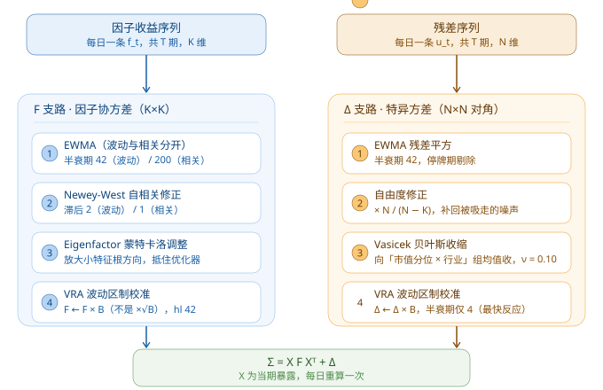

# Barra CNE5 实现手册

> **这份文档的目标**：读完能自己写出来。所有参数给到可直接抄的数值，所有顺序给到不能调换的理由。
> 配套可运行代码：`barra_cne5.py`（`python barra_cne5.py` 会跑一遍模拟数据端到端自检）。
> 理论动机与"为什么这么做"见 `Barra模型讲解.md`；这里只讲"怎么做"。
> **配图**：`figs_barra/barra_fig5_pipeline.svg`（阶段 B 双支路流程图，含全部官方参数）；
> `figs_barra/barra_fig1~4_*.svg` 是讲解文档的 4 张结构图。搬运时整个 `figs_barra` 目录一起带走。

**参数来源**：MSCI 官方 *CNE5 Empirical Notes (2013)*、*USE4 Methodology Notes (2011)*、*Barra GEMTR Datasheet*。
不是经验拍脑袋值，改之前先知道改的是哪一个。

---

## 0. 参数总表（先抄这张表）

单位统一为**交易日**。改一个参数前先问自己：我要的是"反应快"还是"估得稳"。

### 因子协方差 $`F`$

| 参数 | GEMTR 默认 | USE4S | USE4L | 含义 |
|---|---|---|---|---|
| 波动率半衰期 | **42** | 84 | 252 | 越小越敏感，太小则噪声主导 |
| 波动率 NW 滞后 | **2** | 5 | 5 | 处理因子收益自相关 |
| 相关性半衰期 | **200** | 504 | 504 | **必须远大于波动半衰期** |
| 相关性 NW 滞后 | **1** | 2 | 2 | |
| VRA 半衰期 | **42** | 42 | 168 | 波动区制切换的检测速度 |
| EM 算法 | 缺失因子收益时启用 | | | 保证相关矩阵半正定 |

### 特异方差 $`\Delta`$

| 参数 | 值 | 说明 |
|---|---|---|
| 特异波动半衰期 | **42** | |
| NW 自相关滞后 | **0** | 残差近似无自相关 |
| VRA 半衰期 | **4** | 比因子侧快 10 倍，这是日频最有价值的地方 |
| Vasicek 收缩强度 | **0.10** | GEMTR 官方值 |

### descriptor 窗口

| descriptor | 窗口 | 半衰期 | 其他 |
|---|---|---|---|
| BETA | 252 | 63 | |
| RSTR | 504 | 126 | **跳过最近 21 日** |
| DASTD | 252 | 42 | |
| HSIGMA | 252 | 63 | Beta 回归的残差 |
| CMRA | 12 个月 | — | 累积收益的 max − min |
| STOM | 21 | — | 1 个月 = **21 个交易日**，不是自然月 |
| STOQ / STOA | 3 / 12 个月 | — | 月度的**几何**平均 |

### 预处理

| 参数 | 值 |
|---|---|
| MAD 缩尾倍数 | **±5**（1.4826 × MAD） |
| 标准化 | **市值加权**均值与标准差 |
| 缺失填充 | 行业内**市值加权**中位数 |

---

## 1. 数据与估计域

### 1.1 股票池（每个交易日重新筛一遍）

| 剔除项 | 判据 | 理由 |
|---|---|---|
| 次新股 | 上市 < **180** 交易日 | 残差样本不足，Δ 估不准；180–250 天的靠 Vasicek 自然处理 |
| ST / *ST / 暂停上市 | 名称含标记 | 涨跌停 5%，收益分布被截断 |
| 长期停牌 | 当期停牌 > 5 日 | 收益恒为 0，会人为拉低波动 |
| 退市整理期 | 板块标记 | |
| B 股 | 代码前缀 | 流动性结构与 A 股不同 |

**估计域与回归域要分开**：估计域（用来跑回归、估参数的股票）可以宽；投资域是你的实际持仓范围。
Barra 官方 GEMTR 甚至用「t+1 日的指数成分」来跑 t+1 的回归——因为成分调整是提前公告的，不构成前视。

### 1.2 收益口径（三个细节，错一个就白做）

**① 用后复权价，不是原始收盘价。**
除权日股价会跳空（10 送 10 直接腰斩），不复权会在当天产生 −50% 的假收益，残差被污染。
统一用**后复权收盘价**算收益。

**② 截面回归用简单收益，descriptor 用对数收益。**

$$r_t = \frac{P_t}{P_{t-1}} - 1 \quad (\text{回归用}) \qquad \ln(1+r_t) \quad (\text{RSTR 用})$$

理由：截面回归是线性模型，$`r_p = \sum w_i r_i`$ 要求简单收益才能加总；
RSTR 是**跨期累积**，对数收益才能相加。混用会导致动量因子在长窗口上系统性偏差。

**③ 停牌日收益记 0，但估 Δ 时剔除该期。**
记 0 是为了序列不断；剔除是为了不让一堆 0 把波动率拉到接近 0 ——
**这是逆波动权重爆炸的头号原因**（σ→0 时权重 → ∞）。

### 1.3 市值口径

- **回归权重** $`w_i = \sqrt{\text{自由流通市值}}`$
- **Size 因子** $`\text{LNCAP} = \ln(\text{总市值})`$（CNE5 官方用总市值，不是流通市值）

A 股注意：`自由流通股本` 字段各家数据库口径不同（是否剔除持股 5% 以上股东），
同一份数据要全程一致，**中途换字段会造成暴露跳变**。

### 1.4 行业分类与 PIT

- A 股实务：申万一级（31 个）或中信一级（30 个）；Barra CNE5 官方是自建的 32 个行业
- **必须用当时的行业分类**。公司重组改行后，暴露会在某天跳变；
  用今天的分类回填历史 = 前视偏差，回测会虚高
- 财务数据同理：按**公告日**（ann_date）对齐，不是报告期（report_period）

---

## 2. descriptor 逐个算（CNE5 官方定义）

### 2.1 Size

$$\text{LNCAP} = \ln(\text{总市值})$$

### 2.2 Beta

过去 **252** 日，对**市值加权市场收益**做加权时序回归，半衰期 **63** 日：

$$r_{i,t} = \alpha_i + \beta_i \cdot r^{M}_{t} + \varepsilon_{i,t}$$

取斜率 $`\beta_i`$。市场收益必须用**市值加权**的全市场收益，不能用指数（指数成分与你的股票池不同）。

### 2.3 Momentum

$$\text{RSTR} = \sum_{t=1}^{504-21} w_t \cdot \ln(1+r_t), \quad w_t \propto 0.5^{t/126}$$

**跳过最近 21 日**——这 21 天是短期反转区，留着会污染动量信号。

### 2.4 Residual Volatility

$$\text{RESVOL} = 0.74 \cdot \text{DASTD} + 0.16 \cdot \text{CMRA} + 0.10 \cdot \text{HSIGMA}$$

- **DASTD**：252 日超额收益的加权标准差，半衰期 42
- **CMRA**：过去 12 个月累积超额收益的 $`\max - \min`$
- **HSIGMA**：Beta 回归残差的加权标准差，252 日，半衰期 63

**合成之后还要对 Beta 做一次正交化**（官方 note 明确要求），否则 RESVOL 与 Beta 高度共线，
归因会被拆到两个名字相似的因子上。

### 2.5 Non-linear Size

$$\text{NLSIZE} = \text{正交化}\big((\text{标准化 LNCAP})^{3}\big) \;\to\; \text{缩尾} \;\to\; \text{标准化}$$

正交化的对象是 Size 因子，用**回归加权**（$`\sqrt{\text{市值}}`$ 权重）。
顺序不能反：先立方、再正交、最后才缩尾标准化。

### 2.6 Book-to-Price

$$\text{BTOP} = \frac{\text{最近一期普通股账面价值}}{\text{当前总市值}}$$

分子用**普通股股东权益**（不含少数股东权益），分母用总市值。

### 2.7 Liquidity

$$\text{LIQUIDITY} = 0.35 \cdot \text{STOM} + 0.35 \cdot \text{STOQ} + 0.30 \cdot \text{STOA}$$

$$\text{STOM} = \ln\!\left(\sum_{t=1}^{21} \frac{V_t}{S_t}\right), \quad \text{STOQ} = \ln\!\left(\frac{1}{3}\sum_{\tau=1}^{3} e^{\text{STOM}_{\tau}}\right), \quad \text{STOA} = \ln\!\left(\frac{1}{12}\sum_{\tau=1}^{12} e^{\text{STOM}_{\tau}}\right)$$

$`V_t`$ = 成交量，$`S_t`$ = **流通股数**。
注意 STOQ/STOA 是**几何平均**（先 exp 再平均再 ln），不是算术平均——
换手率跨数量级，算术平均会被个别月份主导。

**1 个月 = 21 个交易日**，不是自然月。

### 2.8 Earnings Yield

$$\text{EY} = 0.68 \cdot \text{EPFWD} + 0.21 \cdot \text{CETOP} + 0.11 \cdot \text{ETOP}$$

- **EPFWD**：分析师预测 12 个月远期 EPS / 价格 —— **权重最大（0.68）**，没预期数据这个因子就废了一半
- **CETOP**：经营活动现金流（TTM）/ 市值
- **ETOP**：净利润（TTM）/ 市值

A 股没有 EPFWD 时的常见做法：用 TTM 替代并把权重重分配到 CETOP/ETOP，
但**要意识到这已经不是 CNE5 了**，因子含义会向"价值"偏移。

### 2.9 Growth

$$\text{GROWTH} = 0.47 \cdot \text{SGRO} + 0.24 \cdot \text{EGRO} + 0.18 \cdot \text{EGIBS} + 0.11 \cdot \text{EGIBS\_s}$$

- **SGRO**：过去 5 年**每股销售额**对时间（year = 1…5）回归的斜率 ÷ 5 年平均每股销售额
- **EGRO**：同样的做法作用在**每股盈利**上
- **EGIBS / EGIBS_s**：分析师预测的**长期 / 短期**盈利增速

注意：是"回归斜率 ÷ 均值"，不是简单的五年复合增速（CAGR）。
回归法对个别年份的异常值更稳健。

### 2.10 Leverage

$$\text{LEVERAGE} = 0.38 \cdot \text{MLEV} + 0.35 \cdot \text{DTOA} + 0.27 \cdot \text{BLEV}$$

$$\text{MLEV} = \frac{ME + PE + LD}{ME}, \quad \text{DTOA} = \frac{TD}{TA}, \quad \text{BLEV} = \frac{BE + PE + LD}{BE}$$

| 符号 | 含义 |
|---|---|
| ME | 普通股**市值**（最后一个交易日） |
| BE | 普通股**账面价值** |
| PE | 优先股账面价值（A 股通常 = 0） |
| LD | 长期负债账面价值 |
| TD | 总负债（长期负债 + 流动负债） |
| TA | 总资产 |

---

## 3. 预处理流水线（顺序不能调换）

```
原始 descriptor
  → ① MAD 缩尾 (±5 × 1.4826 × MAD)
  → ② 缺失值填充（行业内市值加权中位数）
  → ③ z-score 标准化（市值加权均值与标准差）
  → ④ 按固定权重合成风格因子
  → ⑤ 再标准化一次
  → ⑥ 正交化（RESVOL ~ Beta、NLSIZE ~ Size）
```

**每一步为什么在这个位置：**

1. **先缩尾再填充** —— 极值会污染中位数，顺序反了等于没缩尾
2. **先填充再标准化** —— 标准化**之后**填 0 = 填截面均值，可接受；
   标准化**之前**填 0 = 填进去一个极端暴露值，会把该股票push到因子尾部
3. **先标准化再合成** —— 各 descriptor 量纲不同（换手率的 ln 值 vs 市值的 ln 值），
   不标准化就合成，等于让数值大的那个独占权重
4. **合成后再标准化** —— 加权合成后尺度又变了，要让最终的因子暴露回到"1 = 1 个标准差"的口径
5. **正交化放最后** —— 对已完成标准化、可直接比较的两个因子做正交

**为什么不能用 ±3σ 去极值**：厚尾分布里极值本身会把 σ 撑大，
σ 一大，±3σ 的边界就跟着外扩，结果**极值一个都没去掉**。MAD 用的是中位数，不受极值影响。

```python
def winsorize_mad(s, k=5.0):
    med = np.nanmedian(s)
    mad = np.nanmedian(np.abs(s - med)) * 1.4826   # 1.4826: 让 MAD 与 σ 可比
    return np.clip(s, med - k*mad, med + k*mad)

def wmean_std(s, w):                                # 市值加权，不能用等权
    ok = ~np.isnan(s); s, w = s[ok], w[ok]
    mu  = np.dot(w, s) / w.sum()
    var = np.dot(w, (s-mu)**2) / w.sum()
    return mu, np.sqrt(var)
```

---

## 4. 截面回归（阶段 A）

### 4.1 矩阵构造

列顺序固定：`[市场(全1)] + [行业哑变量] + [10个风格]`

### 4.2 行业哑变量纯化 —— 必做，否则矩阵奇异

32 个行业哑变量之和 = 全 1 向量 = 市场因子暴露列 → **完美共线**。

$$\tilde X_{i,j} = D_{i,j} - s_j, \qquad s_j = \frac{\sum_{i \in j} w_i}{\sum_i w_i}$$

**关键细节：$`s_j`$ 必须用 $`\sqrt{\text{市值}}`$ 权重算，不是市值权重。**
因为回归权重就是 $`w_i = \sqrt{\text{cap}_i}`$，只有用同一套权重才能保证
$`\sum_i w_i \tilde X_{i,j} = 0`$，即行业列与全 1 列在加权内积下正交。

**纯化后 $`\sum_j \tilde X_{i,j} = 0`$ → 行业块秩为 $`n_{\text{ind}} - 1`$ → 必须丢掉一列。**
不丢的话 `lstsq` 会给一个最小范数解，不报错但结果错。

```python
dum = pd.get_dummies(industry).values.astype(float)
s_j = (dum * w[:, None]).sum(0) / w.sum()      # w = sqrt(市值)
ind = (dum - s_j[None, :])[:, 1:]              # 丢一列!
X   = np.column_stack([np.ones(N), ind, style_df.values])
```

### 4.3 求解

```python
def cross_section_regression(X, r, w):
    ok = ~np.isnan(r) & ~np.isnan(X).any(axis=1)
    X, r, w = X[ok], r[ok], w[ok]
    sw = np.sqrt(w)
    f, *_ = np.linalg.lstsq(X * sw[:, None], r * sw, rcond=None)   # 不要显式求逆
    return f, r - X @ f
```

- **别写 `np.linalg.inv(X.T @ W @ X) @ ...`** —— 条件数差的时候数值误差会放大几个量级
- 每期剔除 $`X`$ 或 $`r`$ 有缺失的股票，不要填充 $`X`$
- 秩不足的兜底：`(X'WX + 1e-8·I)^{-1} X'Wr`

---

## 5. 阶段 B 总览：`F` 与 `Δ` 两条支路



> 这张图是本章的地图：**上面一条路**（蓝）产出因子协方差 $`F`$，**下面一条路**（橙）产出特异方差 $`\Delta`$，
> 最后组装成 $`\Sigma = XFX^{\top} + \Delta`$。每个卡片的第二行是该步的**官方参数**，照抄即可。

## 5A. 因子协方差 $`F`$（四步）

### Step 1｜EWMA —— 波动与相关必须分开半衰期

$$\sigma_i^{2} = \text{EWMA}_{42}(r_{i,t}^{2}) + \text{NW修正}, \qquad \rho_{ij} = \text{EWMA}_{200}(z_{i,t} z_{j,t}), \quad z_{i,t} = \frac{r_{i,t}}{\sigma_i}$$

$$F_{ij} = \rho_{ij}\,\sigma_i\,\sigma_j$$

**为什么分开**：对角元素（波动）的估计误差对矩阵条件数影响很小，
非对角（相关）的误差会直接决定优化器的对冲方向。所以**波动可以短半衰期（快），相关必须长半衰期（稳）**。
实测里把相关的半衰期设短，是协方差矩阵不稳定的头号原因。

衰减系数：$`\lambda = 0.5^{1/h}`$，权重 $`\lambda^{T-t}`$。

### Step 2｜Newey-West（HAC）

因子收益（尤其动量、流动性）有自相关，普通样本协方差会**系统性低估**：

$$F = \hat\Gamma_0 + \sum_{\ell=1}^{L}\Big(1-\frac{\ell}{L+1}\Big)\big(\hat\Gamma_\ell + \hat\Gamma_\ell^{\top}\big)$$

$`1 - \ell/(L+1)`$ 是 Bartlett 权重，保证结果半正定。滞后阶：波动 **2**、相关 **1**。

### Step 3｜Eigenfactor Risk Adjustment —— 最容易被漏掉

**问题**：Shepard (2009) 证明，优化组合的真实波动

$$\sigma_{\text{true}} \approx \frac{\sigma_{\text{pred}}}{1 - K/T}$$

$`K = 43`$, $`T = 250`$ → 低估 $`1/(1-0.172) \approx 1.21`$ 倍。

**机制**：优化器最爱加仓的是 $`F`$ 里**特征值最小**的方向（看起来"风险极低"），
而这些方向恰恰是估计误差最大、最不可信的。**误差被优化器精准地找出来了。**

**做法**：在特征因子（eigenfactor）上做 Monte Carlo。

```python
lam, U = np.linalg.eigh(F)                    # F = U diag(lam) U'
for _ in range(N_SIM):                        # 正式用 1000+
    g = np.random.randn(T, K) * np.sqrt(lam)  # 真实协方差 = diag(lam)
    lam_hat = ewma_var(g, hl=42)              # 用与真实流程相同的估计器
    ratio  += (lam_hat / lam) / N_SIM         # <1 表示该方向被低估
lam_adj = lam / ratio
F_adj   = (U * lam_adj) @ U.T
```

Barra 官方是在**特征因子组合**的收益序列上算 B，不是对 F 直接缩放 —— 差别在于特征因子之间正交，
可以逐个方向独立校准。

### Step 4｜VRA（Volatility Regime Adjustment）

$$B = \text{EWMA}_{42}\!\left[\ \overline{\left(\frac{f_{k,t}}{\sigma^{\text{预测}}_{k,t}}\right)^{2}}\ \right]$$

理想值 = 1。$`B > 1`$ 说明近期系统性低估波动。

**易错点：$`B`$ 作用在方差上。** 标准差要乘 $`\sqrt{B}`$，
所以**协方差矩阵 $`F`$ 与 $`\Delta`$ 都要乘 $`B`$**，不是 $`\sqrt{B}`$。
乘 $`\sqrt{B}`$ 是错的（会让波动只修正 $`B^{1/4}`$ 倍）。

```python
ratio = (F_ret**2) / np.diag(F)[None, :]      # T×K
B     = ewma_series(np.nanmean(ratio, 1), hl=42)[-1]
F_vra = F * B                                  # 乘 B，不是 sqrt(B)
```

---

## 6. 特异方差 $`\Delta`$（四步，接上图下路）

### Step 1｜EWMA 方差

半衰期 **42**，直接对残差平方做指数加权。

### Step 2｜自由度修正 —— 漏了这步，模型会以为世界很安全

$`\hat u_t`$ 是**同一期**截面回归的样本内残差，$`K`$ 个因子已经吸走了样本内的噪声，
方差系统性偏小。修正：

$$\hat\sigma_i^{2} \leftarrow \hat\sigma_i^{2} \times \frac{N}{N-K}$$

$`N=3000, K=43`$ 时修正因子 1.014 —— 看着小，但**所有股票一起偏 1.4%**，
优化器会系统性低估风险。更彻底的做法是用样本外残差（用 t 期估的 $`f`$ 预测 t+1 的残差）。

### Step 3｜Vasicek 收缩

$$\hat\sigma_i^{2} = (1-\nu)\,\hat\sigma^{2}_{i,\text{样本}} + \nu\,\bar\sigma^{2}_{\text{组}}$$

- 组 = **市值分位 × 行业**（不是只用市值分位）
- $`\nu = 0.10`$（GEMTR 官方值）
- 新股 / 短历史股票几乎完全退化为组内均值

**$`\nu`$ 怎么自己定**：用组内样本方差的横截面离散程度反推。
组内方差越集中，$`\nu`$ 可以越小；离散越大，越需要收缩。实务上从 0.1 起调。

### Step 4｜VRA

半衰期 **4** —— 比特异方差自身的 EWMA（42）快 10 倍，
也比因子侧的 VRA（42）快 10 倍。**这是日频最不可替代的功能**：
波动区制切换时，$`\Delta`$ 靠这个 4 天半衰期才能跟上。

---

## 7. 组装与自检

$$\Sigma = X F X^{\top} + \Delta$$

### 唯一的验收标准：bias statistic

$$B = \frac{1}{T}\sum_t \left(\frac{r_t}{\sigma_{t|t-1}}\right)^{2} \approx 1$$

**分层检验**（只看总的 B 会掩盖问题）：

| 分层维度 | 做法 | 看什么 |
|---|---|---|
| 按预测波动分位 | 分 10 组，每组算 B | 低波动组的 B 最容易 > 1（低估） |
| 按市值分位 | 分 10 组 | 小市值组通常偏差最大 |
| 按因子风险占比 | 分 5 组 | 高因子暴露组看 $`F`$ 准不准 |
| 按时间 | 滚动 60 日 | 危机期 B 会飙升（模型滞后） |

**合格线**：整体 0.8 ~ 1.25；分位组 0.7 ~ 1.4。

`barra_cne5.py` 跑出来的实际结果：

```
[阶段A] 个股层面日频截面 R² = 0.240
[阶段B] 因子侧 VRA 偏差统计量 B = 1.031
[阶段B] 特异侧 VRA 偏差统计量 B = 0.947
[自检] 组合        预测年化波动%  实现年化波动%    B    因子风险占比
  等权组合             15.15        15.89       1.10      97.2%
  市值加权             14.93        15.72       1.11      99.0%
```

**别被"因子风险占比 97%"吓到** —— 分散化组合的特异风险早被分散掉了，
这是正常现象。单看一只个股时特异性通常占 60%~80%。

---

## 8. A 股特有的六个坑

| 坑 | 后果 | 做法 |
|---|---|---|
| **涨跌停** | 涨停日收益被截断 → $`\Delta`$ 系统性低估 | 标记涨跌停状态，该日残差单独放大或剔除后另估 |
| **停牌** | 收益恒 0 拉低波动 → 逆波动权重爆炸 | 收益记 0 但估 $`\Delta`$ 时剔除该期；或设波动下限 |
| **ST 股** | 5% 涨跌幅，分布与其他股票不同 | 直接剔除出估计域 |
| **次新股** | 残差样本不足 | <180 交易日剔除；180–250 靠 Vasicek |
| **非同步交易** | 微盘股日频相关性被低估 | Dimson / Scholes-Williams 修正，或接受偏差 |
| **行业切换** | 用今天分类回填历史 = 前视 | 用当时的分类，建 PIT 行业映射表 |

---

## 9. 八个高频 bug（按踩中概率排序）

1. **行业纯化用市值占比而不是 $`\sqrt{\text{市值}}`$ 占比** → 行业列与市场列不正交，归因无唯一解
2. **纯化后忘了丢一列** → 矩阵秩亏，`lstsq` 不报错但给最小范数解，结果错
3. **缺失值在标准化前填 0** → 该股票被推到因子分布的极端位置
4. **用等权标准化** → 与 WLS 口径不一致，小市值噪声被放大
5. **残差不做自由度修正** → $`\Delta`$ 整体偏低 1%~2%，优化器以为世界很安全
6. **VRA 用 $`\sqrt{B}`$ 缩放协方差** → 只修正了 $`B^{1/4}`$，危机期照样爆
7. **财务数据按报告期对齐** → 前视偏差，回测虚高
8. **相关的半衰期设得和波动一样短** → 协方差矩阵不稳定，优化结果天天翻

---

## 10. 上手顺序建议

1. 先跑通 `barra_cne5.py`，确认 bias statistic ≈ 1
2. 换成真实数据，**只做 Size + Beta + Momentum 三个因子**，先把流程跑顺
3. 加满 10 个风格 + 行业，看 $`R^2`$ 是否落在 0.15~0.35
4. 做分层 bias statistic 检验，调半衰期与收缩强度
5. 最后才加 Eigenfactor 调整与涨跌停处理

**不要一上来就全量 43 因子** —— 中间任何一步错了，43 个因子的输出你根本查不出问题在哪。
