# Barra 结构化风险模型：设定、估计与应用

> **文档定位**：面向需要理解并复现 Barra 类结构化风险模型的读者。内容包括模型设定、因子体系、两阶段估计的全部关键参数与执行顺序、验收标准、应用方式与常见实施错误。
> **阅读路径**：第 1–2 节为模型设定，第 3–5 节为估计流程（含全部官方参数），第 6 节为验收，第 7–8 节为应用与实施。
> **配套材料**（本地工作区，不随本文发布）：`Barra实现手册.md`（参数总表、descriptor 定义、流水线顺序）、`barra_cne5.py`（端到端可运行代码，含偏差统计量自检）。
>
> **配图**：`figs_barra_talk/` 目录下 14 张 SVG，由 `figs_barra_talk/make_figs.py` 生成。迁移文档时需同时携带该目录。

---

## 0. 摘要

Barra（MSCI Barra 结构化股权风险模型）是一套**用于估计股票收益协方差矩阵的降维参数化方案**，不是收益预测模型。其设定为

$$r_{i,t} = \sum_{k=1}^{K} X_{i,k,t-1}\, f_{k,t} + u_{i,t}$$

其中 $`X_{i,k,t-1}`$ 为第 $`i`$ 只股票在因子 $`k`$ 上的暴露（期初已知），$`f_{k,t}`$ 为因子收益（待估），$`u_{i,t}`$ 为特异性收益。相应地，收益协方差矩阵被约束为

$$\Sigma = X F X^{\top} + \Delta$$

其中 $`F`$ 为 $`K \times K`$ 因子协方差矩阵，$`\Delta`$ 为对角特异方差矩阵。待估参数量由 $`N(N+1)/2`$ 降至 $`K(K+1)/2 + N`$。取 $`N = 3000`$、$`K = 42`$，参数量由约 $`4.5 \times 10^{6}`$ 降至 $`3.9 \times 10^{3}`$，下降约三个数量级。

三点需要先行确立的认识：

1. **Barra 是风险模型，不是 alpha 模型。** $`f_t`$ 是逐期截面回归的估计副产品，模型不对因子风险溢价作出任何承诺；$`f_t`$ 可正可负、可在长样本下不显著。
2. **模型的输出是 $`\Sigma`$ 的估计量**，服务于风险预测、组合优化与绩效归因，不产生收益预测。
3. **验收标准是偏差统计量 $`B \approx 1`$ 且分层稳定，而非截面 $`R^{2}`$。**

---

## 1. 问题设定：待估参数的量级与样本约束

### 1.1 维度与秩的约束

组合管理需要股票收益的协方差矩阵 $`\Sigma`$（$`N \times N`$）。其独立元素数为 $`N(N+1)/2`$；取 $`N = 3000`$，约为 $`4.5 \times 10^{6}`$。

日频数据年度观测数约为 250。样本协方差矩阵

$$\hat\Sigma_{\text{样本}} = \frac{1}{T-1}\sum_{t=1}^{T}(r_t - \bar r)(r_t - \bar r)^{\top}$$

的秩不超过 $`T-1`$。当 $`T - 1 < N`$ 时矩阵奇异，不可逆；组合优化中所需的 $`\Sigma^{-1}`$ 不存在。即便 $`T > N`$，样本协方差在高维下的估计误差仍显著——一般认为需要 $`T/N`$ 达到 10 的量级才能获得可接受的精度，而这一条件在实务中无法满足（需 30 年日频数据）。

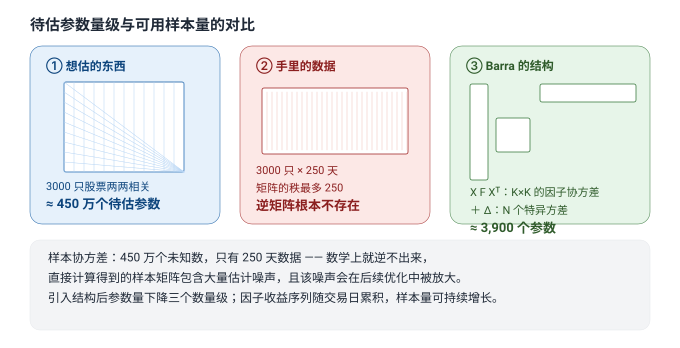

### 1.2 估计误差在优化中的放大效应

问题不止于矩阵不可逆。均值-方差优化的目标函数为

$$\max_{w}\ \alpha^{\top} w - \frac{\lambda}{2} w^{\top}\Sigma w$$

其解 $`w^{\ast} \propto \Sigma^{-1}\alpha`$ 对 $`\Sigma`$ 的估计误差高度敏感。关键在于，**估计误差最大的方向，与事前估计波动最小的方向系统性重合**：优化器将 $`\hat\Sigma`$ 中因误差而显得"低风险"的方向判定为最优，并在其上集中持仓。

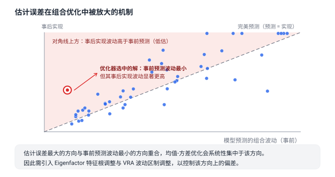

该现象在文献中称为误差最大化（error maximization，Michaud 1989）。其后果是：样本外实现波动系统性地高于事前预测波动，且在事前预测波动最低的组合上偏离最大。

**各种协方差估计器到底差多少——一张定量对照表**。MSCI 在 USE4 方法文档（Menchero 等）中给出过一组以「已知真实协方差的模拟市场」为基准的预测精度对比，用预测/实现波动比与 1 的偏离衡量（1 为完美）：

| 估计方法 | 预测精度 |
|---|---|
| 样本协方差 | ≈ 0.20 |
| Ledoit–Wolf 收缩 | ≈ 0.59 |
| PCA 统计因子模型 | ≈ 0.85 |
| 真实暴露的基本面因子模型 | ≈ 0.99 |
| 基本面因子 + 特征根调整 | ≈ 0.89 |

三个读法：① 样本协方差在高维下不是「精度差一点」而是基本不可用；② PCA 只解决秩的问题，不解译性——用统计因子做优化，无法对行业/风格暴露施加约束（§7 的应用全部失效），这正是 Barra 选择**基本面因子**的原因：暴露矩阵 $`X`$ 可审计，比多出几个点的预测精度更值钱；③ 特征根调整降低了这张表的原始精度数字（0.99→0.89），但优化的是**优化器最关心的低波动方向**的偏差（§5.1 第三步、§1.2 的误差放大方向）——精度度量本身也相对于目标。理论基础上，Ledoit & Wolf（*JMVA* 2004）证明了向结构化目标收缩的最优性：$`T/N`$ 越小，收缩越应该激进。

因此，Barra 的全部设计——加权方式、正交化约束、收缩、特征根调整与波动区制校准——都服务于同一目标：**降低 $`\hat\Sigma`$ 的估计误差，并使误差结构可被检验。**

---

## 2. 模型设定与基本假设

### 2.1 收益分解

对每一个时点 $`t`$，将 $`N`$，维收益向量分解为

$$r_t = X_{t-1} f_t + u_t$$

| 符号 | 维度 | 定义 |
|---|---|---|
| $`r_t`$ | $`N \times 1`$ | $`t`$ 期个股收益向量 |
| $`X_{t-1}`$ | $`N \times K`$ | 因子暴露矩阵，取值在 $`t-1`$ 期末已知 |
| $`f_t`$ | $`K \times 1`$ | $`t`$ 期因子收益向量，待估 |
| $`u_t`$ | $`N \times 1`$ | 特异性收益向量，待估其方差 |

### 2.2 协方差分解

由收益分解式直接得到

$$\Sigma_t = X_{t-1}\, F_t\, X_{t-1}^{\top} + \Delta_t$$

$`X F X^{\top}`$ 为**因子风险**部分，秩为 $`K`$，刻画 $`K`$ 个共同因子引致的协方差结构；$`\Delta`$ 为**特异性风险**部分，由假设 A1 约束为对角阵。

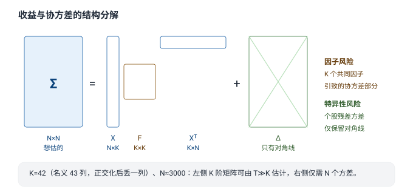

参数量对比：

$$ \underbrace{\frac{N(N+1)}{2}}_{\approx 4.5 \times 10^{6}} \ \longrightarrow \ \underbrace{\frac{K(K+1)}{2}}_{\approx 9.0 \times 10^{2}} + \underbrace{N}_{3.0 \times 10^{3}} \approx 3.9 \times 10^{3} $$

### 2.3 三个基本假设

- **A1（截面不相关）**：$`\mathrm{Cov}(u_{i,t}, u_{j,t}) = 0,\ i \neq j`$，即 $`\Delta`$ 为对角阵。这是最脆弱的假设：同一产业链或同一主题的股票，其残差存在实际相关。缓解手段是将行业因子划分得足够细，使共同变动尽可能被因子吸收。

  **学理层：近似因子模型（approximate factor structure）**。学界早已认识到严格 A1 过强：Connor & Korajzyk（1986, *JET*）提出近似因子结构——允许残差存在弱截面相关，只要任意固定资产集合的平均相关随组合分散趋于零，因子定价与风险分解的核心结论仍然成立。现代高维文献（综述见 Fan, Liao & Yao, *Journal of Econometrics* 2021）系统处理了 $`\Delta`$ 非对角时的估计：用阈值化、收缩等方法直接估计残差相关矩阵的稀疏部分。实务含义：A1 不是「对/错」而是「残差相关有多强」——行业切分越细、主题炒作越弱的市场，A1 越接近成立；A股题材共振期间，$`\Delta`$ 的非对角部分会被明显放大，此时校准 §6.1 的分层偏差统计量比争论假设真假更有用。
- **A2（正交性）**：$`\mathrm{Cov}(u_t, f_t) = 0`$。在加权回归设定下该条件由构造保证。
- **A3（信息集约束）**：$`X_{t-1} \in \mathcal{F}_{t-1}`$。这不是统计假设而是实施纪律：财务类暴露必须按**公告日**（point-in-time）对齐。

### 2.4 与因子定价模型的区别

Barra 的截面回归与因子定价检验在数学形式上一致，但被估对象不同：

- Barra 逐期估计 $`f_t`$，利用单期截面数据，描述已实现的收益结构；
- 因子定价检验估计 $`\hat\lambda = \frac{1}{T}\sum_{t} \hat f_t`$，利用时序均值，检验风险溢价是否显著。

二者的关系是：$`\hat\lambda`$ 恰为 Barra 所产出序列 $`\{\hat f_t\}`$ 的一阶矩（此即 Fama-MacBeth 第二步）。因此二者并非两套独立模型，而是**同一条因子收益序列的一阶矩与二阶矩**：

| 用途 | 统计量 | 消费对象 |
|---|---|---|
| 收益（alpha） | $`\hat\lambda = \overline{f}`$，$`t = \bar f / (\mathrm{sd}(f)/\sqrt{T})`$ | 因子研究 |
| 风险 | $`F = \mathrm{Var}(f_t)`$，$`\Delta = \mathrm{Var}(u_t)`$ | 风险模型 |

结论：$`f_t`$ 的单期实现值不能直接用作下期预测（等价于设定因子收益的 AR(1) 系数为 1），但序列 $`\{f_t\}`$ 本身是因子溢价研究的唯一输入。

---

## 3. 因子体系

以 A 股的 CNE5 为例，因子暴露矩阵含三类列：

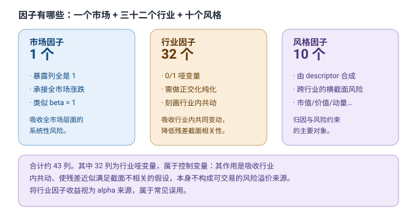

| 类别 | 列数 | 构造方式 | 作用 |
|---|---|---|---|
| 市场因子 | 1 | 暴露列全为 1 | 吸收全市场系统性风险 |
| 行业因子 | 32 | 0/1 哑变量，经正交化 | 吸收行业内共同变动 |
| 风格因子 | 10 | 由 descriptor 加权合成 | 刻画跨行业横截面风险源 |

CNE5 的 10 个风格因子为：Size、Beta、Momentum、Residual Volatility、Non-linear Size、BTOP、Liquidity、Earnings Yield、Growth、Leverage。CNE6 将风格因子扩展至 16 个（CNLT），CNTR 版本另加 4 个高频因子。

### 3.1 descriptor 合成

风格因子不由单一指标直接给出，而是由若干标准化后的 descriptor 按**固定权重**线性合成：

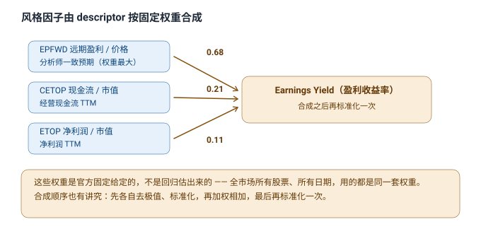

| 风格因子 | 合成权重 |
|---|---|
| Earnings Yield | $`0.68 \cdot \text{EPFWD} + 0.21 \cdot \text{CETOP} + 0.11 \cdot \text{ETOP}`$ |
| Residual Volatility | $`0.74 \cdot \text{DASTD} + 0.16 \cdot \text{CMRA} + 0.10 \cdot \text{HSIGMA}`$ |
| Liquidity | $`0.35 \cdot \text{STOM} + 0.35 \cdot \text{STOQ} + 0.30 \cdot \text{STOA}`$ |
| Leverage | $`0.38 \cdot \text{MLEV} + 0.35 \cdot \text{DTOA} + 0.27 \cdot \text{BLEV}`$ |

合成权重由模型供应商固定给定，不由回归估计，对所有股票、所有日期一致。合成顺序为：各 descriptor 分别去极值、标准化 → 加权求和 → 再次标准化。

### 3.2 关于行业因子的认识

名义上 $`K = 1 + 32 + 10 = 43`$ 列；经正交化产生一个线性约束后，行业块自由度为 31，估计时须丢弃一列，故有效 $`K = 42`$。

需要强调：43 列中 32 列为行业哑变量，其作用是**控制变量**——吸收行业内共同变动，使 A1（残差截面不相关）近似成立，而非提供可交易的风险溢价。将行业因子收益视为 alpha 来源属于常见误用。

---

## 4. 阶段 A：逐期横截面加权回归

对每个交易日 $`t`$ 执行一次加权最小二乘回归，得到 $`\hat f_t`$ 与残差 $`\hat u_t`$。

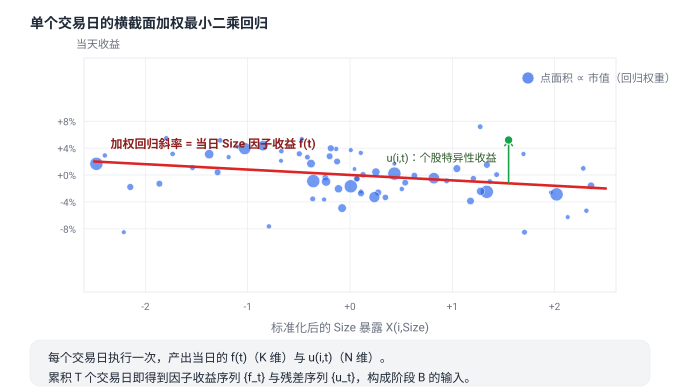

$$\hat f_t = (X^{\top} W X)^{-1} X^{\top} W r_t, \qquad W = \mathrm{diag}(w_i)$$

### 4.1 回归权重的设定

Barra 取 $`w_i \propto \sqrt{\text{cap}_i}`$。其依据与折中如下：

小市值股票的残差波动显著高于大市值股票，近似有 $`\mathrm{Var}(u_i) \propto 1/\text{cap}_i`$。在此异方差结构下，WLS 的理论最优权重为 $`w_i \propto 1/\mathrm{Var}(u_i) \propto \text{cap}_i`$。但直接使用 $`\text{cap}_i`$ 会使有效样本集中于少数大市值股票，因子收益估计的抽样方差随之上升。$`\sqrt{\text{cap}_i}`$ 是效率与稳定性之间的折中，为 Barra 各版本的一致设定。

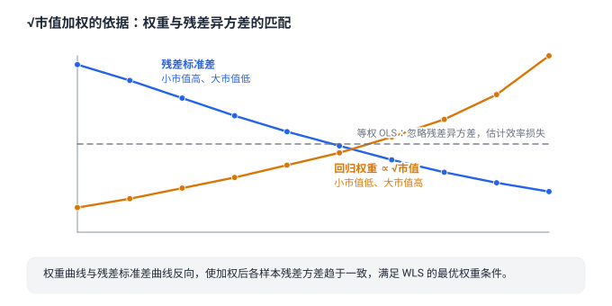

代价是明确的：模型对大市值股票的拟合权重更高，对小市值的风险刻画精度相对更差。在以小市值为主的股票池上直接套用标准 Barra，需自行修正。

### 4.2 行业哑变量的正交化

32 个行业哑变量逐列求和等于全 1 向量，而全 1 即为市场因子的暴露列，二者完全共线，$`X^{\top}WX`$ 奇异。处理方法是令

$$\tilde X_{i,j} = D_{i,j} - s_j, \qquad s_j = \frac{\sum_{i \in \text{行业 } j} w_i}{\sum_i w_i}$$

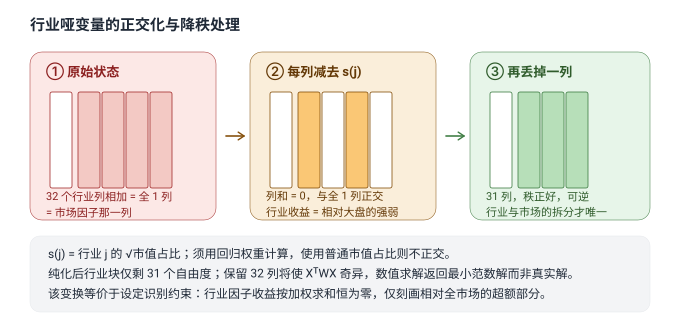

变换后每一行业列的加权和为 0，与全 1 列正交。由于存在该线性约束，行业块自由度为 31，**须再丢弃一列**；若保留 32 列，$`X^{\top}WX`$ 仍奇异，数值求解器（如 `lstsq`）不报错但返回最小范数解，结果错误。

两点实施要求：

1. $`s_j`$ 必须用**回归权重** $`w_i = \sqrt{\text{cap}_i}`$ 计算。若改用普通市值占比，变换后的列与全 1 列不正交，正交化失效。
2. 该变换的经济含义是**识别约束**：行业因子收益按 $`s_j`$ 加权求和恒为零，行业因子仅刻画相对全市场的超额部分，市场层面变动全部归入市场因子。缺少该约束时，行业与市场的收益分解不唯一。

### 4.3 运行频率

四个环节的频率并不相同，需分别说明：

| 环节 | 频率 | 说明 |
|---|---|---|
| 暴露更新 | 日频 + 事件驱动 | 行情类（市值、波动、换手）每日更新；财务类按**公告日**更新，其间前向填充 |
| 截面回归 | 日频 | 每个交易日一次 |
| $`F, \Delta`$ 估计 | 日频重算 | 估计窗口 40–250 个交易日（见 §5.1） |
| $`R^{2}`$ 评估 | 月度口径 | 以月频收益重跑截面回归，取 12 个月滚动均值 |

必须采用日频是硬约束：估计 $`K \times K`$ 的 $`F`$ 要求 $`T \gg K`$；月频下每年仅 12 个观测，累积 250 期需约 20 年，且半衰期参数以交易日为单位，月频下该机制失效。

文献中常引的"月度 $`R^{2} \approx 0.28`$"属**评估口径**，与模型的日频运行频率无关（详见 §6.2）。

---

## 5. 阶段 B：协方差矩阵的时序估计

阶段 A 产出两条序列：因子收益序列 $`\{f_t\}`$（$`T \times K`$）与残差序列 $`\{u_t\}`$（$`T \times N`$）。阶段 B 由这两条序列估计 $`F`$ 与 $`\Delta`$。

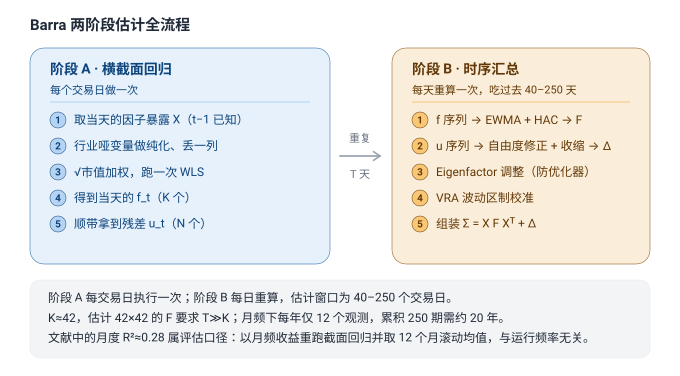

### 5.1 因子协方差矩阵 $`F`$

**第一步：EWMA 加权。** 权重按 $`\lambda^{T-t}`$ 衰减，由半衰期 $`h`$ 参数化：

$$\lambda = 0.5^{1/h}$$

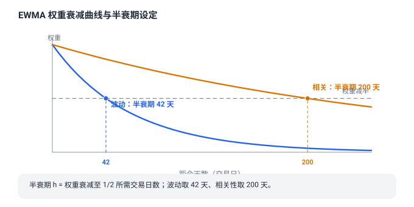

波动与相关性分设半衰期：

| 对象 | 半衰期（交易日） |
|---|---|
| 波动率 | 42 |
| 相关性 | 200 |

依据是二者的持续性不同：波动率存在区制切换，需较短半衰期以跟踪；相关结构相对稳定，且需更长样本方可估计。实现上先以短半衰期估计各因子波动并对收益标准化，再以长半衰期估计标准化序列的相关矩阵，最后重组 $`F = D_{\sigma} R D_{\sigma}`$。若对相关性使用短半衰期，估计所得的相关矩阵在相邻日之间会出现大幅无意义变动。

**第二步：Newey-West（HAC）修正。** 动量、流动性等因子收益存在自相关，普通样本协方差会系统性低估。修正为

$$F = \hat\Gamma_0 + \sum_{\ell=1}^{q}\Big(1-\frac{\ell}{q+1}\Big)\big(\hat\Gamma_{\ell} + \hat\Gamma_{\ell}^{\top}\big)$$

其中 $`\hat\Gamma_{\ell}`$ 为滞后 $`\ell`$ 阶自协方差，$`1 - \ell/(q+1)`$ 为 Bartlett 权重，保证结果半正定。滞后阶取 $`q = 2`$（波动）与 $`q = 1`$（相关）即可。

**第三步：特征根调整（Eigenfactor Risk Adjustment）。** 样本 $`F`$ 在较小特征根对应的方向上存在系统性偏差：这些方向的样本特征值被低估，而优化器恰好偏好低方差方向。修正方式是通过蒙特卡洛模拟或 bootstrap 估计偏差并对特征根施加调整。这一步与 §1.2 的误差放大效应直接对应。正式出处与机制：Menchero, Orr & Wang（*Journal of Portfolio Management* 2011，USE4 方法文档），核心思想是把特征根的期望偏差作为特征根本身的函数拟合出来再反向校正。

**第四步：VRA 缩放**（见 §5.3）。

**变量误差问题**：$`\hat f_t`$ 是估计量而非观测值，估计 $`F`$ 时存在变量误差（errors-in-variables），这要求 $`T \gg K`$。以 $`K = 42`$、$`T = 250`$ 计，该条件勉强满足；若样本进一步缩短，$`F`$ 的估计质量将迅速恶化。

### 5.2 特异方差矩阵 $`\Delta`$

**第一步：EWMA 方差。** 对残差平方序列施加半衰期为 42 日的 EWMA。

**第二步：自由度修正。** 所用残差为**样本内**残差，$`K`$ 个因子已吸收部分噪声，其方差系统性偏小。修正为

$$\hat\sigma^{2}_{i,\text{修正}} = \hat\sigma^{2}_{i,\text{残差}} \cdot \frac{N}{N - K}$$

以 $`N = 3000`$、$`K = 42`$ 计，修正因子约为 1.014。该偏差对所有股票同向，若不作修正，$`\Delta`$ 整体偏低，优化器将低估全部组合的风险。

**第三步：Vasicek 收缩。**

$$\hat\sigma_i^{2} = (1-\nu)\,\hat\sigma_{i,\text{样本}}^{2} + \nu\,\bar\sigma_{\text{组}}^{2}$$

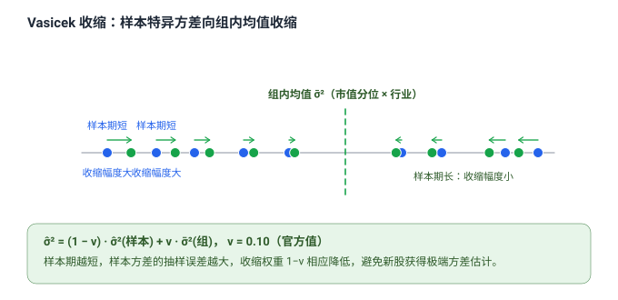

分组方式为**市值分位 × 行业**；$`\nu`$ 为先验等效样本量的函数，官方量级取 0.10 附近，历史越短的样本 $`\nu`$ 越大。其作用是抑制抽样误差：样本期短的股票（如新上市股）其样本方差的抽样误差大，收缩可避免其获得极端方差估计。

**第四步：VRA 缩放**（见 §5.3）。

### 5.3 VRA（波动区制调整）

前述所有估计均基于历史数据，在波动区制切换时存在系统性滞后：低波动期之后模型持续低估，高波动期来临后反应滞后。

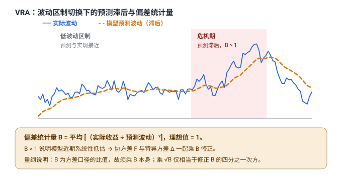

定义偏差统计量

$$B = \frac{1}{T}\sum_{t} \left(\frac{r_t}{\sigma_{t|t-1}}\right)^{2}$$

其中 $`\sigma_{t|t-1}`$ 为模型在 $`t-1`$ 时点对 $`t`$ 期波动的事前预测。理论上 $`\mathbb{E}[B] = 1`$。$`B > 1`$ 表明模型近期系统性低估波动，将 $`F`$ 与 $`\Delta`$ **同乘 $`B`$** 予以修正。

**量纲说明**：$`B`$ 是方差口径的比值，故缩放因子为 $`B`$ 本身；乘以 $`\sqrt{B}`$ 是常见错误，仅相当于修正了 $`B^{1/4}`$。

VRA 自身的估计半衰期较短：因子侧 42 个交易日、特异侧 4 个交易日。这是日频运行不可替代的功能所在——只有日频才能及时察觉区制切换。若将 VRA 降频，风险模型将在波动上升期持续滞后。

### 5.4 组装

$$\Sigma_{t+1} = X_{t}\, F_{t+1}\, X_{t}^{\top} + \Delta_{t+1}$$

即以当期暴露矩阵与最新一期 $`F, \Delta`$ 构造下一期协方差的事前估计。

---

## 6. 模型验收

### 6.1 偏差统计量

风险模型的首要验收标准是偏差统计量 $`B \approx 1`$，且**分层检验后仍接近 1**。实务中合格区间取 $`[0.8, 1.25]`$。

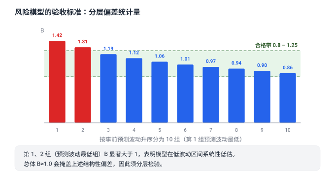

分层检验不可省略。总体 $`B \approx 1`$ 可能掩盖结构性偏差：常见情形是预测波动最低的分层 $`B > 1`$（模型在低波动区间系统性低估），而高波动分层 $`B < 1`$，二者在总体上相互抵消。而优化器恰恰集中于低预测波动的方向，故该偏差会被放大。

### 6.2 关于 $`R^{2}`$

截面 $`R^{2}`$ 反映的是模型对已实现收益的解释比例，不是风险模型的验收指标。日频截面 $`R^{2}`$ 明显偏低且随行情大幅波动，其数值偏低是模型设定的必然结果——大部分个股波动属于特异性成分。

常被引用的 0.28 为**月度**口径，具体为月度截面回归调整 $`R^{2}`$ 的 12 个月滚动均值：

| 样本口径 | 调整 $`R^{2}`$ |
|---|---|
| 全市场 | ≈ 0.28 |
| 沪深 300 | ≈ 0.39 |
| 中证 500 | ≈ 0.19 |
| 中证 800 以外 | ≈ 0.15 |

（数据来源：中信建投 CNE5 复现研报，与 MSCI 官方同口径。）

须注意：该数值与"alpha 模型日频 $`R^{2} < 1\%`$"不可直接比较——二者在频率（月频对日频）、样本内外、因子集宽度（43 列对少数信号）三个维度上均不同，跨口径比较无意义。

### 6.3 模型什么时候集体失效

诚实的验收不止报合格率，还要知道失效模式。风险模型有三种典型的集体失效场景，机制各不相同：

1. **区制切换的水平失效（可被 VRA 修复）**。市场从低波动进入高波动（如 2015 年 A 股去杠杆、2020 年 2–3 月全球疫情冲击），历史样本的 EWMA 滞后于波动跳升，$`B`$ 全分层同步 $`>1`$。这是 VRA 的设计场景：特异侧 4 日半衰期可以在一周量级内追上水平。失效可控。
2. **结构失效（VRA 修不了）**。危机期间截面相关急剧上升、残差相关被放大——$`\Delta`$ 的对角假设（A1）系统性失真，特异性风险被普遍低估，且**被低估的部分恰好在组合间高度相关**：模型认为分散化消除了的风险重新以共同因子（或准因子）的形态出现。此时即使 $`B`$ 已校回 1，按 $`\Sigma`$ 优化的组合仍会集中暴露在「模型认为互不相关、实际同涨同跌」的方向上。任何基于历史相关性的模型都对此有滞后，这正是压力测试与情景分析必须独立于风险模型存在的原因。
3. **暴露失效（数据问题而非统计问题）**。风格因子在极端行情中「翻转」（如小市值因子崩溃），若模型对暴露的更新频率跟不上持仓变化，归因会系统性错配。这类失效的信号不在 $`B`$ 里，而在归因残差的累积漂移里。

判别口诀：**水平错看 $`B`$，结构错看分层后的 $`B`$ 与残差相关，暴露错看归因残差**。三类失效的对策完全不同——分别是调 VRA、压缩风险预算与假设更差的相关结构、修数据管道——对错症是风险模型实务中最贵的错误之一。

---

## 7. 应用

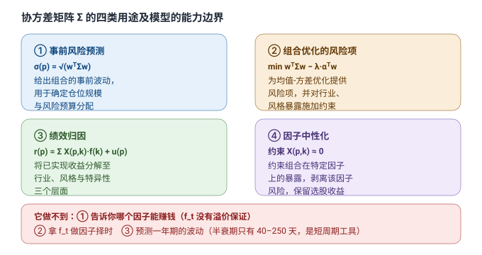

**① 事前风险预测**：$`\sigma_p = \sqrt{w^{\top}\Sigma w}`$，给出组合波动的事前估计，用于仓位与风险预算决策。

**② 组合优化的风险项**：为均值-方差优化提供 $`\Sigma`$，并对行业、风格暴露施加约束。

**③ 绩效归因**：将已实现收益分解至因子与特异性成分，组合波动可逐项分解为

$$\sigma_p^{2} = \sum_{j} \underbrace{X_{p,j}\,(F X^{\top}w)_j}_{\text{因子 } j \text{ 的贡献}} + \underbrace{w^{\top}\Delta w}_{\text{特异性}}$$

在充分分散的组合中，因子风险占总波动的比例通常超过 90%（特异性风险已通过分散化消除）；单只个股的特异性占比通常在 60–80%。

**④ 因子中性化**：约束组合在指定因子上的暴露接近零，剥离该因子风险，保留选股收益。

### 7.1 能力边界

模型不提供以下三类输出：

1. **因子溢价估计**。$`f_t`$ 为回归副产品，模型未设定也无义务产生风险溢价。
2. **因子择时信号**。以 $`f_t`$ 或其时序特征预测下期因子收益，等价于未经检验的时序外推。
3. **长期波动预测**。半衰期参数为 40–250 个交易日，模型属短周期工具，不适用于一年期及以上的波动预测。

---

## 8. 实施中的常见错误

| # | 错误 | 后果 | 正确处理 |
|---|---|---|---|
| 1 | 将因子收益 $`f_t`$ 用于择时或选股 | 模型未对溢价作任何承诺 | 仅用于风险分解、归因与中性化 |
| 2 | 财务数据按报告期对齐 | 前视偏差，回测结果虚高 | 按公告日（PIT）对齐 |
| 3 | 去极值使用 $`\pm 3\sigma`$ | 厚尾使 $`\sigma`$ 被极值撑大，截尾失效 | 使用中位绝对偏差（MAD），截断点取 $`\pm 5\,\mathrm{MAD}`$ |
| 4 | 缺失值在标准化前填 0 | 被识别为极端暴露 | 标准化后填 0（等于填截面均值），或使用行业市值加权中位数 |
| 5 | 正交化使用普通市值占比 | 与市场列不正交，分解不唯一 | $`s_j`$ 须用 $`\sqrt{\text{cap}_i}`$ 占比计算 |
| 6 | 正交化后未丢弃一列 | 求解器不报错但返回最小范数解 | 行业块保留 31 列 |
| 7 | VRA 以 $`\sqrt{B}`$ 缩放 | 仅修正 $`B^{1/4}`$，低估未被消除 | 协方差与特异方差同乘 $`B`$ |
| 8 | 残差未作自由度修正 | $`\Delta`$ 整体偏低约 1–2% | 乘以 $`N/(N-K)`$，或使用样本外残差 |
| 9 | 波动与相关共用一个半衰期 | 相关矩阵估计噪声大且日间不稳定 | 波动 42 日、相关 200 日分设 |
| 10 | 涨跌停与停牌按常规处理 | 收益被截断，$`\Delta`$ 系统性低估 | 标记状态单独处理；估计 $`\Delta`$ 时剔除停牌期 |

---

## 9. 结论

Barra 的实质是：**通过强加一个低维因子结构，把不可估的 $`N`$ 阶协方差矩阵，转化为可估的 $`K`$ 阶因子协方差矩阵与 $`N`$ 个特异方差；估计分两阶段完成——逐期截面加权回归产出因子收益与残差序列，再在该序列上以 EWMA、HAC 修正、收缩与波动区制校准估计二阶矩。** 参数量下降约三个数量级，代价是引入模型设定误差，收益是获得一个误差可控且可被检验的协方差估计量。

模型的使用边界为：估计协方差结构，用于风险预测、组合优化与绩效归因；不产生收益预测，不提供因子溢价，不适用于长期波动预测。验收依据为分层偏差统计量是否接近 1，而非截面 $`R^{2}`$。

---

> **口径与来源**：以 MSCI Barra CNE5 / CNE6（A 股模型）为主，方法论同样适用于 USE（美国）、GEM（全球）版本。因子清单、descriptor 合成权重、半衰期与滞后阶参数核对自 MSCI 官方 CNE5 说明书、USE4 / GEMTR 方法文档及国内复现研报；参数总表与执行顺序见本地 `Barra实现手册.md`。
> **可运行代码**：本地 `barra_cne5.py`，端到端流程，含偏差统计量自检。
>
> 投资有风险，本文仅供研究与学习，不构成投资建议。
