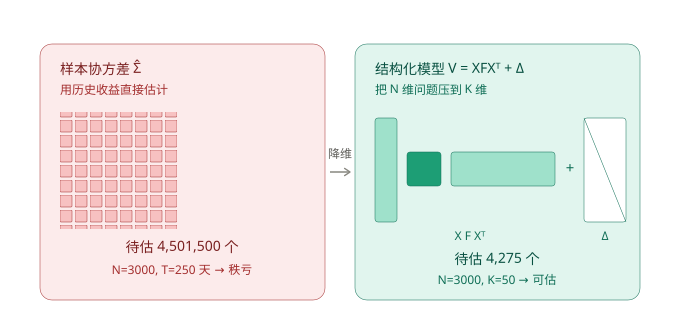
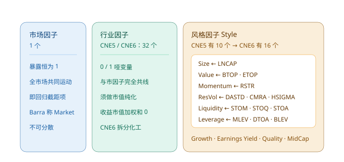
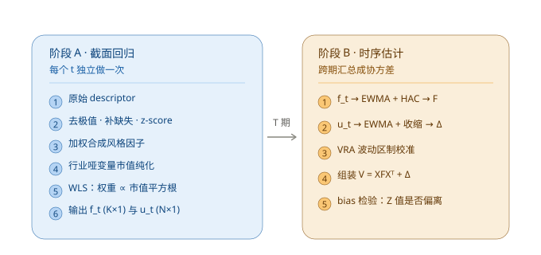
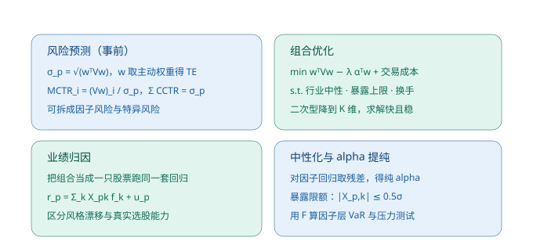

# Barra 结构化风险模型讲解

> **口径**：以 MSCI Barra **CNE5 / CNE6**（A 股模型）为主；方法论同样适用于 USE（美国）、GEM（全球）等版本。
> 版本事实核对自 MSCI 官方 CNE5 说明书与国内 CNE6 复现研报。
> **配图**：4 张结构图存于 `figs_barra` 目录（SVG 矢量，自带白底，浅色 / 深色主题均可读），随本文一并提交。

---

## 0. 五条本质（如果只读一段，读这里）

**① 它是降维工程，不是定价理论。**

存在的唯一理由是：3000 只股票的协方差有 **450 万个**待估参数，而你只有 250 天数据。
Barra 用"结构假设"把这个数压到 **4275 个**。**它不承诺因子有溢价**——把估计出来的因子收益 $`f_t`$ 拿去做因子择时 / 因子配置，是最常见也最致命的误用。

**② 模型好不好不看 $`R^{2}`$，看 bias statistic。**

CNE5 日频横截面 $`R^{2}`$ 均值只有 **0.28**，意味着 70% 的波动落在特异性里。**这是设计使然，不是模型失败。**
谁要是复现出一个 $`R^{2} = 0.6`$ 的"Barra"，先去查是不是混进了未来数据。
真正的验收标准是偏差统计量 $`B = \overline{(r_t / \sigma^{\text{预测}}_t)^{2}} \approx 1`$。

**③ 估计是两阶段，不是一次回归。**

- 阶段 A：每个时点做一次**横截面**回归 → 得到因子收益 $`f_t`$ 序列与残差 $`u_t`$
- 阶段 B：在 $`\{f_t\}`$、$`\{u_{i,t}\}`$ 这两**条时间序列**上估协方差 $`F`$ 与 $`\Delta`$

把这两步混成"一次大回归"，是国内复现失败的头号原因。

**④ 两个"不显然但必须做"的细节。**

- **行业哑变量必须市值纯化**：32 个哑变量之和 = 全 1 向量 = 市场因子暴露，不处理就完美共线、矩阵奇异。
- **必须有 VRA 波动区制校准**：缺了它，模型在平静期系统性低估、在危机期滞后反应——这正是 2008、2015 大批风控失效的机制。

**⑤ 它预测的是"相对结构"，绝对水平靠校准。**

排序可靠；跨期的绝对水平必须经 VRA 校准后才可比。半衰期 40–250 天，**别拿它预测一年期波动**。

### 三件它做不到的事

| 做不到 | 原因 |
|---|---|
| 告诉你哪个因子会涨 | 风险模型，不承诺溢价；$`f_t`$ 是回归副产品 |
| 预测一年期波动 | 半衰期 40–250 天，为日 / 月频设计 |
| 替代交易成本与容量模型 | $`V`$ 里没有冲击成本、没有 ADV 约束 |

---

## 1. 为什么需要它：维度灾难

> **本质**：用"结构假设"换"可估性"。代价是默认了"风险只通过少数几个因子传导"——这个先验成不成立，决定了模型的上下限。

设股票数 $`N = 3000`$，历史样本 $`T = 250`$ 天。

| 做法 | 待估参数 | 问题 |
|---|---|---|
| 样本协方差 $`\hat\Sigma`$ | $`N(N+1)/2 = 4{,}501{,}500`$ | 秩 $`\le \min(T,N) = 250 \ll 3000`$，矩阵奇异 |
| 结构化模型 $`V = XFX^{\top} + \Delta`$ | $`K(K+1)/2 + N \approx 4{,}275`$（$`K = 50`$） | 可估，少三个数量级 |



样本协方差不可逆且噪声巨大，直接喂给均值-方差优化器会出现经典的**"误差放大器"**：
优化器会系统性重仓那些**估计波动率恰好偏低**的股票（尤其停牌多、交易稀疏的微盘股），回测漂亮、实盘崩掉。

> 本工作区 `arkstream_exam` 的实证也印证了这一点：$`N = 647 / T = 179`$ 时样本协方差秩亏，
> LW 收缩强度 $`\delta = 0.949`$，PC1 解释 87.8% 的方差，逆波动权重对"前向填充造成的人造低波动"极度敏感。
> **Barra 与收缩类方法的动机同源，只是把"收缩"换成了"结构 + 因子"。**

---

## 2. 理论

> **本质**：把一个 $`N`$ 维随机向量投影到 $`K`$ 维因子空间，剩下的当成对角噪声。

### 2.1 收益分解

$$r_{i,t} = \sum_{k=1}^{K} X_{i,k,t-1}\, f_{k,t} + u_{i,t}$$

- $`X_{i,k,t-1}`$：**因子暴露**（exposure），$`t-1`$ 时刻已知的特征值
- $`f_{k,t}`$：**因子收益率**，每期一个实数，需要估计
- $`u_{i,t}`$：**特异性收益**（specific / residual return）

### 2.2 协方差分解

$$V = X\,F\,X^{\top} + \Delta$$

- $`F`$：$`K \times K`$ 因子收益率协方差阵
- $`\Delta`$：$`N \times N`$ 特异性方差阵（**对角**）

组合风险：

$$\sigma_p^{2} = w^{\top}Vw = \underbrace{(X^{\top}w)^{\top}F\,(X^{\top}w)}_{\text{因子风险}} + \underbrace{w^{\top}\Delta w}_{\text{特异性风险}}$$

关键收益：**二次型只需在 $`K`$ 维上算**。$`X^{\top}w`$ 是 $`K \times 1`$，优化器复杂度从 $`O(N^{3})`$ 降到接近 $`O(K^{3})`$。

### 2.3 三个硬假设

| 假设 | 含义 | 脆弱性 |
|---|---|---|
| A1 $`\text{Cov}(u_i, u_j) = 0,\ i \neq j`$ | $`\Delta`$ 才能是对角的 | **最脆弱**。同产业链、同主题、同大股东的股票残差实际相关 |
| A2 $`\text{Cov}(u_i, f_k) = 0`$ | 特异收益与因子不相关 | 由构造保证（$`u`$ 是回归残差） |
| A3 $`X`$ 在期初已知 | 无前视偏差 | 财务数据必须用**公告日**（PIT），不能按报告期 |

A1 的补救手段只有一个：**把行业因子做得足够细**（CNE5 / CNE6 用 32 个 GICS 行业），
并引入流动性、动量等因子吸收共同运动。残余的主题 / 供应链风险只能靠人工监控。

### 2.4 与 APT 的关键区别（最重要的认知）

| | APT（Ross 套利定价） | Barra 结构化风险模型 |
|---|---|---|
| 目标 | 解释**预期收益**（定价） | 预测**协方差**（风险） |
| 因子收益 | 有风险溢价 $`\lambda_k`$，来自均衡 | 纯统计副产品，可正可负，可长期不显著 |
| 检验标准 | 因子是否被定价（$`\lambda`$ 显著） | 事前波动预测是否校准（bias statistic ≈ 1） |

**Barra 不承诺因子有溢价。** 它是风险模型，不是 alpha 模型。

参考量级：CNE5 日频横截面 $`R^{2}`$ 平均约 **0.28**；CNE6 交叉验证非中心化 $`R^{2}`$ 约 **0.32**。
**70% 的波动是特异性的，这是设计使然，不是模型失败。**

---

## 3. 因子体系（CNE5 / CNE6）

> **本质**：三类因子分工明确——**市场**管不可分散的部分，**行业**管残差相关（补 A1 的漏洞），**风格**管跨行业的横截面风险源。

### 3.1 三类因子

| 类别 | 数量 | 暴露定义 | 作用 |
|---|---|---|---|
| 市场因子（Market / Country） | 1 | 恒为 1（即回归截距） | 全市场共同运动，不可分散 |
| 行业因子（Industry） | 32（GICS） | 0 / 1 哑变量 | 吸收行业内共同运动，缓解 A1 |
| 风格因子（Style） | CNE5: 10；CNE6: 16（CNTR 再加 4 个快速） | 由 descriptor 加权合成 | 捕捉跨行业的横截面风险源 |



### 3.2 CNE5 的 10 个风格因子与合成权重

**权重是 Barra 固定给定的**（不是回归估计出来的），国内复现基本照抄。

| 风格因子 | 构成（descriptor 与权重） |
|---|---|
| **Size** | $`\text{LNCAP}`$ = 总市值对数 |
| **Non-linear Size** | $`\text{LNCAP}`$ 标准化后取立方，再对 Size 做**回归加权正交化**，最后去极值 + 标准化 |
| **Beta** | 个股超额收益对估计域市值加权超额收益的**时序回归斜率** |
| **Momentum** | $`\text{RSTR}`$（相对强度） |
| **Residual Volatility** | $`0.74 \cdot \text{DASTD} + 0.16 \cdot \text{CMRA} + 0.10 \cdot \text{HSIGMA}`$ |
| **Book-to-Price** | 最新报告期普通股东权益账面值 / 当前市值 |
| **Earnings Yield** | $`0.68 \cdot \text{EPFWD} + 0.21 \cdot \text{CETOP} + 0.11 \cdot \text{ETOP}`$ |
| **Leverage** | $`0.38 \cdot \text{MLEV} + 0.35 \cdot \text{DTOA} + 0.27 \cdot \text{BLEV}`$ |
| **Liquidity** | $`0.35 \cdot \text{STOM(1M)} + 0.35 \cdot \text{STOQ(3M)} + 0.30 \cdot \text{STOA(12M)}`$ |
| **Growth** | $`0.18`$ 长期预测盈利增长 $`+ 0.11`$ 短期预测盈利增长 $`+ 0.24`$ 盈利增长(5Y) $`+ 0.47`$ 销售增长(5Y) |

### 3.3 CNE6 的演进

- 结构：**1 个国家因子 + 32 个行业因子 + 16 个风格因子**（长期模型 CNLT）
- 行业更细：化工拆分为商品化工 / 非商品化工；工业综合与贸易分销拆分
- CNLT 的 16 个风格因子归为 8 大类：Size / Volatility / Liquidity / Value / Quality / Momentum / Growth / Dividend Yield
- 具体为：Beta、Book-to-Price、Dividend Yield、Earnings Quality、Earnings Variability、Earnings Yield、Growth、Investment Quality、Leverage、Liquidity、Long-Term Reversal、Mid Capitalization、Momentum、Profitability、Residual Volatility、Size
- 交易模型 **CNTR** 再加 4 个快速因子：Analyst Sentiment、Industry Momentum、Seasonality、Short-Term Reversal，并对全部因子正交化
- CNE6 强调 **PIT 基本面数据**（防前视），基本面每日更新

---

## 4. 估计：两阶段

> **本质**：先把"收益"变成"因子收益的时间序列"，再用时间序列方法估协方差。



### 阶段 A — 逐期横截面回归（每个 $`t`$ 做一次）

对每一个时点 $`t`$，用当期的 $`N`$ 只股票收益对 $`K`$ 个因子做一次加权回归。

**Step 1｜descriptor 预处理（顺序不能乱）**

```
原始 descriptor
  → 去极值（MAD 法，±5 倍中位绝对偏差，不要用 ±3σ）
  → 缺失值填充（行业内按市值加权的中位数；标准化之后填 0 = 填截面均值）
  → z-score 标准化（用市值加权均值与市值加权标准差，与 WLS 口径一致）
  → 按固定权重合成风格因子
  → 再标准化一次
```

**Step 2｜行业哑变量纯化（去共线）**

32 个行业哑变量之和 = 全 1 向量 = 市场因子暴露 → 完美共线，$`X^{\top}WX`$ 奇异。变换为：

$$\tilde X_{i,j} = D_{i,j} - s_j, \quad s_j = \text{行业 } j \text{ 的（平方根）市值占比}$$

于是 $`\sum_j \tilde X_{i,j} = 0`$，与市场因子自动正交。
经济含义是**识别约束（numeraire）**：行业因子收益按市值加权求和恒为 0，
行业因子只表达"相对全市场的行业强弱"，市场整体涨跌全部归给市场因子。
**不设这个约束，行业 / 风格归因没有唯一解。**

**Step 3｜√市值加权最小二乘（WLS）**

小市值残差方差远大于大市值，$`\text{Var}(u_i) \propto 1/\text{cap}_i`$。
OLS 等权会让噪声最大的样本主导估计。Barra 取 $`w_i \propto \sqrt{\text{cap}_i}`$：

$$\hat f_t = (X^{\top}WX)^{-1} X^{\top} W r_t, \qquad W = \text{diag}(w_i)$$
$$\hat u_{t} = r_t - X\hat f_t$$

代价：**模型对小市值的刻画精度天然更差**，A 股微盘风险预测系统性偏低。

**输出**：本期 $`\hat f_t`$（$`K \times 1`$）、本期残差 $`\hat u_t`$（$`N \times 1`$）。

---

### 阶段 B — 时序上估协方差

**Step 1｜因子协方差 $`F`$**

1. **EWMA**：$`\lambda = 0.5^{1/h}`$，用 $`\lambda^{T-t}`$ 加权。
   经验：**波动率用短半衰期，相关性用长半衰期**（波动切得快，相关需要更长样本才估得稳）。
2. **Newey-West（HAC）**：动量、流动性等因子收益自相关明显，普通样本协方差会低估。

   $$F = \hat\Gamma_0 + \sum_{\ell=1}^{q}\Big(1-\tfrac{\ell}{q+1}\Big)\big(\hat\Gamma_{\ell} + \hat\Gamma_{\ell}^{\top}\big)$$

3. **特征根调整**：样本 $`F`$ 在小特征根方向噪声大，用模拟 / bootstrap 修正（思路同 shrinkage）。
4. **VRA 缩放**：见 Step 3。

**Step 2｜特异性方差 $`\Delta`$**

1. 对每只股票的 $`\hat u_{i,t}`$ 做 EWMA 波动（半衰期比 $`F`$ 更短）
2. **Vasicek 贝叶斯收缩**

   $$\hat\sigma_i^{2} = \frac{\nu\,\bar\sigma^{2}_{\text{组}} + n_i\,\hat\sigma^{2}_{i,\text{样本}}}{\nu + n_i}$$

   组 = 市值分位 × 行业；$`\nu`$ 是先验等效样本量。
   新股 / 短历史 → $`n_i`$ 小 → 估计几乎完全退化为组内均值。
3. 停牌、涨跌停期间的方差须单独处理，不能简单当 0
4. VRA 缩放

**Step 3｜VRA（Volatility Regime Adjustment）— Barra 的独门**

定义偏差统计量：

$$B = \frac{1}{T}\sum_t \left(\frac{r_t}{\sigma_{t|t-1}}\right)^{2}$$

即"实际收益 ÷ 模型事前预测波动"的平方均值，理想值 = 1。
$`B > 1`$ 说明模型近期系统性低估波动，将 $`F`$ 与 $`\Delta`$ 同乘 $`\sqrt{B}`$ 缩放回来。

**没有 VRA，风险模型在平静期持续低估、在危机期滞后反应**——这是 2008、2015 大量风控失效的机制。

**Step 4｜组装与校准检验**

$$V_{t} = X_{t}\,F_{t}\,X_{t}^{\top} + \Delta_{t}$$

校准监控（滚动 12 个月）：

- 构造随机组合 / 因子纯组合，算 $`b_t = r_{p,t} / \sigma_{p,t-1}`$
- $`B = \overline{b_t^{2}}`$ 应 ≈ 1；Barra 会分别监控因子部分 $`B_f`$ 与特异部分 $`B_s`$

---

## 5. 实践用法

> **本质**：$`V`$ 的全部用途就一句话——**如果我这样持仓，风险是多少、来自哪里**。



### 5.1 事前风险预测

$$\sigma_p = \sqrt{w^{\top}Vw}, \qquad \text{TE} = \sqrt{w_a^{\top}Vw_a},\ \ w_a = w_p - w_b$$

**风险贡献分解**（欧拉分解，$`\sum_i \text{CCTR}_i = \sigma_p`$）：

$$\text{MCTR}_i = \frac{(Vw)_i}{\sigma_p}, \qquad \text{CCTR}_i = w_i \cdot \text{MCTR}_i$$

因子层面分解：

$$\sigma_p^{2} = \sum_j \underbrace{X_{p,j}\,(F X^{\top}w)_j}_{\text{因子 } j \text{ 贡献}} + \sum_i w_i^{2}\Delta_{ii}$$

### 5.2 组合优化

$$\min_w \ \ w^{\top}Vw - \lambda\,\alpha^{\top}w + c^{\top}|w-w_0|$$
$$\text{s.t. } \ \sum_i w_i = 1,\ \ |X_{p,k}| \le \bar X_k,\ \ w_{\min} \le w_i \le w_{\max},\ \ \text{行业中性}$$

约束要设在**因子层**（$`X^{\top}w`$ 的上限），而不是逐个股票设。因子结构让约束只有 $`K`$ 条，
且经济含义明确——"我的组合 Size 暴露不超过 $`0.3\sigma`$" 比"单票不超过 2%" 更能对应真实风险。

### 5.3 业绩归因

把组合当作一只"股票"，用它的持仓加权暴露跑同一套回归：

$$r_p = f_{\text{market}} + \sum_j X_{p,j}\,f_j^{\text{ind}} + \sum_k X_{p,k}\,f_k^{\text{style}} + u_p$$

用途：**区分"风格漂移"与"真实选股能力"**。
一个跑赢沪深 300 的组合，若归因显示 80% 来自 Size + Momentum 暴露，那它不是选股厉害，是押对了风格。

对比：Brinson 归因只能拆到**行业配置 + 个股选择**两层，无法识别风格暴露。

### 5.4 alpha 中性化

对目标因子 / alpha 做横截面回归取残差：

$$\alpha_i^{\text{pure}} = \alpha_i - \sum_k X_{i,k}\,\hat\beta_k - \sum_j D_{i,j}\,\hat\gamma_j$$

去掉市值、行业、风格后剩余的，才是真正新增的信息。

### 5.5 因子层风险管理

- 用 $`F`$ 直接算**因子组合**的 VaR / CVaR
- 压力测试：把 $`F`$ 的相关阵整体抬升（如 $`\rho \to \min(1,\, 1.3\rho)`$），看 $`\sigma_p`$ 放大多少
- 暴露限额：$`|X_{p,k}| \le 0.5\sigma_k`$，触发即降杠杆或暂停新开仓

---

## 6. 常见坑清单

| # | 坑 | 正确做法 |
|---|---|---|
| 1 | 财务数据按**报告期**对齐 | 必须用**公告日**（PIT）。报告期数据含前视偏差 |
| 2 | 标准化**之前**把缺失值填 0 | 标准化后填 0 = 填截面均值（可接受）；标准化前填 0 会被当成极端值 |
| 3 | 用 ±3σ 去极值 | 厚尾会把 σ 撑大。改用 **MAD**，±5 倍中位绝对偏差 |
| 4 | z-score 用等权均值 / 标准差 | 必须与 WLS 一致，用**市值加权**的均值与标准差 |
| 5 | 行业分类静态不变 | 公司会换主业 / 重组，行业归属须时变 |
| 6 | 忽略 $`\Delta`$ 的对角假设 | 残差相关被系统性忽略。行业因子不够细会漏掉主题 / 供应链风险 |
| 7 | 拿 Barra 预测**一年期**波动 | 半衰期 40–250 天，模型为**短周期（日 / 月）**设计 |
| 8 | 认为 Barra 因子收益可以择时 | 它是风险模型，不是 alpha 模型；$`f_t`$ 无溢价保证 |
| 9 | 跨期直接比较预测的绝对水平 | 排序可靠，绝对水平靠 VRA 校准；跨期不可比 |
| 10 | A 股涨跌停导致收益截断 | 波动被系统性低估，特异性风险偏低，须标记并放大 |
| 11 | CNE6 多个 Quality 类因子重叠 | Earnings Quality / Investment Quality / Profitability 高度共线，归因要**合并到 8 大类**看 |
| 12 | 微盘股直接套用 Barra 特异风险 | WLS 权重低，模型对微盘刻画差，需自建修正 |

---

## 7. 最小可运行骨架（Python）

```python
import numpy as np
import pandas as pd

# ---------- 阶段 A：单期横截面回归 ----------
def cross_section_regression(r, X, cap, industry_dummy):
    """
    r              : Series, 个股当期收益（N）
    X              : DataFrame, 风格因子暴露（N x Ks），已预处理
    cap            : Series, 总市值（N）
    industry_dummy : DataFrame, 行业 0/1 哑变量（N x J）
    返回 f（K x 1）、u（N）
    """
    w = np.sqrt(cap / cap.sum())          # 权重 ∝ √市值
    W = np.diag(w.values)

    # 1) 行业纯化：D_j -> D_j - s_j，使 Σ_j X̃_j = 0
    s = (w.values[:, None] * industry_dummy.values).sum(axis=0) / w.sum()
    X_ind = industry_dummy.values - s[None, :]

    # 2) 拼装：[市场因子(全1) | 纯化行业 | 风格]
    X_all = np.column_stack([np.ones(len(r)), X_ind, X.values])

    # 3) √市值加权最小二乘
    XtWX = X_all.T @ W @ X_all
    XtWr = X_all.T @ W @ r.values
    f = np.linalg.solve(XtWX + 1e-10 * np.eye(XtWX.shape[0]), XtWr)
    u = r.values - X_all @ f
    return f, u

# 逐期循环
# f_mat[t, k] = f[k] ; u_mat[t, i] = u[i]

# ---------- 阶段 B：EWMA + HAC + 收缩 ----------
def ewma_weights(T, halflife):
    lam = 0.5 ** (1.0 / halflife)
    wt = lam ** np.arange(T - 1, -1, -1)     # 近端权重大
    return wt / wt.sum()

def factor_cov_ewma_hac(f_mat, halflife=90, max_lag=10):
    T = f_mat.shape[0]
    w = ewma_weights(T, halflife)
    fc = f_mat - (w[:, None] * f_mat).sum(axis=0)          # 加权去均值
    G0 = (fc * w[:, None]).T @ fc

    F = G0.copy()
    for l in range(1, max_lag + 1):
        Gl = (fc[l:] * w[l:, None]).T @ fc[:-l]
        F += (1 - l / (max_lag + 1)) * (Gl + Gl.T)          # Bartlett 核
    return F

def specific_var(u_mat, cap, industry, halflife=60, nu=40.0):
    """EWMA + Vasicek 向 '市值分位 × 行业' 组内均值收缩"""
    T, N = u_mat.shape
    w = ewma_weights(T, halflife)
    raw = (w[:, None] * u_mat ** 2).sum(axis=0)             # 加权方差

    n_eff = 1.0 / (w ** 2).sum()                            # 有效样本量
    grp = pd.qcut(cap, 10, labels=False, duplicates='drop').astype(str) + '_' + industry
    prior = pd.Series(raw).groupby(grp.values).transform('mean')

    return (nu * prior + n_eff * raw) / (nu + n_eff)

def vra_scale(r_actual, sigma_forecast):
    """偏差统计量 B 与缩放因子"""
    B = np.mean((r_actual / sigma_forecast) ** 2)
    return B, np.sqrt(B)

# ---------- 组装与风险分解 ----------
def build_V(X, F, delta):
    return X @ F @ X.T + np.diag(delta)

def risk_decomp(w, X, F, delta):
    V = build_V(X, F, delta)
    sig = np.sqrt(w @ V @ w)
    mctr = (V @ w) / sig
    cctr = w * mctr
    fac_var = (X.T @ w) @ F @ (X.T @ w)
    return sig, mctr, cctr, fac_var, w @ np.diag(delta) @ w
```

---

## 8. 检查清单（自己搭模型时照着核）

- [ ] 数据 PIT 对齐：财务用公告日，不是报告期
- [ ] 去极值用 MAD（±5），不是 ±3σ
- [ ] 标准化用市值加权均值 / 标准差
- [ ] 行业哑变量做了市值纯化（$`\sum_j \tilde X_j = 0`$）
- [ ] 回归权重 $`\propto \sqrt{\text{cap}}`$
- [ ] $`F`$ 做了 Newey-West（因子收益自相关）
- [ ] 波动与相关用了不同半衰期
- [ ] $`\Delta`$ 做了 Vasicek 收缩（新股必须靠先验）
- [ ] 有 VRA 或等价的偏差校准
- [ ] 滚动监控 bias statistic $`B`$，并分开看 $`B_f`$ 与 $`B_s`$
- [ ] A 股涨跌停 / 停牌做了方差修正
- [ ] 微盘股的风险预测有额外修正

---

## 9. 一句话速记

> **Barra 的全部内容可以压缩成一句**：
> 承认"我估不了 450 万个协方差参数"，于是假设风险只通过 $`K`$ 个因子传导，
> 剩下的是对角噪声；然后每天跑一次 √市值加权的截面回归把收益翻译成因子收益序列，
> 再用 EWMA + HAC + VRA + 收缩 在这条序列上估出 $`F`$ 与 $`\Delta`$，
> 最后用 $`B \approx 1`$ 检验自己有没有骗自己。

---

> **合规声明**：投资有风险，本内容仅供研究与教育，不构成投资建议。文中参数为方法说明与公开资料口径，
> 非任何实盘业绩；模型预测不等于未来表现。
